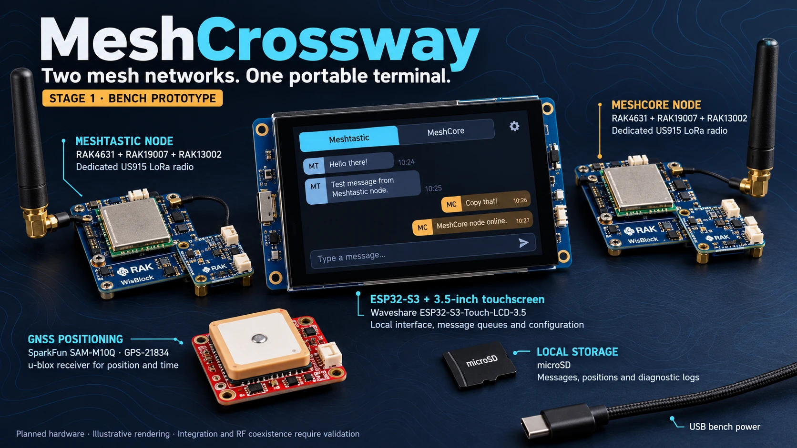
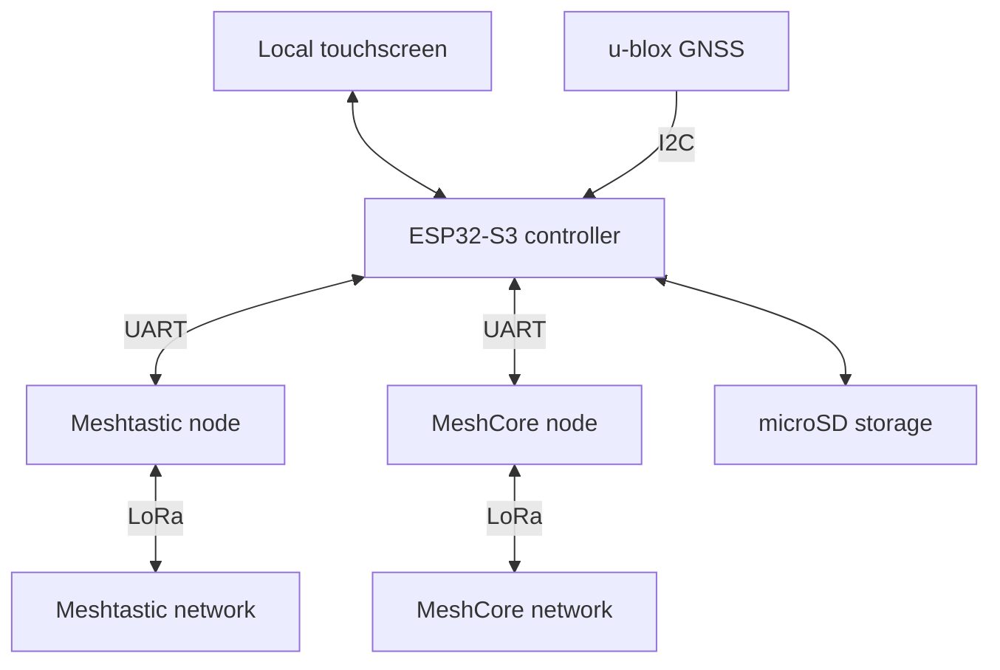

# MeshCrossway

**Two mesh networks. One portable terminal.**

MeshCrossway is an open-source project to build an ESP32-based portable communicator with a touchscreen, dedicated LoRa radios for Meshtastic and MeshCore, GNSS positioning, and local message storage.

The goal is to give travelers, outdoor users, and eventually search-and-rescue teams a single interface for communicating across multiple networks where internet access or cellular coverage may be unavailable.

> **Project status: architecture and bench-prototype planning.** This repository currently contains project documentation and a license. Application firmware, wiring instructions, build commands, and test results are not yet available. Features described below are planned unless explicitly marked otherwise.

## Why MeshCrossway?

Different groups may use different mesh ecosystems. Switching between separate devices and applications adds friction when users need to follow conversations and positions across those networks.

MeshCrossway aims to bring those experiences into one standalone device while preserving each network's native identity, configuration, and security model.

The first prototype will focus on:

- Operating Meshtastic and MeshCore through two dedicated radio nodes.
- Sending and receiving messages from a local touchscreen.
- Showing which network, contact, and channel each message belongs to.
- Recording messages and positions locally.
- Sharing a GNSS source through protocol-specific adapters.
- Remaining usable without a phone, cloud account, or internet connection.

**A unified interface does not make the networks interoperable.** The initial design does not automatically forward messages between Meshtastic and MeshCore. Both radios are intended to remain active, but simultaneous availability and RF coexistence still require testing.

## Documentation

- [Meshtastic and MeshCore: concepts, differences, and official links](docs/meshtastic-vs-meshcore.md)

## Architecture

The ESP32 runs the user interface and coordinates two independent nodes. Each radio node runs its own mesh firmware.

| Component | Planned responsibility |
|---|---|
| ESP32-S3 controller | Touch interface, protocol adapters, queues, configuration, and local history |
| Meshtastic node | Native Meshtastic communication and network behavior |
| MeshCore node | Native MeshCore communication and network behavior |
| GNSS receiver | Local position, fix validity, and positioning data |
| microSD | Persistent messages, logs, and position history |
| Optional phone or computer | Future configuration, export, or auxiliary interface |

The phone is optional. Core messaging is intended to run directly on the terminal.

Independent nodes also allow each mesh firmware to evolve without moving its complete radio stack into the central application. This does not eliminate shared failure points such as the controller, storage, or power supply.

## Selected prototype hardware

These are the current design selections, **not a validated bill of materials or a confirmed shopping list**.

| Quantity | Component | Purpose and status |
|---:|---|---|
| 1 | **Waveshare ESP32-S3-Touch-LCD-3.5**, standard version without case or camera | Selected central controller and touch display; revision V2 preferred, subject to confirmation |
| 2 | **RAK4631 + RAK19007**, US915 variants for the initial US bench | One dedicated node per protocol; serial integration remains to be validated |
| 2 | **RAK13002** IO expansion boards | Proposed access to radio-node signals; connector assembly and pin access require confirmation |
| 1 | **SparkFun SAM-M10Q Qwiic breakout, GPS-21834** | Selected u-blox GNSS candidate with integrated antenna |
| 1 | microSD card | Local history and diagnostic logs; capacity and format to be defined |
| As needed | Suitable LoRa antennas, cables, jumpers, and USB power supplies | Final selection depends on the board revisions and test setup |
| 2 optional | Additional compatible radio nodes | One remote peer for each protocol during bench testing |

The selected controller combines an ESP32-S3, a 3.5-inch touch display, PSRAM, flash, and a microSD slot. The exact board revision, exposed GPIOs, and peripheral conflicts must be checked before publishing a wiring guide.

For the first bench prototype, separate USB supplies are planned for the controller and radio nodes. External signals must use compatible logic levels and a common ground. Do not assume the controller's regulator can power the complete assembly.

### Interface plan

| Connection | Planned interface | Validation needed |
|---|---|---|
| Controller to Meshtastic node | Dedicated UART using the serial client API in `PROTO` mode | Pin assignment, configuration, framing, and recovery |
| Controller to MeshCore node | Separate UART using the Companion protocol | RAK4631 firmware target and physical UART binding |
| Controller to GNSS | I²C | Available pins, address, and driver integration |
| Controller to storage | Onboard microSD interface | Concurrent operation with the display and other peripherals |
| Controller to display and touch | Onboard connections | Driver integration and responsiveness |

**MeshCore UART integration is an open engineering task.** A Companion USB firmware image must not be assumed to expose the same protocol on external UART pins. A custom build or target configuration may be required.

No GPIO assignment is final yet. A tested pin map will follow validation with the display, touch controller, microSD, GNSS, and both radio links active.

## Planned software

The central firmware is intended to use C/C++ with an ESP32-compatible toolchain and **LVGL** for the touchscreen interface. The build framework and dependency versions have not yet been frozen.

The application will separate:

- A Meshtastic adapter that owns its radio connection.
- A MeshCore adapter that owns its radio connection.
- A GNSS service that tracks fix validity and position age.
- Message queues and persistent storage.
- The interface and device configuration.

A failure or reconnection in one adapter should leave the other network and stored history accessible. On an ESP32, these boundaries will be implemented within the firmware rather than as Linux services.

### Interface scope

The first interface will prioritize conversations, a virtual keyboard, predefined messages, radio status, GNSS coordinates, position age, and history.

Detailed offline maps are a later milestone. They introduce additional storage, rendering, data-format, and licensing work.

### Message behavior

Message state must reflect available evidence:

- Stored locally.
- Queued for a radio.
- Accepted by the node.
- Transmission reported, when the protocol provides reliable evidence.
- Acknowledged, with the meaning of that acknowledgment identified.
- Failed, expired, or outcome unknown.

Acceptance into a queue is not proof of transmission. A protocol acknowledgment is not proof that a person read the message.

After a connection failure, a message that may already have been accepted must not be blindly resent. Retry behavior and duplicate handling will be defined per protocol.

Contacts will be keyed by protocol and native identity rather than display name. The same person may have separate identities on the two networks.

### Position and storage behavior

Positions should include their source, available quality information, and temporal validity. An old or invalid fix must not appear as a current location.

The controller will maintain bounded local queues and history, with explicit policies for retention, storage exhaustion, and recovery. GNSS publication will use each protocol's actual capabilities and its own privacy and rate settings.

## Development roadmap

- [x] Define a standalone ESP32 touchscreen architecture.
- [x] Select the initial controller and display.
- [x] Identify candidate radio nodes and GNSS hardware.
- [ ] Validate the controller board revision and complete GPIO allocation.
- [ ] Prove the Meshtastic UART connection.
- [ ] Build and validate the MeshCore Companion UART configuration.
- [ ] Send and receive messages through both adapters.
- [ ] Keep one adapter working while the other node is disconnected.
- [ ] Add the touch interface, message composition, and accurate status reporting.
- [ ] Add GNSS, persistent history, and restart recovery.
- [ ] Measure RF coexistence and power consumption.
- [ ] Run sustained offline and fault-recovery tests.
- [ ] Evaluate a portable enclosure and battery system.
- [ ] Consider a custom PCB after the bench design is reproducible.

### First milestone

**Send and receive messages on both networks from the touchscreen, with independent adapter recovery.**

Before miniaturization, testing must establish how much one nearby transmitter degrades the other receiver. Two dedicated radios do not guarantee uninterrupted reception when placed together.

Tests will cover both interference directions, GNSS behavior during transmission, antenna spacing, power settings, USB or serial interruptions, full storage, and controlled restarts. The host can schedule its own requests, but native firmware may also transmit acknowledgments, announcements, or relayed traffic.

## Operating boundaries

MeshCrossway is being designed for offline use, but messaging still requires compatible peers, matching radio settings, and a usable RF path. It does not create cellular or satellite coverage.

Regional frequency, power, antenna, and channel-access requirements must be checked before transmitting. A US915 bench configuration is not a universal international profile. Region selection must account for autonomous transmissions from the radio firmware as well as host-requested messages.

Search-and-rescue is a target use case for future development. **The prototype is not a qualified emergency communication device and must not be relied on as the sole means of requesting assistance.** Field readiness will require operational testing, power continuity, environmental validation, and procedures developed with users.

## Security and privacy goals

- Preserve each protocol's native security mechanisms.
- Keep network identity and message provenance visible.
- Make location publication and remote administration explicit choices.
- Keep cloud uploads and public telemetry disabled by default.
- Protect stored history and exclude credentials from exported diagnostics.
- Define update and recovery procedures before field deployment.

The central terminal will receive application data from both nodes and becomes part of the security boundary. Separate networks do not automatically provide end-to-end encryption across protocols.

Automatic cross-network bridging is outside the first prototype's scope. Any future bridge will need explicit forwarding rules, loop prevention, identity mapping, and a clear explanation of its privacy consequences.

## Possible future extensions

After the core prototype is validated, potential extensions include offline maps, phone access over Wi-Fi or BLE, additional adapters such as Reticulum/LXMF, cellular or satellite backhaul, and CoT/ATAK integration.

These are exploration areas, not implemented features. Some will require additional radios, service plans, backend infrastructure, or protocol-specific hardware.

## Getting involved

There is no flashable MeshCrossway firmware or reproducible build procedure yet.

Useful early contributions include:

- Reviewing schematics and GPIO allocation.
- Validating Companion UART support on the selected MeshCore target.
- Developing embedded protocol adapters and LVGL screens.
- Designing RF coexistence, storage-recovery, and power tests.
- Documenting reproducible hardware and firmware configurations.

Use [GitHub Issues](https://github.com/Renbrant/MeshCrossway/issues) to discuss a proposed change or report findings. Include board revisions, firmware versions, configuration, and relevant logs, with keys and private location data removed.

## References

- [Waveshare ESP32-S3-Touch-LCD-3.5](https://www.waveshare.com/esp32-s3-touch-lcd-3.5.htm)
- [RAKwireless documentation](https://docs.rakwireless.com/)
- [SparkFun SAM-M10Q hardware documentation](https://docs.sparkfun.com/SparkFun_u-blox_SAM-M10Q/)
- [Meshtastic firmware](https://github.com/meshtastic/firmware)
- [Meshtastic serial module documentation](https://meshtastic.org/docs/configuration/module/serial/)
- [MeshCore firmware](https://github.com/meshcore-dev/MeshCore)
- [LVGL](https://github.com/lvgl/lvgl)
- [ESP-IDF](https://github.com/espressif/esp-idf)

## License

Original MeshCrossway code and documentation in this repository are licensed under the [MIT License](LICENSE).

Third-party firmware, libraries, hardware designs, and assets retain their respective licenses. This repository's MIT license does not relicense those components; integration and distribution must respect their applicable terms.

MeshCrossway is an independent project and is not affiliated with or endorsed by the manufacturers or upstream projects referenced here.
