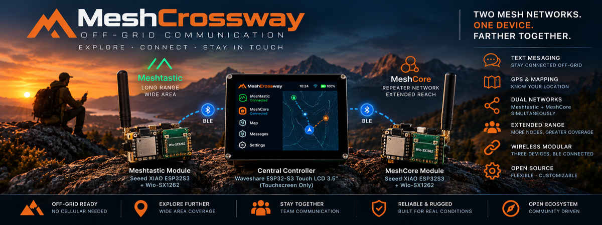
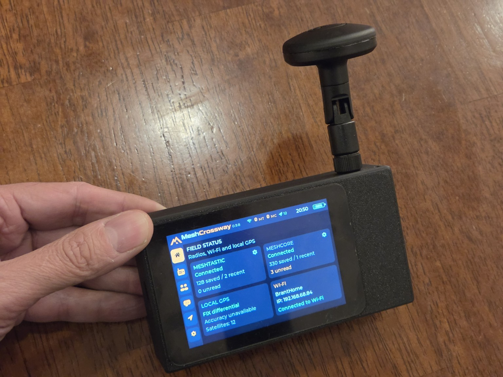
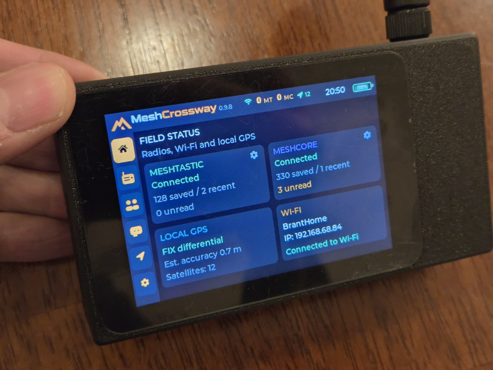
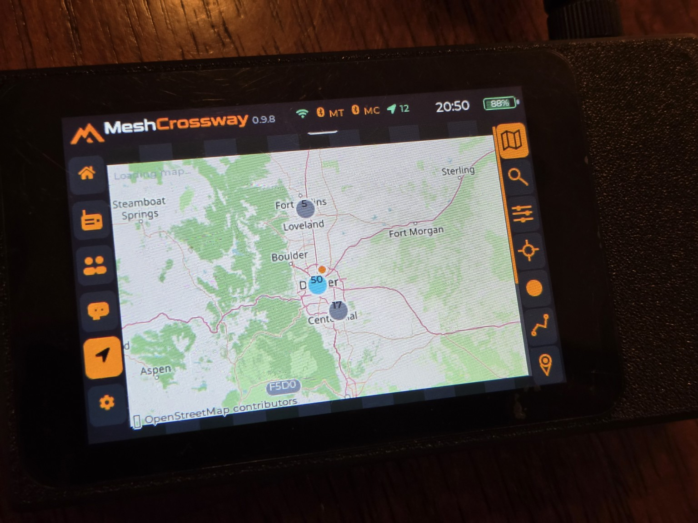
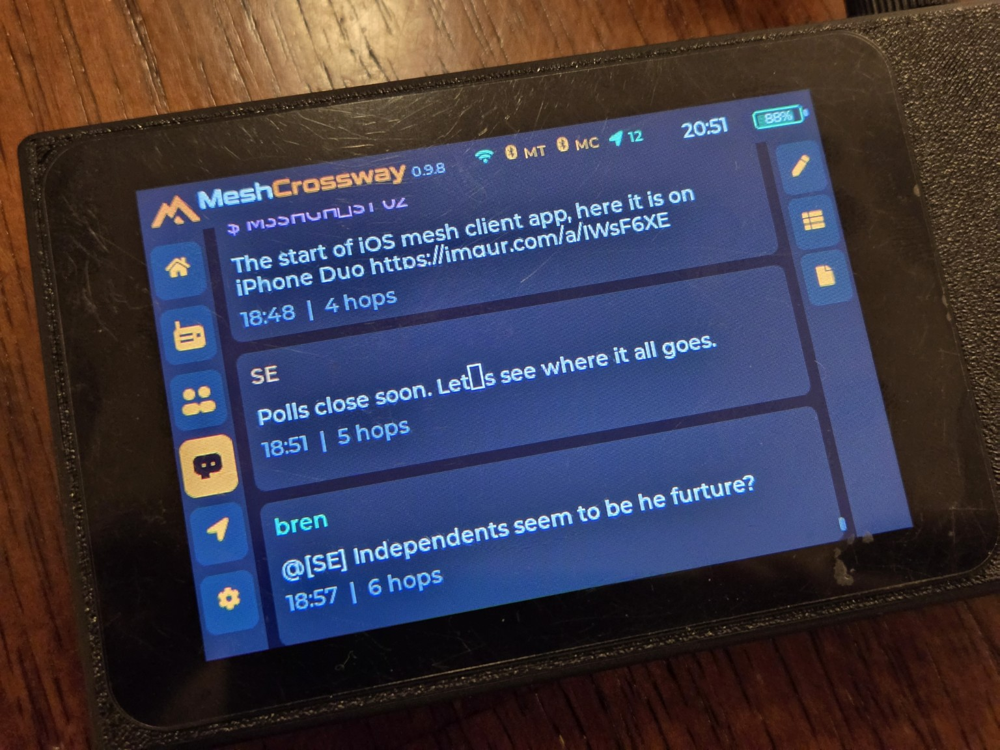
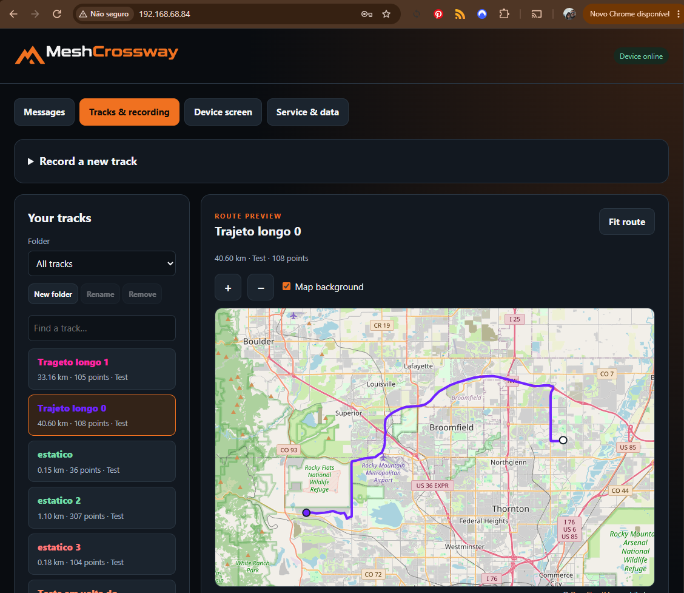
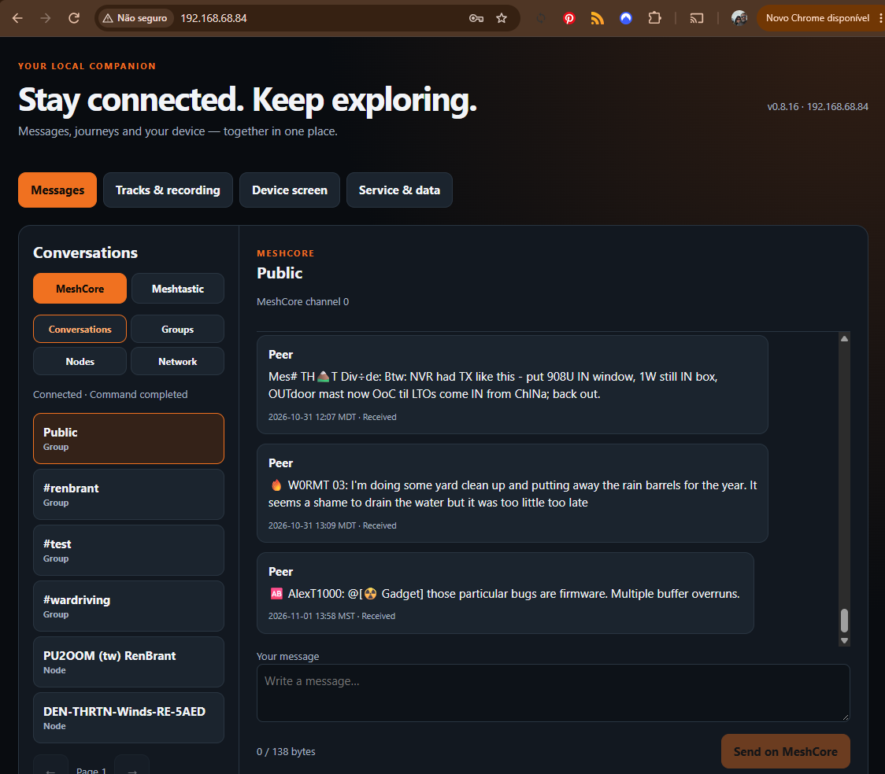

# MeshCrossway

  
  

  
  
  

**A portable, offline-first touchscreen communicator for Meshtastic and MeshCore.** MeshCrossway brings two independent LoRa networks, messaging, GNSS and track tools into one interface. It does not bridge or mix traffic between the networks.

> **Current stable:** v0.9.32, selected after the user confirmed it is functioning very well and remains extremely stable. It includes raster-map pinch zoom and saved 1.25× map magnification. [Install with Web Flasher](https://renbrant.github.io/MeshCrossway/flasher/) or explore the [firmware release history](https://renbrant.github.io/MeshCrossway/project-status/). v0.9.28 is the previous stable recovery; v0.9.25 and v0.9.16 remain earlier recovery options.

## See it in operation

### v0.9.8 candidate running on the device

These field photos show the MeshCrossway touchscreen hardware running the v0.9.8 candidate, including its home status dashboard, map and message views.

  
  

  
  

### Local browser companion

The controller also serves a companion interface over local Wi-Fi, so you can use messaging and track tools from a browser.

  
  

## Hardware concept

The project includes an enclosure design and printable parts. The images below show the proposed physical form.

  
  

[3D models and hardware files](hardware/3D/) · [Hardware design details](docs/TECHNICAL_DOCUMENTATION.md)

## What you can do with MeshCrossway

- **Use two networks together:** send and receive messages on Meshtastic and MeshCore independently, using two compatible Bluetooth-enabled radios.
- **Explore your surroundings:** view your GNSS position, map, nearby nodes, saved places and recorded tracks.
- **Work from a browser:** access the device's local companion interface over Wi-Fi to manage conversations and export tracks.
- **Choose your radios:** Heltec V3 is used for development testing, but compatible radio modules can be selected independently.

The project is offline-first: LoRa messaging does not require cellular service or internet. Some map tiles must be downloaded over Wi-Fi before they are available offline.

[Explore detailed capabilities and technical notes](docs/TECHNICAL_DOCUMENTATION.md)

## How it works

MeshCrossway uses a touchscreen controller and **two separate LoRa radios**, one for Meshtastic and one for MeshCore. Each radio connects to the controller over Bluetooth, and each network operates independently. The controller brings messaging, maps, GNSS and track recording into one interface.

The current controller is based on a Waveshare ESP32-S3 touchscreen. Users are free to choose compatible BLE-capable Meshtastic and MeshCore radio devices; Heltec V3 radios are used during development.

This modular approach also lets the radios be positioned away from one another, instead of forcing both antennas onto one small circuit board.

[Hardware architecture, compatibility and engineering research](docs/TECHNICAL_DOCUMENTATION.md)

## Install and documentation

- **[Web Flasher](https://renbrant.github.io/MeshCrossway/flasher/)** — install available firmware versions.
- **[Technical Documentation](docs/TECHNICAL_DOCUMENTATION.md)** — firmware history, engineering details, research and planned improvements.
- **[Project Status](https://renbrant.github.io/MeshCrossway/project-status/)** — release notes and version history.
- **[Open Issues](https://github.com/Renbrant/MeshCrossway/issues)** — planned features, investigations and bug reports.

## Contributing and support

MeshCrossway is open to contributions in firmware, hardware, documentation and testing. [Open an issue](https://github.com/Renbrant/MeshCrossway/issues), review the [contribution guide](CONTRIBUTING.md), or [support the project through GitHub Sponsors](https://github.com/sponsors/Renbrant).

MeshCrossway is experimental and is not certified for safety-critical use. Do not rely on it as the only communication system in an emergency. Original project code and documentation are provided under the [MIT License](LICENSE); third-party components retain their own licenses. See [licensing details](docs/licensing.md) and [third-party notices](THIRD_PARTY_NOTICES.md).

## Android controller development

An Android APK is now in development, bringing the MeshCrossway controller to phones with the same independent Meshtastic and MeshCore radio architecture. The Android messaging alpha adds channel/direct text, nodes, private history, drafts, unread counters and independent reconnection. Initial dual-radio protocol verification was confirmed on a Galaxy S25; the expanded messaging features are awaiting physical validation. Maps remain planned. See the [Android build and installation guide](docs/android-apk.md) and [tracking issue #187](https://github.com/Renbrant/MeshCrossway/issues/187).
