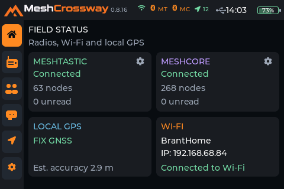
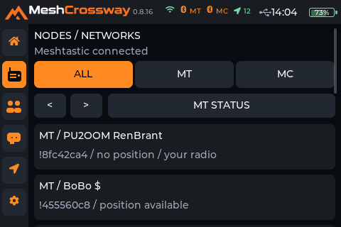
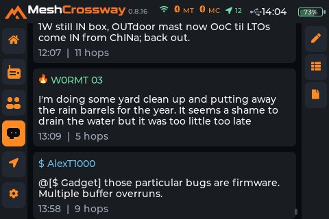
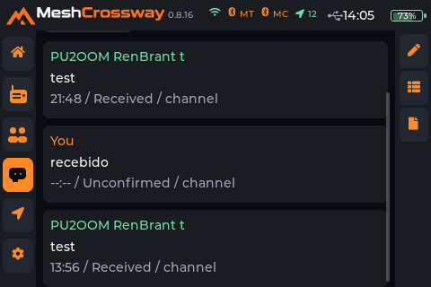

# MeshCrossway

  
  

  
  
  

**A portable, offline-first touchscreen communicator for Meshtastic and MeshCore.** MeshCrossway brings two independent LoRa networks, messaging, GNSS and track tools into one interface. It does not bridge or mix traffic between the networks.

> **Project status — v0.9.28 stable.** Selected as stable by explicit device acceptance on 2026-11-05. The exact published image is checksum-pinned and selected by default in the Web Flasher. v0.9.25 remains the previous stable recovery; v0.9.16 is retained as legacy recovery. See the [stable acceptance record](docs/stable-v0928.md) and [release history](https://renbrant.github.io/MeshCrossway/project-status/).

## Support the project

Developing MeshCrossway takes time and ongoing investment in hardware parts and AI model tokens. If you'd like to help cover these costs, you're welcome to make a one-time donation or become a project sponsor through [GitHub Sponsors](https://github.com/sponsors/Renbrant).

## See it in operation

### v0.9.8 candidate running on the device

These field photos show the MeshCrossway touchscreen hardware running the v0.9.8 candidate, including its home status dashboard, map and message views.

  
  

  
  

### Earlier v0.8.16 device and local browser companion screenshots

These v0.8.16 screenshots document the touchscreen and the device's local browser companion. The browser interface is served by the device over the local network; it is not a cloud service or a web simulator.

  
  

  
  

  
  

## Hardware 3D renders

The renders below show the committed case design. The Waveshare ESP32-S3 enclosure also has printable STL/3MF exports, and the 10,000 mAh battery case has an editable FreeCAD source model.

  
  

  
  

  
  

- [Open the Waveshare enclosure STL in GitHub's 3D viewer](<hardware/3D/Waveshare esp32-s3 case.stl>)
- [Download the Waveshare enclosure 3MF](<hardware/3D/Waveshare esp32-s3 case.3mf>)
- [View the 10,000 mAh battery case FreeCAD source](<hardware/3D/Case bat 10000mA.FCStd>)

## What works today

| Capability | Available in v0.9.28 stable |
|---|---|
| **Two independent radios** | Simultaneous Meshtastic and MeshCore BLE sessions, native messages, channels, separate identities, pairing and reconnection. No bridging between networks. |
| **Touchscreen and local browser** | Home dashboard, network filters, conversations and radio settings. The browser companion runs on the device's local Wi-Fi network and includes messages, settings and track tools. |
| **GNSS and maps** | Local GNSS position, satellites/accuracy, clock/timezone, street/topographic maps and local OpenStreetMap night rendering. Cached SD tiles remain usable offline; uncached tiles require Wi-Fi. |
| **Tracks and POIs** | Record/pause/resume tracks, save POIs, organize folders, preview routes and download GPX through the browser companion. |
| **Readable node lists** | Bounded recent-node lists, fixed row spacing, sorting by last heard or distance, and explicit manual refresh. |
| **Map customization** | Independent format, size and color for each network; circles, squares, crosses or ID badges; optional grouping; zoom controls close automatically after use. |
| **Colors by last reception** | Optional per network: green under 24 hours, yellow from 1 to under 7 days, gray at 7 days or more/unknown. This indicates reception age, not guaranteed reachability. |
| **Configurable local retention** | Keep nodes for 0–365 days (default 30; 0 disables expiry). Protect favorites, local radios, retained conversations/drafts and unknown timestamps. Filter stale imports and save through the SD worker. |
| **Display and connectivity controls** | Automatic 180-degree landscape orientation, saved rotation lock, manual flip/recalibration, brightness and screen timeout; Bluetooth and Wi-Fi power controls. |
| **Diagnostics and storage recovery** | Console memory logs, internal RAM/PSRAM/DMA snapshots, allocation and touch diagnostics, bounded SD work and recovery archives. Cleanup reduces stale records; fixed table capacity remains allocated. |
| **Live position sharing** | Not implemented; remains future work. |

Start with the [current firmware guide](firmware/display-prototype/README.md). Recent operating details: [node age and retention](docs/node-age-v0928.md), [orientation correction](docs/rotation-reference-v0927.md) and [map controls](docs/stable-v0925.md). Existing photos and screenshots retain their original version labels; they are historical evidence, not new v0.9.28 captures. Tested configurations do not establish compatibility with every radio board or firmware version.

## Remote interface and track backup

The companion page is hosted by MeshCrossway and accessed from a browser on the same local network. It lets the user work with messages and network-specific radio views, organize tracks into folders, review a route preview and download GPX files as portable backups. The track journal remains stored on the device's microSD.

The remote page complements the touchscreen; radio messages still use their native MeshCore or Meshtastic connection. No automatic forwarding, conversion, synchronization or cross-network sending occurs.

## Hardware architecture

The implemented software architecture uses three independent devices: a touchscreen Core and two LoRa Radio Pods. Two radio links are operating; the final detachable Pod packaging, power design, RF and environmental qualification remain in progress.

| Unit | Selected hardware | Role |
|---|---|---|
| **MeshCrossway Core** | Waveshare ESP32-S3-Touch-LCD-3.5 Rev2.0, 480 × 320 touchscreen | LVGL interface, local storage, GNSS integration and two BLE Central connections |
| **MX-M Radio Pod** | BLE-capable Meshtastic radio; Heltec V3 tested, XIAO/Wio-SX1262 proposed for the detachable Pod | Native Meshtastic radio using its BLE PhoneAPI |
| **MX-C Radio Pod** | BLE-capable MeshCore radio; Heltec V3 tested, XIAO/Wio-SX1262 proposed for the detachable Pod | Native MeshCore radio using its BLE Companion interface |

Each unit has its own battery and power system. The Core communicates with each Pod wirelessly over BLE; the LoRa radios do not connect to the Core over UART, SPI or GPIO. Each Pod must continue native LoRa operation if the Core is off or out of range.

The two BLE links use separate protocol adapters: Meshtastic protobuf PhoneAPI over BLE GATT and MeshCore Companion binary protocol over BLE GATT. Pairing, identities, settings and messages stay separate. The Core does not relay or bridge between networks.

**Hardware still being validated:** exact battery and charger choices, battery protection and monitoring, GNSS antenna and power integration, antenna separation, RF coexistence, endurance and final enclosure fit. The optional mechanical dock is not required for BLE operation. The previous integrated Rev A UART/PCB design is archived and is not the current assembly baseline.

- [Approved modular architecture and validation plan](docs/modular-architecture.md)
- [Hardware source list](docs/hardware-sources.md)
- [Archived Rev A wiring](docs/hardware-wiring.md)
- [Archived Rev A PCB layout](docs/pcb-layout-rev-a.md)

## Known issue and next steps

The selected stable software is v0.9.28. The earlier map-download and overlapping-node-list problems have implemented fixes; they are not listed as unimplemented features. Broader field coverage and hardware qualification continue.

1. Continue measured runtime and memory testing across radio reconnects, map pans, hotspot changes, SD recovery and node expiry; track evidence in [issue #137](https://github.com/Renbrant/MeshCrossway/issues/137).
2. Evaluate smaller working sets/compact storage separately: deleting entries does not free the currently reserved fixed-capacity arrays.
3. Expand radio/firmware compatibility, battery/autonomy, GNSS and microSD validation.
4. Complete enclosure fit, antenna separation and RF coexistence tests for the final independently powered Pods.
5. Keep live position sharing and optional external integrations as future work; they are not delivered functionality.

## Technical documentation

| Topic | Reference |
|---|---|
| v0.9.28 recommended stable | [Acceptance, binary pin and recovery](docs/stable-v0928.md) |
| Current user features and test procedure | [Firmware guide](firmware/display-prototype/README.md) · [Age colors and retention](docs/node-age-v0928.md) |
| Rotation, lock and manual correction | [Orientation notes](docs/rotation-reference-v0927.md) |
| v0.9.25 previous stable recovery | [Previous stable record](docs/stable-v0925.md) |
| v0.8.26 historical stable image | [Stable release record](docs/stable-v0826.md) |
| v0.8.17 historical stable image | [Historical release record](docs/stable-v0817.md) |
| v0.8.18 node map and activity ordering | [Feature notes](docs/node-map-and-recent-activity-v0818.md) |
| v0.8.20 Home GPS card spacing | [Feature notes](docs/home-gps-layout-v0820.md) |
| v0.8.20 Configurable map node markers and compact toggles | [Map and display notes](docs/map-node-marker-settings-v0820.md) |
| v0.8.21 Adjustable map node marker size and quick access | [Feature notes](docs/map-node-size-v0821.md) |
| v0.8.22 Configurable map node colors | [Feature notes](docs/map-node-color-v0822.md) |
| v0.8.23 Separate node icon and color settings by network | [Feature notes](docs/map-node-style-v0823.md) |
| v0.8.24 Meshtastic and MeshCore settings navigation redesign | [Candidate notes](docs/settings-navigation-v0824.md) |
| v0.8.25 map fallback centering when local GPS has no current fix | [Candidate notes](docs/map-node-centering-v0825.md) |
| v0.8.26 remote MeshCore chat sender names | [Stable release record](docs/stable-v0826.md) |
| v0.9.1 compact settings pages with back navigation on device and remote | [Candidate notes](docs/settings-navigation-v091.md) |
| Simultaneous BLE radios and per-network settings | [Dual-radio implementation notes](docs/dual-radio-settings-v0816.md) |
| Device and browser operation screenshots | [Field evidence](docs/field-evidence-v0816.md) |
| Modular Core and Radio Pod design | [Modular architecture](docs/modular-architecture.md) |
| Native firmware and protocol boundary | [Radio firmware strategy](docs/radio-firmware-strategy.md) |
| Maps and map-rendering investigation | [Maps/GPS notes](docs/maps-gps-v081.md) · [Map rendering latency](docs/map-render-latency-v087.md) |
| Track organization, route preview and GPX backup | [Field evidence](docs/field-evidence-v0816.md) · [Maps/GPS notes](docs/maps-gps-v081.md) |
| Meshtastic and MeshCore comparison | [Protocol comparison](docs/meshtastic-vs-meshcore.md) |
| Community maps and regional coverage | [Maps and regional check](docs/mesh-maps-and-regional-check.md) |
| Future integrations | [Integration registry](docs/future-integrations/README.md) |
| Archived interface concepts | [UI prototype gallery](docs/ui-prototype/README.md) |

The **LilyGO T-Deck Plus** is an optional future central-console candidate, not the current hardware baseline. Any replacement would still need to support two independent BLE radio connections and the same separation between Meshtastic and MeshCore. See the [T-Deck Plus feasibility plan](docs/alternative-central-lilygo-tdeck-plus.md).

## Safety, contributing and license

MeshCrossway is experimental and is not certified for safety-critical use. Do not rely on it as the sole communication device in a rescue or emergency.

Report issues with the board revision, firmware version and reproducible details. Do not post private keys or personal location histories. Original MeshCrossway code and documentation are under the [MIT License](LICENSE); compiled firmware and vendor assets include third-party components under their own licenses.

See the [licensing policy](docs/licensing.md), [third-party notices](THIRD_PARTY_NOTICES.md), [contribution guide](CONTRIBUTING.md) and [image credits](docs/images/README.md). MeshCrossway is independent of the suppliers and protocol projects referenced here.

## Contributing

Contributions are welcome across firmware, hardware, documentation, testing, and interface design. To get involved, open a [GitHub issue](https://github.com/Renbrant/MeshCrossway/issues) to introduce yourself or propose an area to work on; use a pull request for concrete changes. Please read the [contribution guide](CONTRIBUTING.md) first. For larger changes, open an issue before starting so the work can be coordinated.
