# MeshCrossway

**Two mesh networks. One portable terminal.**


MeshCrossway is an **open-source, offline-first touchscreen communicator** designed to use **Meshtastic** and **MeshCore** through **two independent Seeed XIAO ESP32-S3 + Wio-SX1262 radio kits**. One interface brings together messaging, navigation, GNSS positioning, tracks and field diagnostics without requiring cellular coverage or the internet.

> **Development status — October 26, 2026:** hardware architecture and documentation updated for XIAO/Wio; interactive UI is a **simulation with sample data**, not working radio hardware. UART integration, shared power, firmware images, RF coexistence and tracking are not bench validated. This is not a certified rescue/emergency device.

## Try the interactive interface

[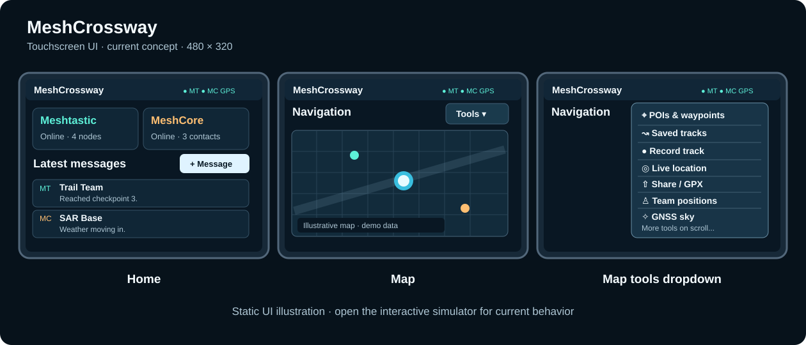](https://renbrant.github.io/MeshCrossway/)

**[Launch the interactive 480 × 320 UI →](https://renbrant.github.io/MeshCrossway/)**

The UI prototype explores **horizontal-screen navigation**, collapsible left navigation and right contextual tools, a pull-down top settings area, messages, maps, sharing and diagnostics. It does not yet communicate with physical radios. [Interface documentation](docs/ui-prototype/README.md).

## V1 hardware selection

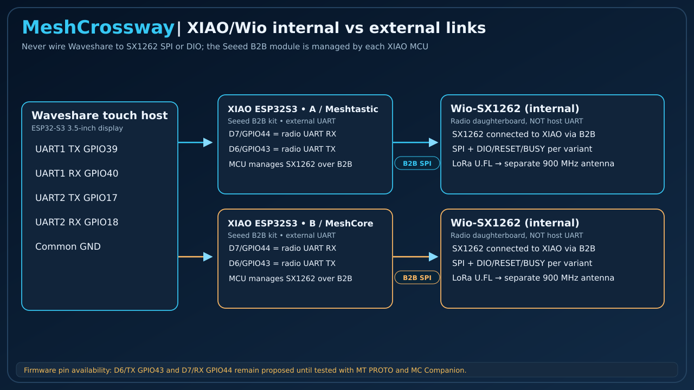

| Role | Selected component | Function |
|---|---|---|
| Main display/controller | **Waveshare ESP32-S3-Touch-LCD-3.5** | LVGL UI, navigation, local storage and coordination |
| Radio A | **Seeed XIAO ESP32-S3 + Wio-SX1262** | Meshtastic |
| Radio B | **Second Seeed XIAO ESP32-S3 + Wio-SX1262** | MeshCore Companion |
| GNSS | **Uputronics u-blox MAX-M10S**, 3 V breakout | Position and time; active antenna under validation |
| Storage | Waveshare onboard **microSD** | Messages, POIs, GPX and future offline map assets |
| Portable power | **Waveshare AXP2101 + protected 1S LiPo (candidate)** | Charging and distribution, subject to electrical validation |

**Radio kit:** [Seeed Studio XIAO ESP32-S3 & Wio-SX1262](https://www.seeedstudio.com/Wio-SX1262-with-XIAO-ESP32S3-p-5982.html). The SX1262 connects internally to each XIAO through the kit's B2B connector; the Waveshare talks to the two XIAO MCUs over independent UARTs.

**Important:** the earlier Aideepen/Heltec LoRa V3 boards, external UART GPIO4/5 instructions and previous BOM totals are **superseded**. Current proposed external XIAO UART signals are **D7/GPIO44 RX and D6/GPIO43 TX** (to be proven with both firmware builds). The Waveshare J8 3V3 supply for both kits is **not electrically approved** until current and reverse-power measurements are complete. See [current wiring, shopping and pinout](docs/hardware-wiring.md).

## What MeshCrossway is designed to do

| Capability | Planned experience | Current state |
|---|---|---|
| Dual network messaging | Unified inbox; clear Meshtastic / MeshCore source and reply network | Simulated UI |
| Navigation | GNSS map, POIs, waypoints, recorded tracks and GPX files | Simulated UI and specification |
| Live location sharing | Per-network audience, movement/time triggers, automatic expiry | Design only |
| Direct Only tracking | Attempt zero-relay position updates without silently flooding | Requires firmware and RF tests |
| Radio diagnostics | Independent connection, packet, status and route information | Simulated UI |
| Offline storage | Message history, configuration, GPX, local assets | Planned |
| Future bulk transfer | Authenticated BLE/Wi-Fi for larger files and map assets | Future |
| Future protocol option | Reticulum evaluation, separate from the two V1 radios | Research only |

No automatic cross-network bridging is performed. Each radio keeps native identities, security, channel models and routing rules.

## Explore the proposed screens

These images show **simulated UI states**, not operational-device screenshots.

### Messaging

[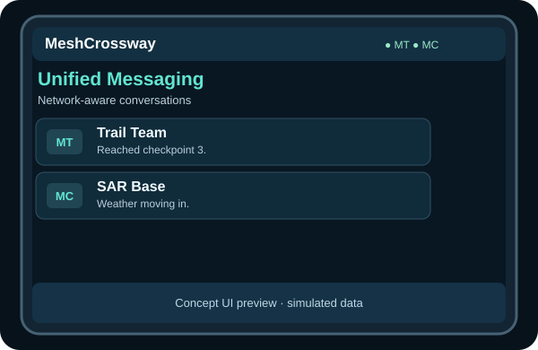](https://renbrant.github.io/MeshCrossway/)

A single inbox preserves each message's original network and destination.

### Navigation, tools and POIs

[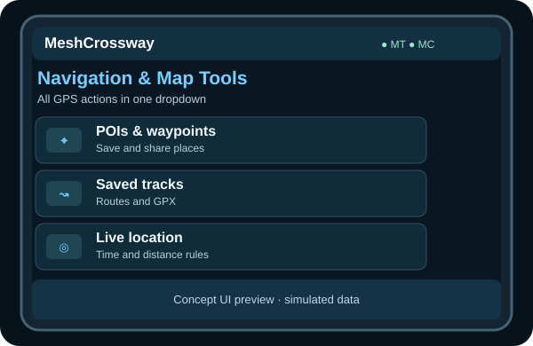](https://renbrant.github.io/MeshCrossway/)

[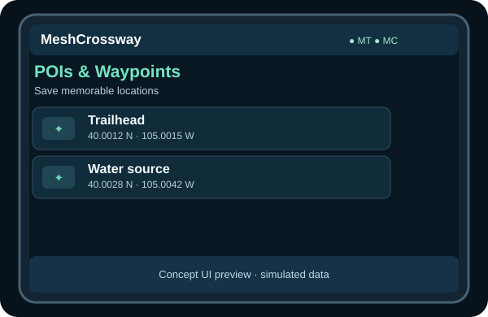](https://renbrant.github.io/MeshCrossway/)

The navigation interface groups location, POIs, saved tracks, recording and GNSS functions without sacrificing map space.

### Tracks and live sharing

[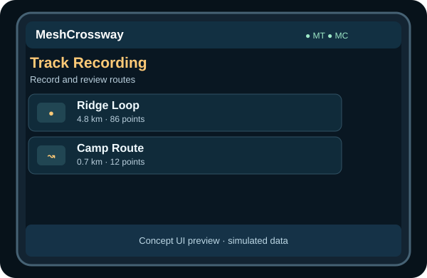](https://renbrant.github.io/MeshCrossway/)

[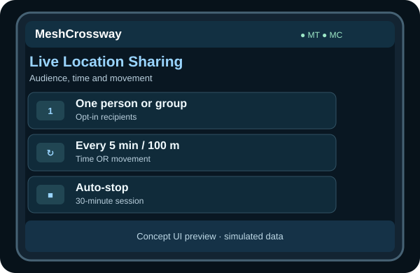](https://renbrant.github.io/MeshCrossway/)

Location updates require deliberate user consent and defined duration, movement threshold and airtime limits. Native zero-hop behavior remains unverified.

### Diagnostics and device settings

[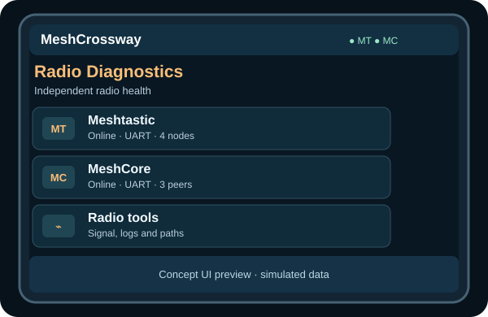](https://renbrant.github.io/MeshCrossway/)

[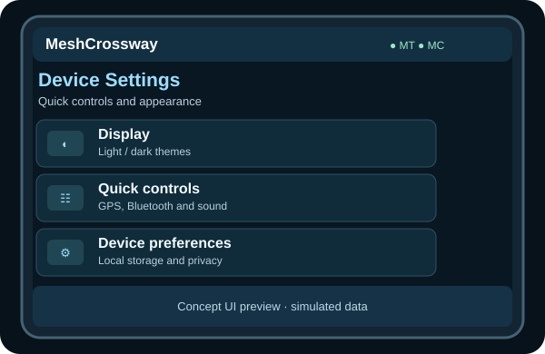](https://renbrant.github.io/MeshCrossway/)

## How the system works


The Waveshare controller runs the main UI and separate radio adapters. **Meshtastic uses the PROTO/Protobuf serial API; MeshCore uses its Companion binary API.** Two radio stacks and two SX1262 transceivers remain independent. Firmware on each kit is preferably upstream, with board-specific configuration/builds and patches only when a demonstrated blocker requires them.



The illustrated electrical design is a **proposal**; it is not a production-ready schematic.

## Design and documentation

| Topic | Detailed documentation |
|---|---|
| **Hardware, shopping, UART pinout and wiring** | [XIAO/Wio V1 hardware guide](docs/hardware-wiring.md) |
| **Power and charging** | [3.3 V rail and validation gates](docs/power-architecture.md) |
| **Radio APIs and transport** | [Meshtastic PROTO, MeshCore Companion and interoperability](docs/radio-communication-architecture.md) |
| **Firmware responsibilities** | [Upstream firmware, custom builds and fallback strategy](docs/radio-firmware-strategy.md) |
| **Navigation and live sharing** | [Positions, GPX, routing policies and airtime](docs/navigation-and-sharing.md) |
| **Meshtastic versus MeshCore** | [Illustrated comparison and technical analysis](docs/meshtastic-vs-meshcore.md) |
| **Maps and regional checks** | [Community coverage and map services](docs/mesh-maps-and-regional-check.md) |
| **Future Reticulum** | [Future integration feasibility](docs/reticulum-future-integration.md) |
| **Interface simulator** | [UI documentation and limitations](docs/ui-prototype/README.md) |
| **Project baseline** | [Current V1 technical reference](docs/project-reference.md) |

## Next validation milestones

1. Check exact received **XIAO/Wio B2B kit** hardware revision, SX1262 RF configuration and external UART pin availability.
2. Prove Meshtastic **PROTO** and MeshCore **Companion** over separate external UART links with real firmware.
3. Measure Waveshare J8 spare 3.3 V current, XIAO USB/charger backfeed paths and SX1262 TX peaks before shared-power assembly.
4. Bring up two radios concurrently and test independent recovery, GNSS, microSD and a responsive LVGL interface.
5. Validate zero-hop routing, channel congestion, close-proximity RF coexistence and privacy with actual peer/repeater devices.
6. Finalize carrier PCB and enclosure only after the above electrical and protocol gates.

**This project is experimental.** Do not rely on it as the sole communication device in a rescue or safety-critical situation.

## Contributing and license

Open an [issue](https://github.com/Renbrant/MeshCrossway/issues) with board revision, firmware version and reproducible details. Do not post private keys or personal location histories.

MeshCrossway original code and documentation are provided under the [MIT License](LICENSE). Third-party product imagery, upstream firmware and documentation retain their separate licenses; see [image credits](docs/images/amazon/README.md). MeshCrossway is independent of the suppliers and protocol projects referenced here.
