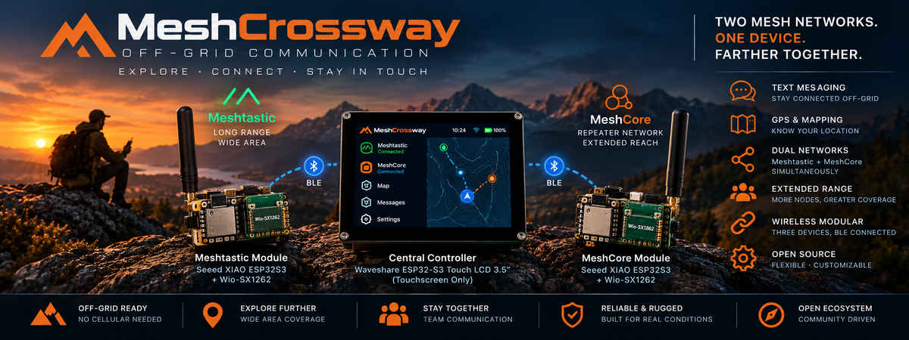
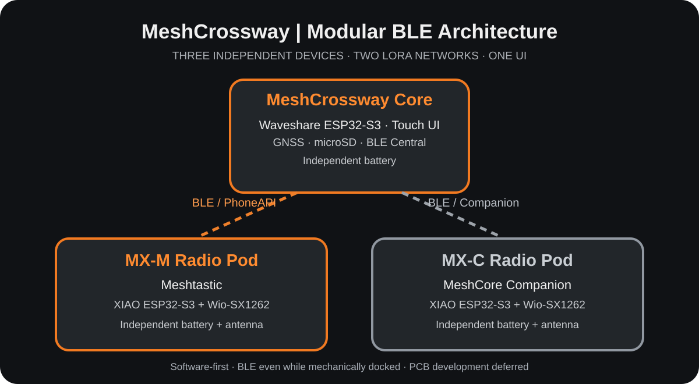

**v0.8.3 experimental:** Local SD track recording and GPX, saved POIs and map overlays, reordered borderless contextual controls, map-style selection and automatic provider credits. [Operation and hardware acceptance](docs/gps-navigation-v083.md). **v0.8.2 is now the owner-confirmed recovery**, including Bluetooth reconnection after restart. Install without Erase.

**v0.8.1 (experimental):** GPS fix/satellite indicator, saved GPS reading settings and real XYZ PNG maps with pan, zoom, GPS follow and microSD cache. Offline packs use `/tiles/z/x/y.png`; online viewing uses HTTPS OpenStreetMap tiles and visible attribution. No bulk download or automatic mesh location sharing. Map/SD/TLS/BLE coexistence still requires hardware validation. [Map and GPS guide](docs/maps-gps-v081.md). v0.7.8 remains recovery.

MeshCrossway is an **open-source, offline-first modular communication system** with **three independent, battery-powered devices**: one touchscreen **Core** and two detachable LoRa **Radio Pods**, one for **Meshtastic** and one for **MeshCore**. The Core connects to both Pods over **two separate Bluetooth Low Energy (BLE) links**, bringing messaging, navigation, GNSS positioning, tracks and field diagnostics into a single interface without requiring cellular coverage or the internet.

> **Development status:** **v0.8.2 is the owner-tested recovery**. Local GPS UART reception was observed on v0.8.0 with a live fix; v0.8.1 adds map rendering and GPS configuration pending hardware qualification. Meshtastic PhoneAPI and MeshCore remain independent, with one active BLE radio at a time. Full Meshtastic RX/TX hardware validation, concurrent BLE sessions, tracks and live sharing are still pending. The web simulator is separate from physical LVGL firmware.

**v0.7.13 experimental (not hardware tested):** Includes PR #63 touch sampling on a separate task, retained PSRAM message cards and reading position, and earlier offline SD restore for MeshCore and Meshtastic. The two mesh networks remain completely independent; only one BLE radio is active at a time. Install from the [Web Flasher](https://renbrant.github.io/MeshCrossway/flasher/) with **Erase unchecked**. The owner-tested v0.7.8 remains the default recovery image; real hardware qualification is pending. [Touch/history acceptance notes](docs/touch-history-pr.md).

**v0.7.12 experimental:** Meshtastic PhoneAPI integration now supports a T-Deck / T-Deck Plus as the external BLE radio: native nodes, channels, direct/channel messages, positions/metrics, drafts and separate plaintext SD history. Use **Bluetooth Programming Mode or BaseUI**, T-Deck Wi-Fi off, and the displayed PIN. One active BLE radio session; both networks remain independent. Physical T-Deck qualification is pending; **v0.7.8 remains recovery**. [Setup and compatibility checks](docs/meshtastic-v0712.md).

## Current hardware — three independent BLE devices

**Three separate units, three batteries, two simultaneous BLE links, and two independent LoRa networks.** The three devices may be carried separately or attached to an optional mechanical dock. **There is no electrical wiring, shared carrier PCB or shared battery between the Core and either Pod** in the current software-first design. BLE remains the Core-to-Pod data link even when the units are docked.

| Device | Selected hardware | Independent power | Role and wireless connection |
|---|---|---|---|
| **MeshCrossway Core** | **Waveshare ESP32-S3-Touch-LCD-3.5 Rev2.0** (480 × 320 touchscreen) | **Own protected rechargeable battery**, charging/power management to be validated | Central LVGL UI, microSD, planned MAX-M10S GNSS; **BLE Central** connected to both Pods |
| **MX-M Radio Pod** | **Seeed XIAO ESP32-S3 + Wio-SX1262** B2B kit | **Own protected rechargeable battery**, charging circuit and power switch | Native **Meshtastic** radio with **BLE PhoneAPI Peripheral**; its own SX1262 and LoRa antenna |
| **MX-C Radio Pod** | **Second Seeed XIAO ESP32-S3 + Wio-SX1262** B2B kit | **Own protected rechargeable battery**, charging circuit and power switch | Native **MeshCore BLE Companion Peripheral**; its own SX1262 and LoRa antenna |

**Selected radio kit:** [Seeed Studio XIAO ESP32-S3 & Wio-SX1262](https://www.seeedstudio.com/Wio-SX1262-with-XIAO-ESP32S3-p-5982.html), **quantity 2**. The XIAO controls its own SX1262 through the kit's **internal board-to-board (B2B) connection**. The Core talks to each XIAO **wirelessly over BLE**, not via UART, SPI or GPIO wires.

**Two BLE connections, two different APIs:** Meshtastic uses **protobuf PhoneAPI over BLE GATT**; MeshCore uses its **Companion binary protocol over BLE GATT**. These are distinct protocol adapters, not an interchangeable serial stream. Concurrent pairing, reconnection, packet handling and responsiveness remain real-hardware validation tasks. The Pods must retain their native LoRa operation when the Core is off or out of BLE range.

**Three independent power systems:** Each enclosure requires its own battery protection, charging, charge-state/level monitoring and power switching as appropriate. Final battery chemistry/capacity, charger choices, mounting and endurance are **not yet approved**. A future docking charger, if adopted, must charge the three cells through **separate protected charging paths**; battery terminals are never directly paralleled. This modular design also allows a **larger Core battery** without being constrained by a shared carrier PCB.

**GNSS:** The [u-blox MAX-M10S breakout](docs/hardware-sources.md) remains a proposed **Core-side** location/time source; its exact power connection and antenna require validation. Waveshare onboard microSD is the planned local storage. Each LoRa Pod has its **own antenna**, with coexistence testing required even when carried close together.

**Mechanical concept:** The Core and Pods are **detachable**; an optional physical dock can hold them together, but **docked UART and dock charging are future options**, not V1 prerequisites. Firmware and BLE interoperability come **before** new enclosure, charging-board or PCB work.

**Reference:** [Approved modular architecture, BLE roles and test plan](docs/modular-architecture.md). The former [integrated Rev A UART wiring](docs/hardware-wiring.md), [PCB layout](docs/pcb-layout-rev-a.md) and KiCad files are retained **unchanged as an archived variant**; they are not assembly instructions for the current design.

## What MeshCrossway is designed to do

| Capability | Planned experience | Current state |
|---|---|---|
| Dual network messaging | MeshCore contacts, channels and direct/group chat; Meshtastic planned | MeshCore v0.7.9 experimental; physical acceptance pending |
| Navigation / GPS | Local GNSS, POIs, manually drawn/imported courses, recorded tracks and GPX; automatic routing deferred | Simulated UI and specification |
| Connected track library | wanderer API integration; separate instance account, direct website access and personal SD export | Selected direction; not implemented |
| Live location sharing | Per-network audience, movement/time triggers, automatic expiry | Design only |
| Direct Only tracking | Attempt zero-relay position updates without silently flooding | Requires firmware and RF tests |
| Radio diagnostics | Independent connection, packet, status and route information | Simulated UI |
| Offline storage | MeshCore messages, contacts, channels and local chat preferences | v0.7.9 plaintext journal; GPX/maps remain planned |
| Future bulk transfer | Authenticated BLE/Wi-Fi for larger files and map assets | Future |
| Future protocol option | Reticulum evaluation, separate from the two V1 radios | Research only |
| Future ATAK interoperability | Evaluate ATAK-CIV gateway, CoT positions and controlled event sharing | Research only |

No automatic cross-network bridging is performed. Each radio keeps native identities, security, channel models and routing rules.

## How the modular system works

The Waveshare **Core acts as a BLE Central with two independent Peripheral connections**. It maintains one Meshtastic PhoneAPI (protobuf) adapter for **MX-M** and one MeshCore Companion (binary) adapter for **MX-C**. The two LoRa networks are handled **on their own XIAO ESP32-S3 + SX1262 Pods**, using their respective native firmware and separate antenna/battery systems.

1. **Core:** touchscreen navigation, unified inbox, GNSS and microSD plans, local configuration and per-network status; Core battery powers **only the Core**.
2. **BLE link A:** Core ↔ **MX-M** via the Meshtastic GATT PhoneAPI. MX-M operates on the Meshtastic LoRa network with its **own battery**.
3. **BLE link B:** Core ↔ **MX-C** via the MeshCore Companion GATT API. MX-C operates on the MeshCore LoRa network with its **own battery**.
4. **Separation:** the Pods are **not** electrically tethered to the Core, do not exchange packets directly by BLE, and should continue native radio operation when disconnected from the Core. The Core does not automatically bridge one mesh network to the other.

The v0.7.0 experimental firmware adds bounded MeshCore BLE queues, authenticated pairing and a serialized Companion session integrated with LVGL. **Two concurrent BLE radio sessions remain a design target.** Wi-Fi AP+STA and PIN-free manual screenshots remain available; remote touch is disabled. The immutable v0.7.8 image is the rollback.

Each Pod should use a verified upstream BLE-enabled firmware target. In particular, MeshCore must use a **BLE Companion** build rather than an old serial-only build; on Meshtastic ESP32, enabling Wi-Fi may disable Bluetooth. Radio frequencies, antennas, duty/airtime policies and close-proximity RF interference require regional and physical testing.

[Implementation specification](docs/modular-architecture.md) · [Native radio firmware strategy](docs/radio-firmware-strategy.md) · [Protocol documentation (legacy UART sections are historical)](docs/radio-communication-architecture.md)

## GPS, tracks and wanderer

[wanderer](https://wanderer.to/) is the selected open-source application/service base for the planned connected track library and sharing workflow. The Core will record locally to microSD; **automatic route calculation and recalculation are deferred**.

Online synchronization and private library/sharing management require a **separate account on the chosen wanderer instance**. There is no assumed universal account at the official project site. Users will always have an option to open that instance's website directly, independently of the MeshCrossway interface. **Local GNSS and track recording require no wanderer account.**

Planned personal SD export/backup preserves portable tracks and supported metadata; server-wide backups remain the hosting operator's responsibility. API integration, authentication, SD backup and restoration are **not yet implemented or validated**, and no formal partnership exists.

[Read the selection study, account model, API boundary and backup requirements](docs/gps-wanderer-integration.md).

## Future integrations and collaborations

Explore the [future integrations registry](docs/future-integrations/README.md), including [Colorado Mesh-Client](docs/future-integrations/colorado-mesh-client.md), MeshMapper, ATAK, Reticulum and upstream protocol projects. These are research opportunities, not committed features or partnerships.

## Alternative central console: LilyGO T-Deck Plus

The **LilyGO T-Deck Plus** is being evaluated as an **optional portable replacement for the Waveshare central display/controller**, keeping MeshCore and Meshtastic on independent radio nodes (including compatible Heltec V3 devices) linked by BLE. Its screen, keyboard and trackball would provide the MeshCrossway UI; a dedicated firmware build would aim to support the installed Launcher Web Flasher workflow. **Candidate only — BLE multi-peer operation, firmware packaging and on-device compatibility still require hardware validation.** The existing modular reference architecture remains unchanged.

[Read the T-Deck Plus alternative central-controller feasibility plan](docs/alternative-central-lilygo-tdeck-plus.md).

## Design and documentation

| Topic | Detailed documentation |
|---|---|
| **Approved modular hardware / two BLE links / three batteries** | [Three-device modular architecture](docs/modular-architecture.md) |
| **Former integrated hardware and UART wiring (archived)** | [Rev A wiring and historic shopping guide](docs/hardware-wiring.md) |
| **Archived PCB variant — not the new baseline** | [Rev A 4-layer PCB reference](docs/pcb-layout-rev-a.md) |
| **Manufacturer hardware sources** | [Official source registry](docs/hardware-sources.md) |
| **Power and charging (current concept)** | [Independent batteries and charge-domain requirements](docs/modular-architecture.md#power-and-charging) |
| **Archived shared-carrier power design** | [Rev A 5 V/VBUS study](docs/power-architecture.md) |
| **Radio APIs and BLE transports** | [Meshtastic BLE PhoneAPI + MeshCore BLE Companion](docs/modular-architecture.md#ble-implementation) |
| **Legacy UART transport research** | [Older PROTO/Companion serial design](docs/radio-communication-architecture.md) |
| **Firmware responsibilities** | [Upstream firmware, custom builds and fallback strategy](docs/radio-firmware-strategy.md) |
| **GPS / wanderer selection, accounts and SD backup** | [Integration study and requirements](docs/gps-wanderer-integration.md) |
| **Navigation and live sharing** | [Positions, GPX, routing policies and airtime](docs/navigation-and-sharing.md) |
| **Meshtastic versus MeshCore** | [Illustrated comparison and technical analysis](docs/meshtastic-vs-meshcore.md) |
| **Maps and regional checks** | [Community coverage and map services](docs/mesh-maps-and-regional-check.md) |
| **Future Reticulum** | [Future integration feasibility](docs/reticulum-future-integration.md) |
| **Future ATAK / CoT** | [ATAK-CIV gateway and interoperability research](docs/atak-future-integration.md) |
| **Interface concepts and archived screenshots** | [UI documentation and historical gallery](docs/ui-prototype/README.md) |
| **Project baseline** | [Current V1 technical reference](docs/project-reference.md) |

## Next validation milestones

1. Confirm hardware revisions for the **two Seeed XIAO ESP32-S3 + Wio-SX1262** kits; install compatible **Meshtastic BLE PhoneAPI** and **MeshCore BLE Companion** firmware, respectively.
2. Verify that **each Pod connects to its native phone app independently**, retains LoRa operation without the Core, and reports available radio/battery telemetry.
3. Make the **Waveshare Core establish and maintain both BLE connections at once** using separate protocol adapters, with secure pairing, automatic recovery and a responsive touchscreen.
4. Decode/send real messages separately on Meshtastic and MeshCore; validate identity, acknowledgments, queues and per-network diagnostics without automatic cross-network bridging.
5. Validate the **three separate battery/charging systems**, current consumption, autonomy, GNSS integration, microSD and Wi-Fi/BLE coexistence where needed.
6. Measure RF coexistence, packet reception and antenna separation in both **separated and optionally docked** configurations.
7. **Only then** design optional Pod carriers, enclosures, secure dock/charging and a future modular PCB revision. Keep the older integrated KiCad variant archived and unchanged.

**This project is experimental.** Do not rely on it as the sole communication device in a rescue or safety-critical situation.

## Contributing and license

Open an [issue](https://github.com/Renbrant/MeshCrossway/issues) with board revision, firmware version and reproducible details. Do not post private keys or personal location histories.

MeshCrossway original code and documentation remain under the [MIT License](LICENSE). Compiled display firmware combines original code with Waveshare and other components under their own licenses; it must not be described as MIT-only. Native Radio Pod firmware, product imagery and vendor CAD retain their separate terms.

See the [licensing policy](docs/licensing.md), [initial dependency review and outstanding release checks](docs/third-party-licenses.md), [third-party notices](THIRD_PARTY_NOTICES.md), [contribution guide](CONTRIBUTING.md) and [image credits](docs/images/README.md). This is an initial source-level review, not a complete audit of published binaries. MeshCrossway is independent of the suppliers and protocol projects referenced here.

> **Emoji display candidate (v0.7.3, not hardware-tested):** PR #41 adds 92 local color emoji sprites for read-only MeshCore chat rendering, built on the v0.7.2 Wi-Fi/BLE auto-reconnection firmware. Incoming message bytes and both independent mesh protocols remain unchanged. [Implementation and hardware tests](docs/emoji-read-only-preparation.md).

> **v0.7.4 emoji fix (experimental):** MeshCore checkered-flag names (🏁 U+1F3C1) and message bodies render the 93rd local color glyph instead of `[emoji]`, without touching transmitted UTF-8 or saved bonds. [Test procedure](docs/checkered-flag-emoji-v074.md). The Web Flasher retains v0.6.8 as tested rollback.

