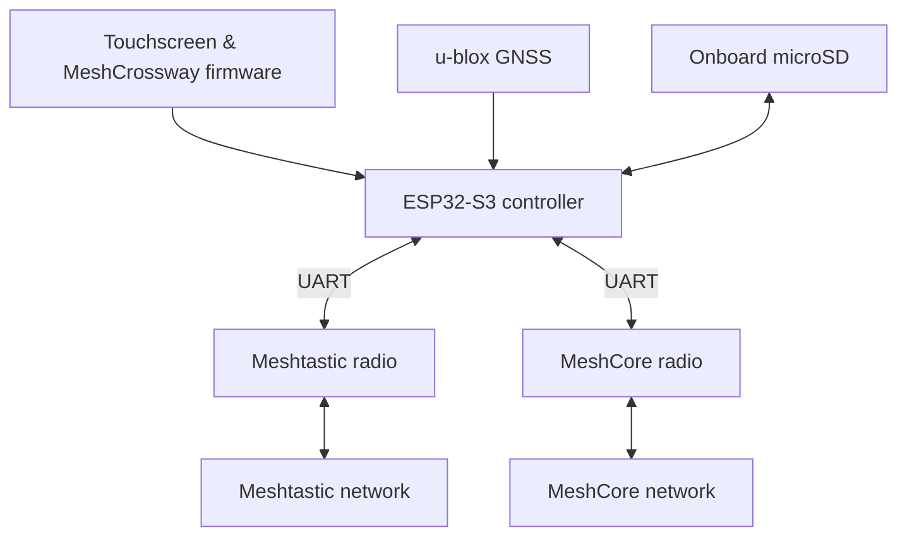

# MeshCrossway

**Two mesh networks. One portable terminal.**

MeshCrossway is an open-source, standalone touchscreen communicator being designed to access **Meshtastic** and **MeshCore** through separate LoRa radios. The goal is simple: communication, positioning and navigation in one portable device, even without cellular service or internet.

> **Project status: design and bench-prototype planning.** The interactive UI is a simulator with sample data. Firmware, radio integration, hardware wiring and field performance are **not yet validated**. This is not a certified emergency communications device.

## Explore the interface

**[Try the interactive touchscreen simulator →](https://renbrant.github.io/MeshCrossway/)**

A browser preview of the planned **480 × 320** interface. The static illustration highlights the current Home, Map and Map → Tools navigation. The link opens the full interactive simulator, including chats, live-location sharing, POIs, tracks and diagnostics.

## Planned capabilities

- **Two independent mesh networks:** unified inbox and conversations with clear Meshtastic/MeshCore identification, without automatically bridging their protocols.
- **Messaging:** private conversations, channels, quick replies and local history.
- **Navigation:** GNSS positioning, points of interest, waypoints, track recording and GPX management.
- **Location sharing:** send a position or POI, share with one person or a group, and configure tracking by time, movement and session duration.
- **Direct Tracking:** proposed one-hop tracking to reduce repeater traffic, subject to native-protocol support and real-world validation. One-hop transmissions still consume shared airtime.
- **Offline-first:** local microSD storage, with future map downloads and optional Bluetooth transfer of larger files.
- **Field tools:** radio diagnostics, connection health and team-position views.

## Key functions illustrated

These are **illustrative screens with simulated data**, based on the planned touchscreen UI. They are not screenshots of operating hardware. **[Explore the interactive simulator](https://renbrant.github.io/MeshCrossway/)** for clickable examples.

### Unified messaging

Conversations from both networks appear in one inbox, while every contact and message retains its original network identity. Replies require an explicit destination.

### Navigation and map tools

The **Map → Tools** menu brings POIs, saved tracks, recording, team positions, sharing and GNSS tools together without crowding the map.

### POIs and waypoints

Save trailheads, checkpoints, water sources and other locations. Compact coordinates could be shared over a selected LoRa network, subject to protocol capability and airtime limits.

### Tracks and GPX

Record and review tracks locally. Full GPX transfer is planned through an authenticated Bluetooth companion in a future phase rather than sending large files over LoRa.

### Live location sharing

Choose a person or group, transmission interval, movement threshold and automatic expiration. **Direct Only** is the proposed default to avoid repeater forwarding, but it still occupies shared radio airtime. Strict zero-hop behavior must be validated with both protocols.

### Radio status and diagnostics

Separate health information for Meshtastic and MeshCore, with planned diagnostics for link status, packet logs and routing behavior.

### Device settings

Centralized preferences for display appearance, device controls, local storage and privacy—separate from the navigation tools.

## System overview

The central controller handles the UI, GNSS, navigation, storage and sharing policy. Each radio runs its own upstream protocol firmware, with board-specific configuration or compilation where required. Source patches are a last resort.

## Project documentation

| Area | Details |
|---|---|
| **Hardware & purchasing** | [Selected equipment, specifications, shopping links, prices and wiring](docs/hardware-wiring.md) |
| **Power** | [Battery charging, 3.3 V architecture and electrical verification](docs/power-architecture.md) |
| **Firmware architecture** | [Radio firmware policy, processing responsibilities and tests](docs/radio-firmware-strategy.md) |
| **Navigation & sharing** | [GPS, POIs, GPX, group tracking, Direct Only and congestion controls](docs/navigation-and-sharing.md) |
| **Protocols** | [Meshtastic and MeshCore overview](docs/meshtastic-vs-meshcore.md) |
| **UI prototype** | [Simulator features, status and limitations](docs/ui-prototype/README.md) |
| **Technical reference** | [Detailed project decisions, roadmap, equipment and supporting references](docs/project-reference.md) |

## Development priorities

1. Verify electrical interfaces, available power and both radio UART connections.
2. Prove independent messaging with upstream Meshtastic and MeshCore builds.
3. Implement the LVGL touchscreen interface, GNSS and persistent storage.
4. Validate tracking, routing restrictions, congestion limits and privacy on real hardware.
5. Evaluate offline maps, Bluetooth GPX transfer, enclosure and field performance.

Contributions and technical discussions are welcome in [GitHub Issues](https://github.com/Renbrant/MeshCrossway/issues). Please include hardware revisions, firmware versions and reproducible steps; never publish private keys or sensitive location history.

## License

Original project code and documentation: [MIT License](LICENSE). Third-party software, hardware documentation and product images retain their respective licenses. See [photo sources and rights](docs/images/amazon/README.md).

MeshCrossway is an independent project and is not affiliated with or endorsed by the manufacturers or upstream projects referenced here.
