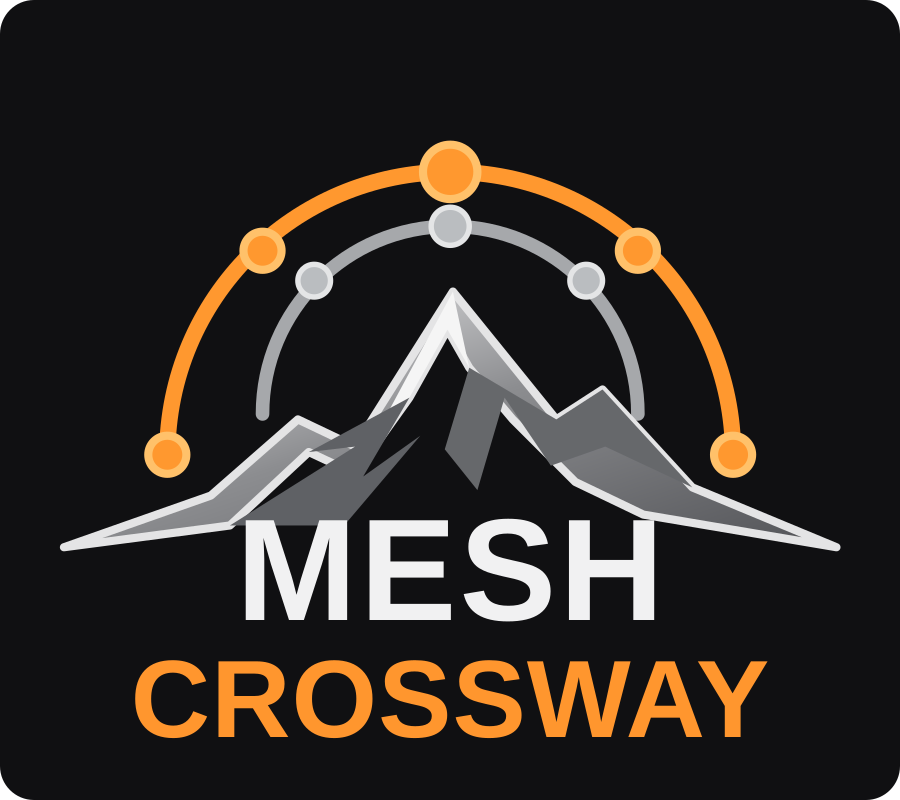

<p align="center"></p>

# MeshCrossway

**TWO MESH NETWORKS. THREE MODULAR DEVICES. ONE INTERFACE.**

Brand identity: **MeshCrossway** (one word, capital M and C). The two rings represent distinct, independent networks: gray and orange. [Horizontal logo](docs/site/assets/logo-horizontal.svg) · [Symbol](docs/site/assets/logo-symbol.svg).

**Meshtastic + MeshCore — two independent detachable LoRa radio Pods connected via Bluetooth Low Energy (BLE) to a dedicated touchscreen Core.**

> **Approved architecture — October 28, 2026:** MeshCrossway consists of **three individually powered, separable devices**. The Waveshare touchscreen/GNSS **Core** is BLE Central; the **MX-M Pod** runs Meshtastic BLE PhoneAPI and the **MX-C Pod** runs MeshCore BLE Companion, each on a Seeed XIAO ESP32-S3 + Wio-SX1262 kit. BLE is the primary data connection **even when docked**. The units can mechanically attach as one handheld or be carried apart (backpack, vest, helmet, or vehicle mount). The old single-carrier Rev A PCB and UART wiring are **superseded integration experiments, not the current production direction**. No physical prototype, BLE integration, enclosure, RF coexistence or vehicle safety qualification is complete. See [approved modular architecture](docs/modular-architecture.md).


[Archived integrated design illustrations](docs/images/README.md)

*This is an architecture diagram, not a measured mechanical design or completed hardware. Production enclosure renders remain pending.*

MeshCrossway is an **open-source, offline-first touchscreen communicator** designed to use Meshtastic and MeshCore independently. One interface brings together messaging, navigation, GNSS positioning, tracks and field diagnostics without requiring cellular coverage or internet access. Radio Pods remain autonomous when the Core disconnects.

## Try the interactive interface

[](https://renbrant.github.io/MeshCrossway/)

[](https://renbrant.github.io/MeshCrossway/)

**[Launch the interactive 480 × 320 UI →](https://renbrant.github.io/MeshCrossway/)**

The UI prototype explores horizontal-screen navigation, contextual tools, settings, messages, maps and diagnostics. It does not yet communicate with physical radios. [Interface documentation](docs/ui-prototype/README.md).

## Approved hardware topology

```text
                     MeshCrossway Core
           Waveshare ESP32-S3 touchscreen
               MAX-M10S GNSS + microSD
                    BLE CENTRAL
                    /         \
                   BLE        BLE
                  /             \
          MX-M Radio Pod      MX-C Radio Pod
          Meshtastic          MeshCore Companion
          XIAO ESP32-S3       XIAO ESP32-S3
          Wio-SX1262          Wio-SX1262
          Own battery         Own battery
          Own antenna         Own antenna
```

| Unit | Selected hardware | Role |
|---|---|---|
| MeshCrossway Core | Waveshare ESP32-S3-Touch-LCD-3.5 + MAX-M10S + microSD | UI, GNSS, storage and two BLE clients |
| MX-M Pod | Seeed XIAO ESP32-S3 + Wio-SX1262 | Autonomous Meshtastic BLE node |
| MX-C Pod | Seeed XIAO ESP32-S3 + Wio-SX1262 | Autonomous MeshCore BLE Companion |
| Each unit | Individual protected battery and validated charging path | Untethered operation |
| Dock | Mechanical latch, optional protected charging contacts | Handheld assembly; **BLE remains the main data transport** |

Pods can be used on backpack/shoulder/helmet attachments; car-roof mounting is a potential accessory requiring vehicle-rated retention, weatherproofing, LiPo temperature qualification, BLE cabin-link tests, RF exposure and antenna separation. A magnetic holder alone is not considered adequate roof retention.

**Design rule:** the three units are independent. **Do not manufacture the old single shared carrier PCB as the final modular product.** [Modular architecture and engineering tests](docs/modular-architecture.md). Prior [integrated UART wiring](docs/hardware-wiring.md) and [power investigation](docs/power-architecture.md) remain historical bench references.

## What MeshCrossway is designed to do

| Capability | Planned experience | Current state |
|---|---|---|
| Dual network messaging | Unified inbox; clear Meshtastic / MeshCore source and reply network | Simulated UI |
| Navigation | GNSS map, POIs, waypoints, recorded tracks and GPX files | Simulated UI and specification |
| Live location sharing | Per-network audience, movement/time triggers, automatic expiry | Design only |
| Direct Only tracking | Attempt zero-relay position updates without silently flooding | Requires firmware and RF tests |
| Radio diagnostics | Independent connection, packet, status and route information | Simulated UI |
| Offline storage | Message history, configuration, GPX, local assets | Planned |
| Future bulk transfer | Authenticated BLE/Wi-Fi for larger files and map assets | Future |
| Future protocol option | Reticulum evaluation, separate from the two V1 radios | Research only |
| Future ATAK interoperability | Evaluate ATAK-CIV gateway, CoT positions and controlled event sharing | Research only |

No automatic cross-network bridging is performed. Each radio keeps native identities, security, channel models and routing rules.

## Explore the proposed screens

These images show **simulated UI states**, not operational-device screenshots.

### Messaging

[](https://renbrant.github.io/MeshCrossway/)

A single inbox preserves each message's original network and destination.

### Navigation, tools and POIs

[](https://renbrant.github.io/MeshCrossway/)

[](https://renbrant.github.io/MeshCrossway/)

The navigation interface groups location, POIs, saved tracks, recording and GNSS functions without sacrificing map space.

### Tracks and live sharing

[](https://renbrant.github.io/MeshCrossway/)

[](https://renbrant.github.io/MeshCrossway/)

Location updates require deliberate user consent and defined duration, movement threshold and airtime limits. Native zero-hop behavior remains unverified.

### Diagnostics and device settings

[](https://renbrant.github.io/MeshCrossway/)

[](https://renbrant.github.io/MeshCrossway/)

## How the system works


The Waveshare controller runs the main UI and separate radio adapters. **Meshtastic uses the PROTO/Protobuf serial API; MeshCore uses its Companion binary API.** Two radio stacks and two SX1262 transceivers remain independent. Firmware on each kit is preferably upstream, with board-specific configuration/builds and patches only when a demonstrated blocker requires them.


The illustrated electrical design is a **proposal**; it is not a production-ready schematic.

## Design and documentation

| Topic | Detailed documentation |
|---|---|
| **Hardware, shopping, UART pinout and wiring** | [XIAO/Wio V1 hardware guide](docs/hardware-wiring.md) |
| **PCB layout baseline** | [Rev A 4-layer floorplan, routing and fabrication gates](docs/pcb-layout-rev-a.md) |
| **Manufacturer hardware sources** | [Official source registry](docs/hardware-sources.md) |
| **Power and charging** | [5 V/VBUS source selection and validation gates](docs/power-architecture.md) |
| **Radio APIs and transport** | [Meshtastic PROTO, MeshCore Companion and interoperability](docs/radio-communication-architecture.md) |
| **Firmware responsibilities** | [Upstream firmware, custom builds and fallback strategy](docs/radio-firmware-strategy.md) |
| **Navigation and live sharing** | [Positions, GPX, routing policies and airtime](docs/navigation-and-sharing.md) |
| **Meshtastic versus MeshCore** | [Illustrated comparison and technical analysis](docs/meshtastic-vs-meshcore.md) |
| **Maps and regional checks** | [Community coverage and map services](docs/mesh-maps-and-regional-check.md) |
| **Future Reticulum** | [Future integration feasibility](docs/reticulum-future-integration.md) |
| **Future ATAK / CoT** | [ATAK-CIV gateway and interoperability research](docs/atak-future-integration.md) |
| **Interface simulator** | [UI documentation and limitations](docs/ui-prototype/README.md) |
| **Project baseline** | [Current V1 technical reference](docs/project-reference.md) |

## Next validation milestones

1. Check exact received **XIAO/Wio B2B kit** hardware revision, SX1262 RF configuration and external UART pin availability.
2. Prove Meshtastic **PROTO** and MeshCore **Companion** over separate external UART links with real firmware.
3. Measure Waveshare **J8 5 V** source capability, the alternate `LOCAL_5V` regulator, Schottky drop, XIAO USB/VBUS backfeed paths and SX1262 TX peaks before approving shared carrier power.
4. Bring up two radios concurrently and test independent recovery, GNSS, microSD and a responsive LVGL interface.
5. Validate zero-hop routing, channel congestion, close-proximity RF coexistence and privacy with actual peer/repeater devices.
6. Finalize carrier PCB and enclosure only after the above electrical and protocol gates.

**This project is experimental.** Do not rely on it as the sole communication device in a rescue or safety-critical situation.

## Contributing and license

Open an [issue](https://github.com/Renbrant/MeshCrossway/issues) with board revision, firmware version and reproducible details. Do not post private keys or personal location histories.

MeshCrossway original code and documentation are provided under the [MIT License](LICENSE). Third-party product imagery, upstream firmware and documentation retain their separate licenses; see [image credits and technical-diagram sources](docs/images/README.md). MeshCrossway is independent of the suppliers and protocol projects referenced here.
