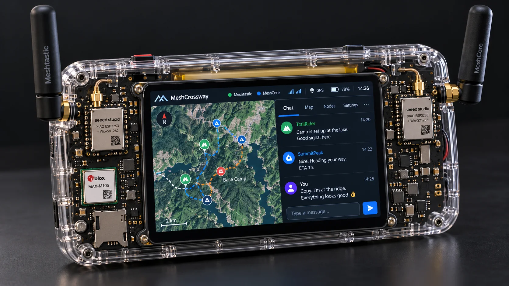
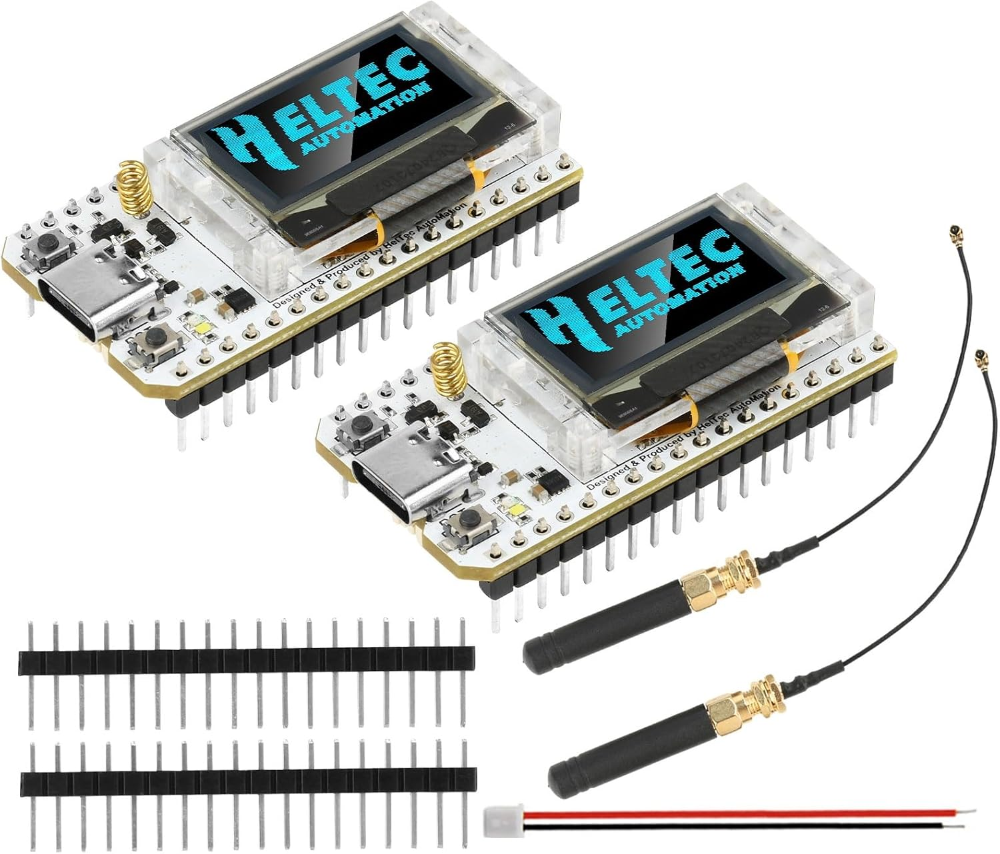
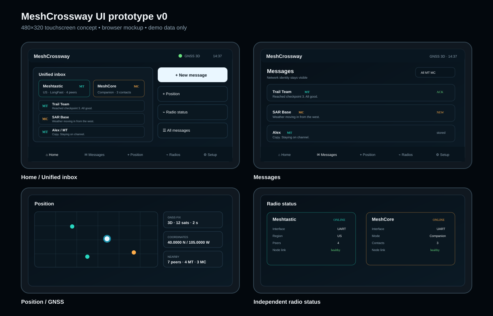
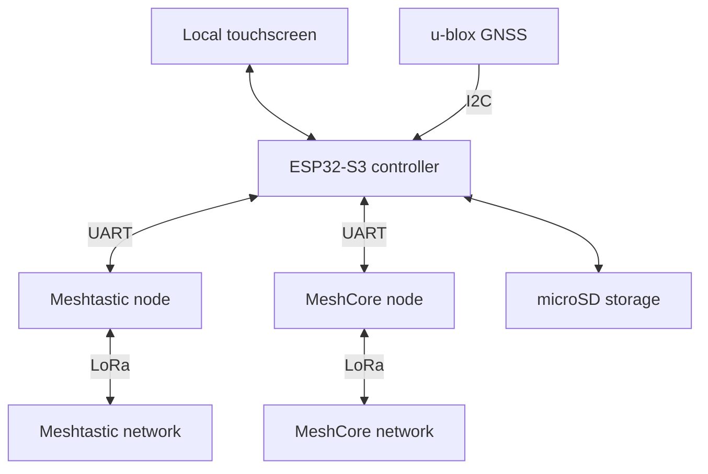
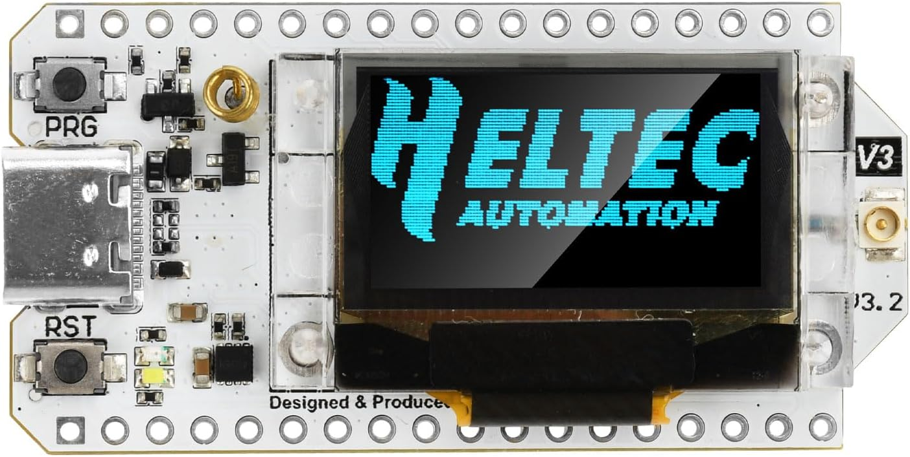

# MeshCrossway

| Touchscreen controller | Two independent radio nodes |
|:---:|:---:|
|  |  |
| **Waveshare ESP32-S3-Touch-LCD-3.5** | **LoRa V3 ESP32-S3 + SX1262, two-pack** |

Original product photos from the selected Amazon listings. Displays and firmware shown are vendor examples, not working MeshCrossway firmware. [Photo sources and rights](docs/images/amazon/README.md).

**Two mesh networks. One portable terminal.**

MeshCrossway is an open-source project to build an ESP32-based portable communicator with a touchscreen, dedicated LoRa radios for Meshtastic and MeshCore, GNSS positioning, and local message storage.

The goal is to give travelers, outdoor users, and eventually search-and-rescue teams a single interface for communicating across multiple networks where internet access or cellular coverage may be unavailable.

> **Project status: architecture and bench-prototype planning.** This repository currently contains project documentation and a license. A schematic-reviewed wiring proposal is available below. Application firmware, bench-validated assembly instructions, build commands, and test results are not yet available. Features described below are planned unless explicitly marked otherwise.

## Interactive touchscreen UI preview

**[▶ Open the live, clickable MeshCrossway simulator](https://renbrant.github.io/MeshCrossway/)**

Explore the planned 480 × 320 touchscreen experience: dual-network messaging, GNSS/peer positions, POIs and waypoints, track recording, route summaries, opt-in live position sharing for individuals or groups, radio diagnostics, quick replies, and field tools.

> **UI concept only.** Screens contain simulated information; there is no real messaging, GPS tracking, RF diagnostics, or emergency alert. GitHub READMEs cannot embed executable interactive HTML, so the preview opens the simulator hosted on GitHub Pages. The image above is an earlier static screen overview; the linked simulator is the current interactive version.

## Why MeshCrossway?

Different groups may use different mesh ecosystems. Switching between separate devices and applications adds friction when users need to follow conversations and positions across those networks.

MeshCrossway aims to bring those experiences into one standalone device while preserving each network's native identity, configuration, and security model.

The first prototype will focus on:

- Operating Meshtastic and MeshCore through two dedicated radio nodes.
- Sending and receiving messages from a local touchscreen.
- Showing which network, contact, and channel each message belongs to.
- Recording messages and positions locally.
- Sharing a GNSS source through protocol-specific adapters.
- Remaining usable without a phone, cloud account, or internet connection.

**A unified interface does not make the networks interoperable.** The initial design does not automatically forward messages between Meshtastic and MeshCore. Both radios are intended to remain active, but simultaneous availability and RF coexistence still require testing.

## Documentation

- [V1 power architecture: Waveshare AXP2101, shared J8 3V3 rail, capacitors and validation](docs/power-architecture.md)
- [Bench wiring guide: connectors, GPIOs, power, and connection diagrams](docs/hardware-wiring.md) — provisional proposal; GNSS drawings and BOM require revalidation after the MAX-M10S selection.
- [Meshtastic and MeshCore: concepts, differences, and official links](docs/meshtastic-vs-meshcore.md)
- [Navigation, POIs, tracks, GPX and live location sharing specification](docs/navigation-and-sharing.md)
- [Interactive touchscreen simulator and feature notes](docs/ui-prototype/README.md)

## Architecture

The ESP32 runs the user interface and coordinates two independent nodes. Each radio node runs its own mesh firmware.

| Component | Planned responsibility |
|---|---|
| ESP32-S3 controller | Touch interface, protocol adapters, queues, configuration, and local history |
| Meshtastic node | Native Meshtastic communication and network behavior |
| MeshCore node | Native MeshCore communication and network behavior |
| GNSS receiver | Local position, fix validity, and positioning data |
| microSD | Persistent messages, logs, and position history |
| Optional phone or computer | Future configuration, export, or auxiliary interface |

The phone is optional. Core messaging is intended to run directly on the terminal.

Independent nodes also allow each mesh firmware to evolve without moving its complete radio stack into the central application. This does not eliminate shared failure points such as the controller, storage, or power supply.

## Selected prototype hardware

These are the selected purchase references. The [buying and wiring guide](docs/hardware-wiring.md) records prices, quantities and validation requirements; no complete hardware assembly has been bench-tested.

| Quantity | Component | Purpose and status |
|---:|---|---|
| 1 | [**Waveshare ESP32-S3-Touch-LCD-3.5**](https://www.amazon.com/dp/B0F3WS2W5R), standard/no camera | Selected touch controller; $35.99 in supplied screenshot; revision and 32-pin labels to verify |
| 1 two-pack | [**Aideepen LoRa V3 ESP32-S3 + SX1262, 863–928 MHz**](https://www.amazon.com/dp/B0DRSJV1ZL), option **Lora-V3 2Pcs** | Two boards: one Meshtastic, one MeshCore; $39.99 per pair in supplied screenshot; headers and Heltec V3-compatible routing to verify |
| 1 | [**Uputronics u-blox MAX-M10S breakout (3 V variant)**](https://shop.wegmatt.com/products/uputronics-ublox-max-breakout-for-active-antennas?variant=44060220489751) | Selected GNSS board with SMA connector for an external active GNSS antenna; $36.00 reference price |
| 1 | [**Bingfu 4-System GNSS Helix active antenna**](https://www.amazon.com/dp/B0FL7PVF16), Amazon B0FL7PVF16 | Selected for V1 bench testing, **not electrically validated**; SMA male, GNSS L1, advertised $21.69. Confirm antenna bias voltage/current delivered at Uputronics SMA before use |
| 1 candidate | [**ETWOWUP 1S LiPo 10,000 mAh**](https://www.amazon.com/dp/B0H9H5CTGT) | Candidate pack only; verify discharge limit, polarity, protection, size and compatible charge settings |
| 1 | microSD card | Local history and diagnostic logs; capacity and format to be defined |
| As needed | Jumpers, USB-C cables, and regulated USB supplies | Use the two antenna/pigtail sets shown in the radio package; verify contents before buying extras |
| 2 optional | Additional compatible radio nodes | One remote peer for each protocol during bench testing |

The listing's close-up shows a **V3.2** marking; the package photo shows **loose header strips**. Soldering the headers is part of the planned bench assembly. Confirm the delivered revision and GPIO routing before using the wiring tables.

The selected controller combines an ESP32-S3, a 3.5-inch touch display, PSRAM, flash, and a microSD slot. The proposed wiring is documented, but the actual board revisions and shared GPIOs must be checked before assembly. The radio listing is branded Aideepen and does not establish original Heltec manufacture or pre-soldered headers. No separate radio base or IO adapter is required. The former modular radio selection is superseded.

For initial bench bring-up, separate USB supplies may still be used for the radio nodes. **Selected V1 power architecture for validation:** the Waveshare AXP2101 handles LiPo charging and battery status, and its **J8 3V3 output is proposed to power both LoRa nodes plus GNSS**, with local decoupling. AXP2101 DCDC1 has a nominal 2 A datasheet rating, **not 2 A of guaranteed spare current at J8**. Actual board current headroom, module backfeed, battery/USB operation, low-voltage behavior and capacitance stability must be checked **before using a shared rail**. The Adafruit BQ25185 and external buck-boost/power mux are **not selected** for V1. See [power architecture and acceptance tests](docs/power-architecture.md).

### Interface plan

| Connection | Planned interface | Validation needed |
|---|---|---|
| Controller to Meshtastic node | Dedicated UART using the serial client API in `PROTO` mode | Pin assignment, configuration, framing, and recovery |
| Controller to MeshCore node | Separate UART using the Companion protocol | Heltec V3-compatible target, build flags, and physical GPIO routing |
| Controller to MAX-M10S breakout | I²C (provisional) | Verify breakout SDA/SCL labels, signal voltage, pin order, GNSS configuration and power budget |
| Controller to storage | Onboard microSD interface | Concurrent operation with the display and other peripherals |
| Controller to display and touch | Onboard connections | Driver integration and responsiveness |

**MeshCore UART integration still needs a compiled and tested build.** The reviewed upstream ESP32 Companion source includes a hardware UART interface selected by `SERIAL_RX` / `SERIAL_TX`. The proposed radio assignment is RX GPIO4 / TX GPIO5 at 115200 baud. A stock USB/BLE binary must not be assumed to enable it.

The [bench wiring proposal](docs/hardware-wiring.md) assigns Meshtastic to GPIO39/40, MeshCore to GPIO17/18, and GNSS I²C provisionally to GPIO21/38. Each radio uses proposed RX GPIO4 / TX GPIO5. The guide explicitly distinguishes the 32-pin Waveshare listing-photo numbering from Rev2 PDF J8 numbering: the two positions in each row are reversed. Use GPIO identities and confirm the actual PCB labels before wiring. This allocation still requires validation with the display, touch, microSD, GNSS, and both radio links active.

Previous bench-only parts subtotal: **$148.02**, including the Bingfu antenna at its screenshot reference price of $21.69, but **excluding the candidate battery, carrier PCB, capacitors, any needed RF adapters, shipping and taxes**, when reusing USB supplies/cables. This is a parts estimate, not a complete assembled-device cost; see the [bill of materials](docs/hardware-wiring.md#2-shopping-list-and-budget).

## Planned software

The central firmware is intended to use C/C++ with an ESP32-compatible toolchain and **LVGL** for the touchscreen interface. The build framework and dependency versions have not yet been frozen.

The application will separate:

- A Meshtastic adapter that owns its radio connection.
- A MeshCore adapter that owns its radio connection.
- A GNSS service that tracks fix validity and position age.
- Message queues and persistent storage.
- The interface and device configuration.

A failure or reconnection in one adapter should leave the other network and stored history accessible. On an ESP32, these boundaries will be implemented within the firmware rather than as Linux services.

### Interface scope

The first interface will prioritize conversations, a virtual keyboard, predefined messages, radio status, GNSS coordinates, position age, and history.

The [navigation and sharing specification](docs/navigation-and-sharing.md) covers POIs, waypoints, track recording, GPX exchange, live location sharing to one person or a group, and configurable time/movement triggers. Large GPX files are planned for a future authenticated Bluetooth companion connection rather than direct LoRa transmission. All of these are product/design features; the browser simulator is not working firmware.

Detailed offline maps are a later milestone. They introduce additional storage, rendering, data-format, and licensing work.

### Message behavior

Message state must reflect available evidence:

- Stored locally.
- Queued for a radio.
- Accepted by the node.
- Transmission reported, when the protocol provides reliable evidence.
- Acknowledged, with the meaning of that acknowledgment identified.
- Failed, expired, or outcome unknown.

Acceptance into a queue is not proof of transmission. A protocol acknowledgment is not proof that a person read the message.

After a connection failure, a message that may already have been accepted must not be blindly resent. Retry behavior and duplicate handling will be defined per protocol.

Contacts will be keyed by protocol and native identity rather than display name. The same person may have separate identities on the two networks.

### Position and storage behavior

Positions should include their source, available quality information, and temporal validity. An old or invalid fix must not appear as a current location.

The controller will maintain bounded local queues and history, with explicit policies for retention, storage exhaustion, and recovery. GNSS publication will use each protocol's actual capabilities and its own privacy and rate settings.

### Direct Tracking and network protection

**Proposed default for real-time positions: Direct Only (one-hop / no repeater forwarding).** Tracking sends compact, rate-limited updates only to nearby compatible peers without silently escalating to multi-hop forwarding. Ordinary user messages can still use their normal mesh routes. A radio channel remains shared even in one-hop mode, so **Direct Only lowers forwarding load but cannot eliminate congestion or guarantee delivery**.

- **Direct Only:** no repeater forwarding and no automatic flooding fallback; stale/out-of-range peers show their last fix with timestamp, not a live location.
- **Adaptive (future):** mesh fallback only after explicit user approval.
- **Mesh Network (future):** routed location sharing with a separate, conservative airtime budget.
- **Traffic protection:** minimum transmission gap, GNSS quality and movement filtering, per-radio airtime budget, backoff under congestion, bounded retries, deduplication, recipient caps and priority for user messages.
- **Initial experimental cadence:** stationary no faster than 5 min; walking no faster than 60 s or 100 m (plus a mandatory minimum gap); any faster updates require RF measurements. Session duration is bounded and sharing remains OFF by default.
- **Compatibility limitations:** Meshtastic zero-hop requires outgoing packet hop limit 0. MeshCore direct routing can still involve repeaters and group channels normally flood; verify true zero-hop behavior and disable route/flood fallback before enabling this mode.
- **Range:** no fixed guaranteed radius. Portable 915 MHz LoRa range can vary from very short obstructed links to multiple kilometers with favorable line of sight; actual performance needs field tests.

**[Full Direct Tracking, position sharing and anti-congestion design](docs/navigation-and-sharing.md#direct-tracking-local-one-hop-location-sharing-design-proposal)**. The simulator does not implement RF transmissions or enforce these budgets.

## Development roadmap

- [x] Define a standalone ESP32 touchscreen architecture.
- [x] Select the initial controller and display.
- [x] Identify candidate radio nodes and GNSS hardware.
- [ ] Validate the controller board revision and complete GPIO allocation.
- [ ] Prove the Meshtastic UART connection.
- [ ] Build and validate the MeshCore Companion UART configuration.
- [ ] Send and receive messages through both adapters.
- [ ] Keep one adapter working while the other node is disconnected.
- [ ] Add the touch interface, message composition, and accurate status reporting.
- [ ] Add GNSS, persistent history, and restart recovery.
- [ ] Implement local POI/waypoint management, track recording and GPX import/export.
- [ ] Validate opt-in live position sharing to a person or group with time, movement and auto-stop settings.
- [ ] Validate Direct Only packet routing (zero repeater hops) independently for Meshtastic and MeshCore, with no implicit mesh fallback.
- [ ] Measure airtime, collision and delivery impact; implement per-radio budgets, adaptive backoff, minimum gaps and GNSS jitter filtering.
- [ ] Prototype an authenticated Bluetooth companion channel for bulk GPX transfers.
- [ ] Show peer positions with network identity, last-update age and stale-fix warnings.
- [ ] Measure RF coexistence and power consumption.
- [ ] Run sustained offline and fault-recovery tests.
- [ ] Design a modular carrier PCB with central display, radios toward opposite edges, externally mounted GNSS antenna, and a rear battery/power section.
- [x] Adopt the Waveshare AXP2101 charger and J8 3V3 rail as the V1 power architecture **candidate**; remove the separate BQ25185 charger.
- [ ] Verify the shipped Waveshare 3V3 source and **available external current** under full display load.
- [ ] Validate combined loads, bulk/local capacitor values, radio USB/backfeed behavior, battery and charging operation.
- [ ] Evaluate a portable enclosure and battery system.
- [ ] Consider a custom PCB after the bench design is reproducible.

### First milestone

**Send and receive messages on both networks from the touchscreen, with independent adapter recovery.**

Before miniaturization, testing must establish how much one nearby transmitter degrades the other receiver. Two dedicated radios do not guarantee uninterrupted reception when placed together.

Tests will cover both interference directions, GNSS behavior during transmission, antenna spacing, power settings, USB or serial interruptions, full storage, and controlled restarts. The host can schedule its own requests, but native firmware may also transmit acknowledgments, announcements, or relayed traffic.

## Operating boundaries

MeshCrossway is being designed for offline use, but messaging still requires compatible peers, matching radio settings, and a usable RF path. It does not create cellular or satellite coverage.

Regional frequency, power, antenna, and channel-access requirements must be checked before transmitting. A US915 bench configuration is not a universal international profile. Region selection must account for autonomous transmissions from the radio firmware as well as host-requested messages.

Search-and-rescue is a target use case for future development. **The prototype is not a qualified emergency communication device and must not be relied on as the sole means of requesting assistance.** Field readiness will require operational testing, power continuity, environmental validation, and procedures developed with users.

## Security and privacy goals

- Preserve each protocol's native security mechanisms.
- Keep network identity and message provenance visible.
- Make location publication and remote administration explicit choices.
- Keep cloud uploads and public telemetry disabled by default.
- Protect stored history and exclude credentials from exported diagnostics.
- Define update and recovery procedures before field deployment.

The central terminal will receive application data from both nodes and becomes part of the security boundary. Separate networks do not automatically provide end-to-end encryption across protocols.

Automatic cross-network bridging is outside the first prototype's scope. Any future bridge will need explicit forwarding rules, loop prevention, identity mapping, and a clear explanation of its privacy consequences.

## Possible future extensions

After the core prototype is validated, potential extensions include offline maps, phone access over Wi-Fi or BLE, additional adapters such as Reticulum/LXMF, cellular or satellite backhaul, and CoT/ATAK integration.

These are exploration areas, not implemented features. Some will require additional radios, service plans, backend infrastructure, or protocol-specific hardware.

## Getting involved

There is no flashable MeshCrossway firmware or reproducible build procedure yet.

Useful early contributions include:

- Reviewing schematics and GPIO allocation.
- Validating Companion UART support on the selected MeshCore target.
- Developing embedded protocol adapters and LVGL screens.
- Designing RF coexistence, storage-recovery, and power tests.
- Documenting reproducible hardware and firmware configurations.

Use [GitHub Issues](https://github.com/Renbrant/MeshCrossway/issues) to discuss a proposed change or report findings. Include board revisions, firmware versions, configuration, and relevant logs, with keys and private location data removed.

## References

- [Waveshare ESP32-S3-Touch-LCD-3.5](https://www.waveshare.com/esp32-s3-touch-lcd-3.5.htm)
- [Heltec WiFi LoRa 32 V3 hardware reference](https://heltec.org/project/wifi-lora-32-v3/)
- [Selected LoRa V3 two-pack listing](https://www.amazon.com/dp/B0DRSJV1ZL)
- [MeshCore ESP32 Companion UART source](https://github.com/meshcore-dev/MeshCore/blob/main/examples/companion_radio/main.cpp)
- [Bingfu 4-System GNSS Helix antenna, selected for V1 testing](https://www.amazon.com/dp/B0FL7PVF16)
- [Selected Uputronics MAX-M10S breakout (3 V variant)](https://shop.wegmatt.com/products/uputronics-ublox-max-breakout-for-active-antennas?variant=44060220489751)
- [u-blox MAX-M10S product documentation](https://www.u-blox.com/en/product/max-m10-series)
- [Meshtastic firmware](https://github.com/meshtastic/firmware)
- [Meshtastic serial module documentation](https://meshtastic.org/docs/configuration/module/serial/)
- [MeshCore firmware](https://github.com/meshcore-dev/MeshCore)
- [LVGL](https://github.com/lvgl/lvgl)
- [ESP-IDF](https://github.com/espressif/esp-idf)

## License

Original MeshCrossway code and documentation in this repository are licensed under the [MIT License](LICENSE).

Amazon listing photos are third-party materials credited in [photo sources and rights](docs/images/amazon/README.md); they are not covered by the MeshCrossway MIT license. Third-party firmware, libraries, hardware designs, and assets retain their respective licenses. This repository's MIT license does not relicense those components; integration and distribution must respect their applicable terms.

MeshCrossway is an independent project and is not affiliated with or endorsed by the manufacturers or upstream projects referenced here.

