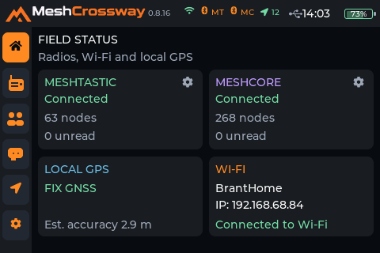
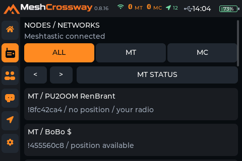
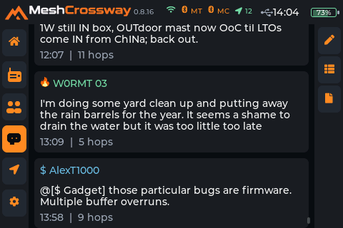
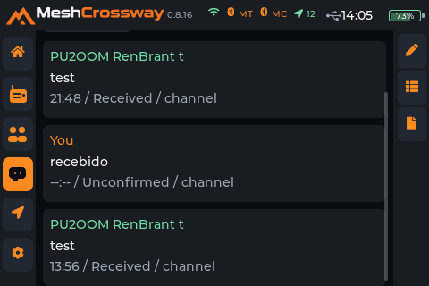
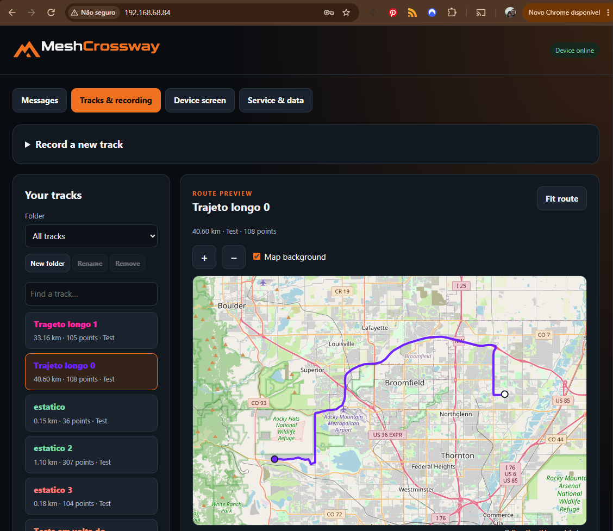
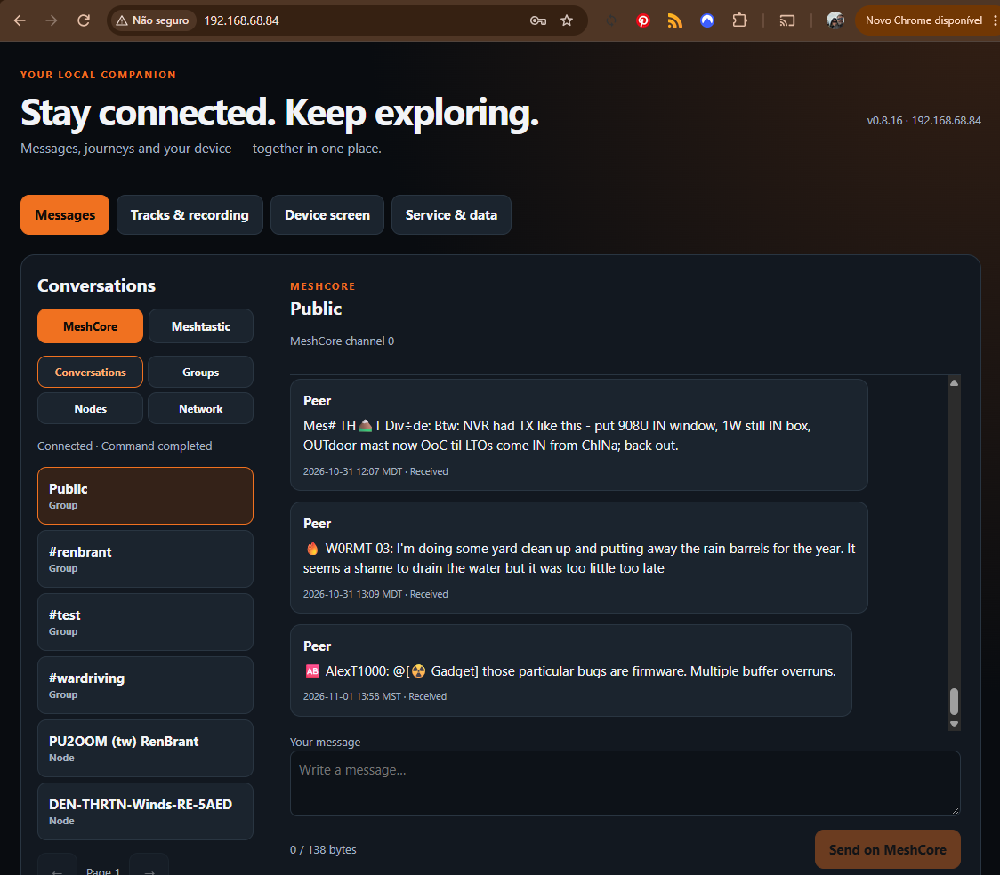

# MeshCrossway v0.8.16 — screenshots of working features

**Evidence supplied for the project record on 1 November 2026.** These captures show the
v0.8.16 firmware running on the MeshCrossway touchscreen and the device's local
browser companion. They record point-in-time operation; they are not a claim of
long-duration testing or universal compatibility with every radio firmware.

## Touchscreen device

### Home status — both mesh radios connected

The Home screen reports **Meshtastic Connected** and **MeshCore Connected** at
the same time. It also shows live node counts, local GNSS fix/estimated accuracy,
Wi-Fi state and direct settings shortcuts on both radio cards.

### Nodes and network filters

The Nodes/Networks screen displays the selected network and provides **All / MT /
MC** filters while listing native nodes.

### Device-side messages and conversations

The device message view renders sender, message text, local time and hop metadata.

Conversation history is available on the touchscreen and distinguishes received
messages from messages whose delivery is not confirmed.

## Local browser companion

The browser interface is served by the MeshCrossway device and accessed over the
local network. It is operating on the same device data; it is not a simulated
web prototype or cloud service.

### Tracks, folders and map preview

The Tracks & recording page shows folder selection and controls, a saved-track
list, route details and an interactive route preview. GPX files can be downloaded
from the browser as portable backups while the original track journal stays on
the device's microSD.

### Remote messaging

The Messages page provides separate MeshCore/Meshtastic selection, Conversations,
Groups, Nodes and Network views, message history, a composer and radio send
controls. Radio settings are available from the selected network's Network view.

## What this evidence establishes

- Both Meshtastic and MeshCore were connected concurrently in the v0.8.16 build.
- Network and conversation views were rendering on the physical touchscreen.
- The local browser companion was online and displaying message and track data.
- Track folders, route preview and local GPX backup workflow were available in
  the browser interface.
- Radio settings can be reached from the radio cards on Home and from the
  selected network's remote Network view.

The recommended stable release remains **v0.8.14** until v0.8.16 completes the
project's broader regression, compatibility and stability acceptance.
