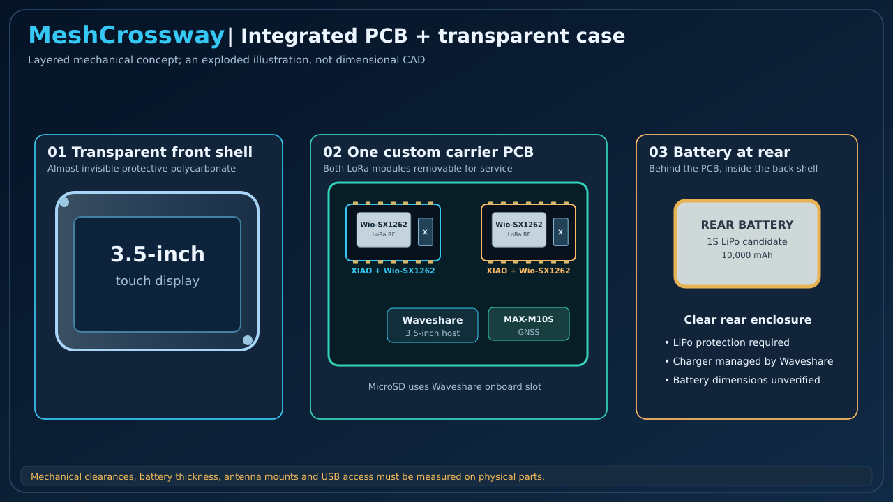
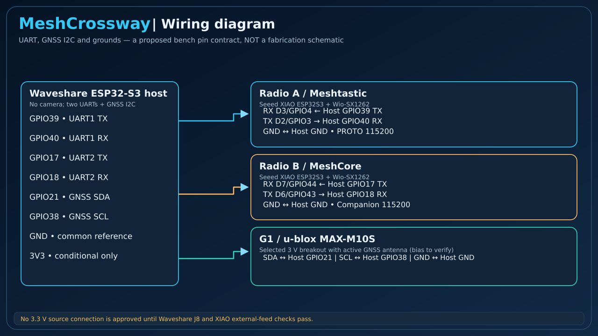

# MeshCrossway V1 — Seeed XIAO ESP32-S3 + Wio-SX1262 hardware and wiring

[README](../README.md) · [Power design](power-architecture.md) · [Serial APIs](radio-communication-architecture.md)

> **Current V1 hardware selection (2026-10-26):** two **Seeed Studio XIAO ESP32-S3 & Wio-SX1262 kits**, one running Meshtastic and one MeshCore Companion. No soldered prototype or PCB has been electrically validated.

## Physical assembly concept — one carrier PCB, rear battery




This assembly concept places the two Seeed XIAO/Wio kits and MAX-M10S breakout on **one custom carrier PCB** around the Waveshare display. The protected 1S LiPo pack is **behind the PCB**, not mounted next to the screen. These AI-assisted renders are approximate and **not exact supplier photos or mechanical CAD**. Verify real footprints, B2B stack height, charging safety and antenna clearances before layout approval.




## 1. Hardware inventory and buying links

| ID | Part | Quantity | Purpose |
|---|---|---:|---|
| U1 | [Waveshare ESP32-S3-Touch-LCD-3.5](https://www.amazon.com/dp/B0F3WS2W5R) | 1 | 480 × 320 display, touchscreen, ESP32-S3 host, microSD and PMIC |
| A | [Seeed XIAO ESP32-S3 & Wio-SX1262 kit](https://www.seeedstudio.com/Wio-SX1262-with-XIAO-ESP32S3-p-5982.html) | 1 | dedicated Meshtastic radio |
| B | [Seeed XIAO ESP32-S3 & Wio-SX1262 kit](https://www.seeedstudio.com/Wio-SX1262-with-XIAO-ESP32S3-p-5982.html) | 1 | dedicated MeshCore Companion radio |
| G1 | [Uputronics MAX-M10S breakout, 3 V variant](https://shop.wegmatt.com/products/uputronics-ublox-max-breakout-for-active-antennas?variant=44060220489751) | 1 | host-side u-blox GNSS over I²C |
| ANT-G | [Bingfu active GNSS antenna](https://www.amazon.com/dp/B0FL7PVF16) | 1 | candidate active GNSS antenna, bias/connector validation required |
| S1 | microSD for Waveshare onboard slot | 1 | storage, logs and future map assets |
| BAT | protected 1S LiPo compatible with Waveshare requirements | 1 | proposed portable power; verify protection, connector, current, enclosure |

The XIAO ESP32-S3 kit contains a 2.4 GHz Wi-Fi/BLE MCU with **8 MB flash and 8 MB PSRAM** plus a SX1262 operating across supported sub-GHz bands. It uses a **board-to-board (B2B)** connection between the XIAO and Wio daughterboard. A Wio module supplied for a **XIAO nRF52840** or an alternative **header-board variant** may use *different* wiring; do not substitute it based on its name. The SX1262 antenna uses a U.FL/IPEX connector; confirm antenna/pigtail suitability for the selected regional frequency and final enclosure.

**Cost planning:** Calculate the complete BOM using two Seeed kits, applicable taxes/shipping, RF pigtails and antennas, carrier PCB fabrication, battery and enclosure. Confirm purchase prices before publishing a total.

Manufacturer: [Seeed XIAO + Wio getting started](https://wiki.seeedstudio.com/xiao_esp32s3_%26_wio_SX1262_kit_for_meshtastic/) · [Meshtastic Seeed Wio support](https://github.com/meshtastic/meshtastic/blob/master/docs/hardware/devices/seeed-studio/wio-series/wio-sx1262.mdx).

## 2. Interfaces: external UART versus internal SX1262 B2B bus

Each kit contains two internally connected devices: a **XIAO ESP32-S3 MCU** and a **Wio SX1262 radio module**. The MCU controls the SX1262 via **internal SPI and GPIOs on the B2B connector**. The Waveshare communicates only with the **XIAO MCU** via a *separate* external UART API. Do not wire Waveshare GPIOs to the SX1262 SPI signals or DIO1/BUSY lines.

### Proposed host-to-XIAO serial connectivity


| Function | Waveshare U1 | XIAO A (Meshtastic) | XIAO B (MeshCore) | Status |
|---|---|---|---|---|
| Host UART1 TX → radio A RX | GPIO39 | **D7 / GPIO44 (RX)** | — | proposed, firmware configuration required |
| Radio A TX → host UART1 RX | GPIO40 | **D6 / GPIO43 (TX)** | — | proposed, firmware configuration required |
| Host UART2 TX → radio B RX | GPIO17 | — | **D7 / GPIO44 (RX)** | proposed, firmware configuration required |
| Radio B TX → host UART2 RX | GPIO18 | — | **D6 / GPIO43 (TX)** | proposed, firmware configuration required |
| Common logic reference | GND | GND | GND | mandatory |
| Central GNSS SDA / SCL | GPIO21 / GPIO38 | — | — | G1 SDA/SCL; verify host revision |
| Supplies | Waveshare J8 3V3 | XIAO 3V3 candidate | XIAO 3V3 candidate | **not electrically approved** |

**GPIO43/44** are the candidate XIAO external UART TX/RX signals. They may also be used for serial boot diagnostics and USB/debug workflows; verify that the exact Meshtastic serial module and MeshCore Companion build can bind the API to these pins without startup logging corrupting the binary stream. Wire **TX ↔ RX**, never TX ↔ TX. Baseline link target: **115200 baud, 8N1**, explicitly configured (the Meshtastic serial default is not necessarily 115200).

XIAO pins labeled **D6/D7** are board-pin names; the numbers **GPIO43/44** are ESP32-S3 native GPIO numbers. Do not confuse either with pins on the Wio SX1262 radio module.

### SX1262 internal B2B hardware (reference, NOT external host wiring)

The official XIAO ESP32-S3 Wio build has been reported with SX1262 SPI SCK=GPIO36, MISO=GPIO37, MOSI=GPIO35, NSS=GPIO7, RESET=GPIO4, DIO1=GPIO1, BUSY=GPIO2 and module enable=GPIO5. **These definitions are for the exact B2B kit only and must be checked against the firmware variant and schematic before using them in any custom build.** Alternative Wio header variants have different mappings. These GPIOs must not be reused as host UART pins. A complete source/board manifest must lock TCXO configuration and RF-switch control as well.

Reference discussion: [Meshtastic XIAO S3 RadioLib SPI pin details](https://github.com/meshtastic/firmware/discussions/6744). See [Seeed kit schematics](https://wiki.seeedstudio.com/xiao_esp32s3_%26_wio_SX1262_kit_for_meshtastic/).

## 3. Bench wiring

```text
                  Waveshare ESP32-S3-Touch-LCD-3.5
                    UART1 TX GPIO39  ----->  A XIAO D7 / GPIO44 RX
                    UART1 RX GPIO40  <-----  A XIAO D6 / GPIO43 TX
                    UART2 TX GPIO17  ----->  B XIAO D7 / GPIO44 RX
                    UART2 RX GPIO18  <-----  B XIAO D6 / GPIO43 TX
                    GND              ------- A GND / B GND / GNSS GND

                    I2C SDA GPIO21  <----->  MAX-M10S SDA
                    I2C SCL GPIO38  <----->  MAX-M10S SCL

        XIAO A --(internal B2B SPI)--> Wio SX1262 A -- antenna
        XIAO B --(internal B2B SPI)--> Wio SX1262 B -- antenna
```

The Waveshare GPIO39/40 and GPIO17/18 assignments assume the **camera is absent and disabled**. The board listing and Waveshare revision-specific J8 drawings disagree on pin numbering: locate contacts by printed **GPIO signal** and verified continuity, not by picture-position numbers. Reserve GPIO43/44 **on the Waveshare** for diagnostics; the same native numbers **on each XIAO** serve a different physical MCU and may be used for its external UART.

## 4. Firmware bring-up

1. Identify the exact Wio B2B kit and XIAO PCB revision. Test each separately via its own USB-C interface and an antenna connected.
2. Flash a **Seeed XIAO ESP32-S3 + Wio SX1262** Meshtastic image for A; enable the Serial module in `PROTO` mode using XIAO RX=44, TX=43 if that release supports that mapping. Validate actual framing, reboot and incoming messages; use the firmware target specifically built for the Seeed XIAO/Wio kit.
3. Flash a **Xiao_S3_WIO Companion** MeshCore variant for B, not repeater firmware. For external UART, verify the exact release source has `SERIAL_RX`/`SERIAL_TX` transport enabled and build with RX=44, TX=43 where feasible. USB/BLE Companion support **does not prove external hardware UART support**.
4. MeshCore's release/partition layout may require a **complete merged firmware image** on first flash to retain configuration. Check release instructions and verify region/name/settings survive a cold power cycle; do not blindly flash an app-only image to a blank target.
5. Capture UART framing with each kit alone; then connect both to Waveshare and test concurrency, reconnect and isolation. Preserve both separate USB ports for maintenance.

Upstream MeshCore FAQ explicitly lists **Xiao S3 WIO** as supported; [Seeed's MeshCore guide](https://wiki.seeedstudio.com/pt-br/get_started_with_esp32s3_meshcore/) discusses merged images and persistent settings. The exact external-UART mode is **a design gate, not yet verified on this board**.

## 5. Power / RF / mechanical gates


Power distribution via Waveshare AXP2101 and J8 3V3 remains a **candidate**, not an electrical recommendation that is safe to energize. The Seeed XIAO has its own regulator, LiPo charger and USB circuitry; determine whether feeding its **3V3** rail externally is supported and isolated, and test reverse-current paths if USB or battery is connected. Never tie two chargers or their battery pads together. Use independent USB supplies for initial tests plus signal GND common. Check 3V3 load margin, radio TX current pulses, rail startup, powered-off I/O injection and local decoupling. See [power study](power-architecture.md).

The XIAO's smaller footprint does not reduce the electrical separation needed by two simultaneous nearby RF transmitters. Mount the antennas apart, verify suitable 915 MHz antennas for US deployment, and characterize desensitization during simultaneous TX/RX.

For carrier PCB: use footprints matching the **specific XIAO + Wio B2B kit stacking geometry**; leave USB-C accessible for firmware service, reserve UART test pads, and consider controlled reset and switched power **only after verifying available pins and safe shutdown behavior**. No final mechanical clearance, stack height, antenna pigtail path or footprint is approved yet.

## 6. Required validations

- Board ID and pinout with actual hardware (all external UART and internal SX1262 pin reservations)
- Meshtastic PROTO on external XIAO UART at configured baud, without debug contamination
- MeshCore Companion on external XIAO UART with persisted settings
- Two simultaneous independent UARTs, power-cycle and queue recovery
- J8 spare-current, 3V3 topology, charging/backfeed, brownout and RF TX-current measurement
- RF coexistence and antenna placement
- GNSS antenna bias/current and I²C compatibility
- Prove route behavior separately for both firmware releases; zero-hop remains unverified

**Design decision:** two XIAO ESP32-S3 + Wio SX1262 kits are selected for V1 documentation and bench evaluation; PCB release awaits the gates above.
