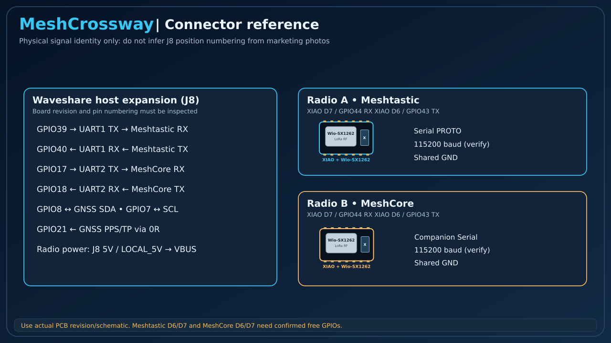
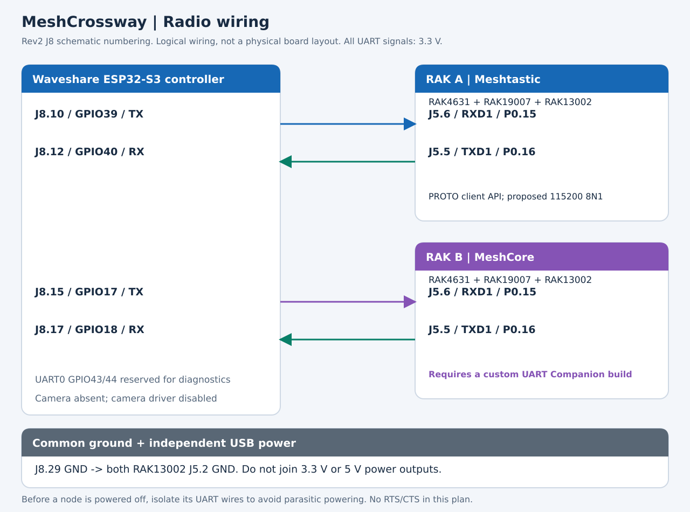
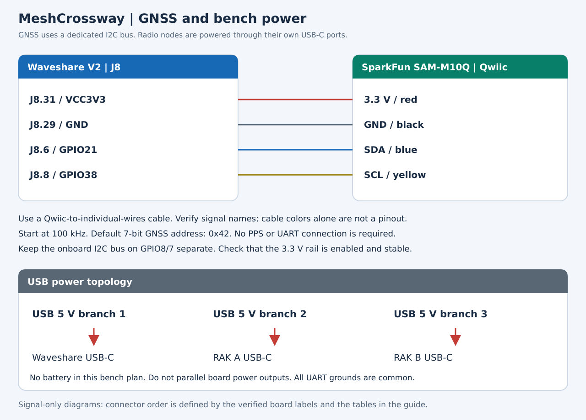

# Bench prototype: component-by-component wiring

[Back to README](../README.md)

**Status: schematic-reviewed wiring proposal; not bench-tested.** This guide specifies a concrete connection plan for the selected components. It does not imply that MeshCrossway firmware or the MeshCore UART adaptation has been built or validated.

**Board restriction:** the controller pin numbers below refer exclusively to the **Waveshare ESP32-S3-Touch-LCD-3.5 Rev2.0 schematic, connector J8, 2 x 16 pins**. They do not apply to the 3.5B or to an unidentified board revision.

The manufacturer's product page also contains a 26-pin illustration that differs from the 32-pin J8 in its Rev2 PDF. Before using numbered connections, match your PCB revision, connector size, pin-1 mark, and signal labels to that PDF. If they differ, stop and remap from the correct schematic. Do not count positions from the older illustration.

All illustrations below are original vector diagrams of electrical relationships. **They are not photographs, PCB placement drawings, or instructions for connector viewing orientation.**

## 1. Components and assembly

| ID | Component | Assembly or connection |
|---|---|---|
| U1 | Waveshare ESP32-S3-Touch-LCD-3.5, Rev2, no camera | Central controller; onboard display, touch, and microSD slot |
| A | RAK4631 + RAK19007 + RAK13002 | Meshtastic node; RAK4631 in Core slot, RAK13002 in IO slot |
| B | RAK4631 + RAK19007 + RAK13002 | MeshCore node; same mechanical assembly as A |
| G1 | SparkFun SAM-M10Q Qwiic breakout, GPS-21834 | Separate GNSS board; Qwiic-to-individual-wires cable |
| S1 | microSD card | Insert in U1's onboard TF/microSD slot |
| ANT-A, ANT-B | Suitable regional LoRa antennas | One per RAK4631 LoRa connector |
| P1, P2, P3 | USB 5 V power branches and USB-C cables | One branch per controller/radio baseboard |

Seat WisBlock connectors squarely and secure the modules with the supplied screws, following the RAK assembly guide. Do not install a separate GNSS module on the RAK boards: the selected UART pair must remain available.

For the bench, use short jumper wires, a ground distribution point, and headers compatible with the actual assemblies. Check whether the supplied RAK13002 and Waveshare connectors require ordinary through-hole soldering. Do not substitute bare SAM-M10Q modules for the SparkFun breakout.

## 1.1. Purchase links and reference prices

**Price review: October 24, 2026. Currency: USD.** Prices exclude shipping, sales tax, import charges, discounts, and assembly labor. These are reference prices, not a checkout quote. Reuse suitable supplies, cables, jumpers, and a microSD card you already own.

The Waveshare price is the publicly indexed catalog range; live access to its product page was blocked during this review, so the exact no-case variant price and V2 stock remain to be confirmed. RAK's generic kit starts at $19.50, but that starting price belongs to other core options: **the selected RAK4631 Arduino + RAK19007 US915 variant is $24.99**, as checked in the seller's product variant data.

### Terminal: required hardware and assembly accessories

| Qty | Component and purchase link | Exact selection / purpose | Unit price | Line total |
|---:|---|---|---:|---:|
| 1 | [Waveshare ESP32-S3-Touch-LCD-3.5](https://www.waveshare.com/esp32-s3-touch-lcd-3.5.htm) | **Without case**, SKU **30733**; request/confirm Rev2 and J8 before ordering; not 3.5B | $25.99–$32.99 catalog range | $25.99–$32.99 |
| 2 | [RAK WisBlock Starter Kit — selected US915 variant](https://store.rakwireless.com/products/wisblock-starter-kit?variant=41786685063366) | **RAK19007 + RAK4631, Arduino, US915**, SKU **116013**; one for A and one for B | $24.99 | $49.98 |
| 2 | [RAK13002 IO module](https://store.rakwireless.com/products/adapter-module-rak13002) | SKU **100029**, one per terminal radio; verify J5 headers are assembled | $6.00 | $12.00 |
| 1 | [SparkFun SAM-M10Q Qwiic GNSS breakout](https://www.sparkfun.com/sparkfun-gps-breakout-chip-antenna-sam-m10q-qwiic.html) | **GPS-21834**, complete breakout with integrated antenna | $51.50 | $51.50 |
| 1 | [SparkFun flexible Qwiic-to-breadboard cable](https://www.sparkfun.com/flexible-qwiic-cable-breadboard-jumper-4-pin.html) | **PRT-17912**, 150 mm; Qwiic to four male 2.54 mm contacts | $1.95 | $1.95 |
| 1 | [SparkFun microSD card, 1 GB, Class 4](https://www.sparkfun.com/microsd-card-1gb-class-4.html) | **COM-15107**; economical initial message/log storage candidate; validate formatting and driver support | $5.50 | $5.50 |
| 1 pack | [Adafruit female/male jumpers, 20 × 150 mm](https://www.adafruit.com/product/1954) | **1954**; female ends fit RAK13002 male pins, male ends fit U1 sockets or breadboard | $1.95 | $1.95 |
| 1 pack | [Adafruit male/male jumpers, 20 × 150 mm](https://www.adafruit.com/product/1957) | **1957**; U1 socket to common-ground breadboard and short links | $1.95 | $1.95 |
| 1 | [Adafruit half-size breadboard, 400 points](https://www.adafruit.com/product/64) | **64**; common-ground distribution and temporary test connections | $4.95 | $4.95 |
| | **Terminal parts subtotal, before additional USB power/cable** | | | **$155.77–$162.77** |

A 1 GB card is a cost-driven candidate for the first messaging bench, not a capacity commitment for future offline maps. Reuse a suitable larger card if available; buy only one card. The exact card and filesystem still need validation.

**Do not buy the RAK4631 cores or RAK19007 bases separately in addition to these kits.** Each selected kit lists a base, core, LoRa antenna, BLE antenna, USB-C cable, and screws. Use its supplied LoRa antenna initially; no extra antenna, pigtail, or radio display is budgeted. Both terminal kits can be identical hardware: they receive different firmware. Buying a LoRaWAN kit does not make it ready for these mesh protocols without flashing.

### USB power: purchase only what is missing

| Qty for the terminal | Component and purchase link | Selection / purpose | Unit price | Maximum additional cost shown |
|---:|---|---|---:|---:|
| 3 | [SparkFun USB wall charger, 5 V / 2 A](https://www.sparkfun.com/usb-wall-charger-5v-2a.html) | **TOL-16893**; one USB-A supply per U1, A, and B; reuse equivalent regulated supplies if owned | $9.50 | $28.50 |
| 1 | [Adafruit USB-A to USB-C data/power cable, approximately 1 m](https://www.adafruit.com/product/4474) | **4474**; extra cable for U1, assuming the two radio kits supply suitable cables | $4.95 | $4.95 |

The terminal requires three powered USB connections, not three additional supplies if you already have suitable equipment. The table assumes the bundled radio cables have USB-A ends compatible with the listed chargers; check the shipment, and add $4.95 per missing compatible cable if needed. Bench current and voltage margin must still be measured.

### Optional: two remote radio peers for reproducible tests

If you do not already have compatible peers, add these to test both networks independently of local community coverage:

| Additional qty | Component and purchase link | Purpose | Unit price | Line total |
|---:|---|---|---:|---:|
| 2 | [Same RAK4631 + RAK19007 Arduino US915 kit](https://store.rakwireless.com/products/wisblock-starter-kit?variant=41786685063366) | One remote Meshtastic peer and one remote MeshCore peer; includes their antennas and USB cables | $24.99 | $49.98 |
| Up to 2 | [SparkFun 5 V / 2 A USB chargers](https://www.sparkfun.com/usb-wall-charger-5v-2a.html) | Remote-peer power if suitable supplies are not already available | $9.50 | $19.00 |

These peers **do not need RAK13002 modules** for ordinary USB/BLE client testing. The optional full bench therefore has four radio kits total, but still only two IO adapters.

### Budget summary

| Scenario | Reference total |
|---|---:|
| Terminal parts and assembly accessories; reuse USB power and cables | **$155.77–$162.77** |
| Terminal above + three new chargers + one extra USB cable | **$189.22–$196.22** |
| Complete bench above + two remote kits + two more chargers | **$258.20–$265.20** |

Totals assume the exact quantities above, the listed kit contents, and no missing headers. They exclude tools, mounting hardware beyond kit contents, a card reader, and any parts needed for future powered-off signal protection.

If the RAK13002 ships without J5 headers, a conditional option is one [Adafruit 16-pin breakaway male-header pack, five strips, ID 400](https://www.adafruit.com/product/400), listed at **$3.00 per pack**. Cut two 8-position sections and confirm fit, contact length, and clearance before soldering; this extra-long header option is not automatically required or included in totals.

**Before checkout:** confirm U1's Rev2 connector, choose RAK4631 Arduino rather than another core or RUI3, and retain the MeshCore UART firmware prerequisite in section 4. This list prices the proposed bench hardware; it does not certify a working assembly.

## 2. Controller ports and GPIO allocation

### Selected external connections

`J8.10` means **connector J8, physical pin 10**. It does not mean GPIO10.

| U1 connector | ESP32 signal | Assigned function | Destination |
|---|---|---|---|
| J8.10 | GPIO39 | UART1 TX, Meshtastic | A: RAK13002 J5.6, RXD1 |
| J8.12 | GPIO40 | UART1 RX, Meshtastic | A: RAK13002 J5.5, TXD1 |
| J8.15 | GPIO17 | UART2 TX, MeshCore | B: RAK13002 J5.6, RXD1 |
| J8.17 | GPIO18 | UART2 RX, MeshCore | B: RAK13002 J5.5, TXD1 |
| J8.6 | GPIO21 | Dedicated GNSS I2C SDA | G1: Qwiic SDA |
| J8.8 | GPIO38 | Dedicated GNSS I2C SCL | G1: Qwiic SCL |
| J8.29 | GND | Ground distribution | A J5.2, B J5.2, G1 GND |
| J8.31 | VCC3V3 | GNSS supply, subject to rail/load verification | G1: Qwiic 3.3 V |

UART1/UART2 here are **ESP32 peripheral assignments chosen for this project**. The firmware must explicitly route them to these GPIOs. They are independent of the RAK's own UART numbering.

This supersedes the earlier preliminary suggestion to use GPIO43/44 for Meshtastic. Those are the ESP32 UART0 pins and are reserved for diagnostics here, reducing the risk of boot/debug output reaching the radio API. GPIO39/40, 17/18, and 21/38 are shared with the camera interface: **leave the camera disconnected and do not initialize its driver.**

### Leave these external header connections unused

| Connection | Reason |
|---|---|
| J8.1 VBUS and J8.2 VBAT | Not part of the external power plan |
| J8.5 / GPIO19 and J8.7 / GPIO20 | Native USB D-/D+; reserve for USB |
| J8.9 / GPIO11, J8.11 / GPIO10, J8.13 / GPIO9 | Already connected to onboard microSD |
| J8.19 / GPIO0, J8.21 / ESP_EN, J8.23 / PWRON | Boot/reset/power controls |
| J8.25 / GPIO7 and J8.27 / GPIO8 | Onboard I2C bus, kept separate from GNSS |
| J8.26 / GPIO43 and J8.28 / GPIO44 | UART0 diagnostics |
| Other unused pins | No jumper connection needed |

Source: [Waveshare Rev2.0 schematic](https://files.waveshare.com/wiki/ESP32-S3-Touch-LCD-3.5/ESP32-S3-Touch-LCD-3.5_Rev2.0.pdf), also available in the [manufacturer's hardware repository](https://github.com/waveshareteam/ESP32-S3-Touch-LCD-3.5/tree/main/hardware/schematic).

## 3. RAK node A: Meshtastic

Power off all boards before attaching jumpers. The following three signal wires connect A to U1; **no power wire runs from U1 to A**.

| Wire | From | To | Direction / purpose |
|---|---|---|---|
| A-TX | U1 J8.10, GPIO39 | A J5.6, RXD1, nRF P0.15 | ESP32 output to RAK input |
| A-RX | A J5.5, TXD1, nRF P0.16 | U1 J8.12, GPIO40 | RAK output to ESP32 input |
| A-GND | U1 ground distribution point | A J5.2, GND | Common signal reference |

**RAK13002 connector distinction:** the accessible 8-pin UART/analog header is **J5**. Its pin 5 is TXD1 and pin 6 is RXD1. The 40-pin WisConnector's TXD1/RXD1 positions are 33/34; those are not J5 jumper positions. The enlarged RAK schematic confirms the J5 signal names used here.

Leave J5.1 (VCC), J5.3/4 (TXD0/RXD0), and J5.7/8 (analog inputs) open.

### Required Meshtastic configuration

The documented RAK4631/RAK19007 serial pair is TX 16 and RX 15. Configure:

| Setting | Bench target |
|---|---|
| Physical GPS mode | `NOT_PRESENT` |
| Serial module enabled | `true` |
| Serial mode | `PROTO` |
| Serial TXD | `16` |
| Serial RXD | `15` |
| Baud | Explicitly select `115200` on both ends; project choice, not the module default |
| Framing | 8 data bits, no parity, 1 stop bit; no RTS/CTS wiring |

Use the configuration tool supported by the frozen firmware version. Confirm its accepted enum/value syntax rather than copying display labels into an untested command. `PROTO` is a binary Protobuf client interface; plain text written to it is not a valid chat command. Keep logs off the API UART.

Sources: [Meshtastic serial configuration](https://meshtastic.org/docs/configuration/module/serial/), [RAK13002 datasheet and schematic](https://docs.rakwireless.com/product-categories/wisblock/rak13002/datasheet/).

## 4. RAK node B: MeshCore

| Wire | From | To | Direction / purpose |
|---|---|---|---|
| B-TX | U1 J8.15, GPIO17 | B J5.6, RXD1, nRF P0.15 | ESP32 output to RAK input |
| B-RX | B J5.5, TXD1, nRF P0.16 | U1 J8.17, GPIO18 | RAK output to ESP32 input |
| B-GND | U1 ground distribution point | B J5.2, GND | Common signal reference |

Leave B J5.1, J5.3/4, and J5.7/8 open. Do not wire A directly to B.

### Firmware prerequisite: not plug-and-play yet

The reviewed upstream RAK4631 variant defines `PIN_SERIAL1_RX = 15` and `PIN_SERIAL1_TX = 16`. This establishes an available pin mapping, **not a ready-to-use Companion UART firmware image**.

The custom target must bind the Companion transport to that physical UART, choose and document its framing, keep debug output separate, and implement the expected serial framing. The proposed target is **115200 baud, 8N1, no hardware flow control**. It is not claimed to be the behavior of an existing stock image.

Before treating B as operational, validate device identification, contact synchronization, transmission, reception, and reconnection through J5.5/6. A stock Companion USB or BLE build does not automatically perform this binding.

Sources: [MeshCore RAK4631 variant](https://github.com/meshcore-dev/MeshCore/blob/main/variants/rak4631/variant.h), [Companion implementation](https://github.com/meshcore-dev/MeshCore/tree/main/examples/companion_radio), [Companion documentation](https://docs.meshcore.io/companion_protocol/). The documentation includes BLE-specific transport details; use the serial implementation for actual UART framing.

## 5. GNSS: SparkFun SAM-M10Q Qwiic

Use one Qwiic-to-individual-wires cable. Connect either Qwiic socket on G1; leave the other unused.

| U1 connection | G1 Qwiic signal | Usual Qwiic cable color | Purpose |
|---|---|---|---|
| J8.31, VCC3V3 | 3.3 V | Red | Power |
| Ground distribution from J8.29 | GND | Black | Ground |
| J8.6, GPIO21 | SDA | Blue | Bidirectional I2C data |
| J8.8, GPIO38 | SCL | Yellow | I2C clock |

Check signal labels and cable continuity; colors alone do not establish pin order. Never apply USB 5 V to a Qwiic power or data pin. Before connecting G1, measure J8.31 relative to ground and verify a stable 3.3 V rail, then verify it under GNSS load. The available regulator margin has not been measured for the complete assembly.

Use the second ESP32 I2C controller for this dedicated bus, initially at **100 kHz**. The default unshifted **7-bit address is `0x42`**. Keep the manufacturer's onboard I2C driver on GPIO8/7; do not globally reassign that bus to GPIO21/38.

G1 already has pull-ups through its I2CPUR jumper. Do not add another set by default. Leave PPS, UART TX/RX, INT, SAFE, and RST unconnected. Mount the integrated GNSS antenna with an unobstructed sky view and away from the LoRa antennas and noisy power wiring.

Sources: [SparkFun hardware overview](https://docs.sparkfun.com/SparkFun_u-blox_SAM-M10Q/hardware_overview/), [SparkFun schematic](https://docs.sparkfun.com/SparkFun_u-blox_SAM-M10Q/assets/board_files/SparkFun_u-blox_SAM-M10Q.pdf), [SAM-M10Q datasheet](https://docs.sparkfun.com/SparkFun_u-blox_SAM-M10Q/assets/component_documentation/SAM-M10Q_DataSheet_UBX-22013293.pdf).

## 6. Display, touch, and microSD

These components are already connected inside U1. **Do not run external jumper wires to them.** Use the matching Waveshare example/BSP as the baseline.

| Onboard function | Existing connection in the Rev2 schematic |
|---|---|
| LCD SPI | MOSI GPIO1, MISO GPIO2, SCLK GPIO5, DC GPIO3 |
| LCD control | Backlight GPIO6; reset through TCA9554 EXIO1; CS tied low |
| Touch | SDA GPIO8, SCL GPIO7; interrupt through TCA9554 EXIO2 |
| microSD | D0 GPIO9, CMD GPIO10, CLK GPIO11; use the corresponding 1-bit SDMMC wiring |
| Card detection, V2 | TCA9554 EXIO3, with shared/optional interrupt connections in the schematic |

Insert the card with power off for initial assembly. Firmware must initialize the PMIC/IO expander as required by the board examples. A display driver alone does not initialize every onboard peripheral.

Do not attach an external SPI peripheral to header pins 9/11/13 while using the onboard card without redesigning bus ownership. The diagram's SD labels identify the existing SDMMC signals, not three spare pins.

Source: [Waveshare Rev2 schematic and examples](https://docs.waveshare.com/ESP32-S3-Touch-LCD-3.5/Resources-And-Documents).

## 7. Power, ground, and shutdown behavior

| Device | Power entry | External power connections to other boards |
|---|---|---|
| U1 controller | Its own USB-C, 5 V | Supplies G1 only through the verified 3.3 V rail |
| A Meshtastic | RAK19007 USB-C, 5 V | None |
| B MeshCore | RAK19007 USB-C, 5 V | None |
| G1 GNSS | U1 J8.31, 3.3 V through Qwiic | None |

Use a suitable regulated USB supply or independently powered USB branches. A hub is not a data requirement for this architecture. A multiport supply remains a common point of failure.

Join U1 J8.29, A J5.2, B J5.2, and G1 GND through a secure ground distribution point. **Do not parallel the boards' 3.3 V, VBUS, or battery outputs.** Battery and solar connectors remain unused in this bench plan.

All UARTs are 3.3 V logic; they are not RS-232 or RS-485. No level translator is proposed between these selected boards.

**An unpowered board can receive current through UART protection paths.** For an initial manual disconnection test, detach the affected node's TX/RX wires before removing its USB power. Likewise isolate radio signals before switching off only U1. Ground remains connected while any signal connection remains. Safe independent power switching with live signal wires needs an additional design, such as appropriately specified powered-off-protected buffers; it is not solved by the jumpers in this guide.

## 8. Antennas and remote test nodes

Attach ANT-A and ANT-B to the respective **LoRa** RF connectors on the RAK4631 boards, using compatible supplied antennas or verified pigtails. Do not confuse the LoRa and BLE antenna connections. Avoid pulling sideways on miniature coax connectors.

Attach antennas before enabling transmission. Start with separated radio/antenna assemblies, approximately 1 m apart as a repeatable bench geometry, and measure coexistence before reducing spacing. This is a test setup, not a guaranteed isolation distance. Select legal regional profiles and power before any radiated test.

The two optional remote peers connect only by radio. Each needs its own firmware, antenna, power, and compatible settings: one Meshtastic peer and one MeshCore peer. There are no jumper wires from those peers to U1.

References: [RAK4631 antenna and hardware documentation](https://docs.rakwireless.com/product-categories/wisblock/rak4631/datasheet/), [RAK19007 documentation](https://docs.rakwireless.com/product-categories/wisblock/rak19007/).

## 9. Assembly and verification sequence

1. **Identify U1.** Match the Rev2 PCB and 32-pin J8 to the source schematic. Locate pin 1; check ground pins with the unpowered board. If the connector differs, do not use these physical numbers.
2. **Test each board alone.** Confirm the display/touch and card with vendor examples; load and configure each radio independently. Avoid unintended autonomous RF transmissions during setup.
3. **Assemble with everything off.** Mount the Core/IO modules, attach antennas, and wire common ground. Check for power shorts and connector offsets.
4. **Connect A only.** Verify the binary client API at the configured baud; exchange messages with the Meshtastic peer. Do not connect an extra USB-UART transmitter to the same RX line.
5. **Connect B after its custom build is ready.** Verify framing and identify the node before attempting messaging. A wiring check cannot substitute for the missing transport implementation.
6. **Add G1.** Verify 3.3 V first, detect address 0x42 on the dedicated I2C bus, and confirm valid positioning data. A detected address is not proof of a valid fix.
7. **Run the onboard peripherals together.** Verify touch response, SD writes, GNSS polling, and both UART streams without data corruption or rail collapse.
8. **Exercise recovery.** Use signal isolation before a one-board power-off test. Verify the unaffected adapter and stored history remain accessible.
9. **Record the actual build.** Save PCB revisions, firmware commits, serial parameters, cable mapping, current measurements, and any changes from this proposal.

No connection in this document has been bench-verified by this repository. Publish test results before relabeling this proposal as a validated assembly guide.

## 10. Source and revision record

| Source | Used for |
|---|---|
| Waveshare ESP32-S3-Touch-LCD-3.5 Rev2.0 PDF, J8 and GPIO table | Controller connector numbering and shared peripheral nets |
| RAK13002 official schematic, J5 | Accessible UART and ground positions |
| Meshtastic serial module documentation | PROTO configuration and RAK TX/RX selection |
| MeshCore `variants/rak4631/variant.h`, reviewed blob `38cc88685c073bd5430d3f13f2e5ce463e97a996` | Target UART mapping; not proof of an operational Companion UART build |
| SparkFun GPS-21834 schematic and hookup guide | GNSS supply, I2C connections, pull-ups, and address |

The linked upstream pages can change. Recheck the actual board revision and freeze source/firmware snapshots when preparing a reproducible hardware release.
