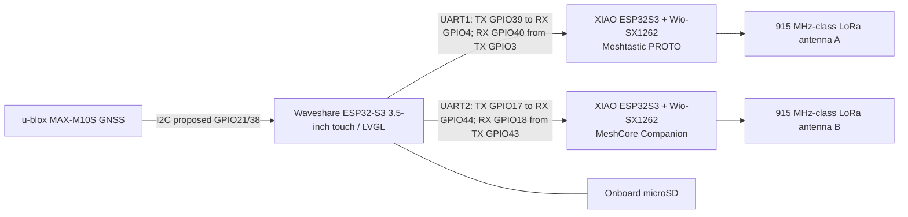

# MeshCrossway V1 — XIAO ESP32S3 + Wio-SX1262 wiring and BOM

[Project README](../README.md) · [Radio software interfaces](radio-communication-architecture.md) · [Power validation](power-architecture.md)

> **Decision: 2026-10-26. Proposed, not electrically tested.** Two identical Seeed Studio XIAO ESP32S3 + Wio-SX1262 kits replace the earlier Aideepen/Heltec V3 two-pack. Prior Heltec pin assignments, headers, images, and pricing are **obsolete** for V1. Do not use earlier wiring SVGs as assembly instructions until revised. Review the actual board schematic, pin exposure, and firmware variant before fabrication.

## Illustrated system

## Selected hardware (purchase reference, not a certified assembled design)

| Ref | Quantity | Selected component | Action |
|---|---:|---|---|
| U1 | 1 | Waveshare ESP32-S3-Touch-LCD-3.5 (no camera) | Retain |
| A, B | **2 kits** | [Seeed XIAO ESP32S3 + Wio-SX1262](https://www.seeedstudio.com/Wio-SX1262-with-XIAO-ESP32S3-p-5982.html) | **New V1 radio design**: A Meshtastic, B MeshCore |
| G1 | 1 | u-blox MAX-M10S breakout, selected 3 V variant | Retain, verify I2C and active-antenna bias |
| ANT-G | 1 | Bingfu GNSS active antenna candidate | Retain pending antenna-bias testing |
| ANT-A, ANT-B | 2 | Region-appropriate 50-ohm LoRa antenna and compatible RF cable/connector | Verify kit contents, U.FL attachment, antenna placement and US915 match |
| SD | 1 | microSD in Waveshare | Retain |
| PWR | 1 | Waveshare AXP2101 battery management + protected 1S battery | Conditional on J8 3V3 spare-current testing |
| CARRIER | 1 | Removable XIAO sockets / serviceable mounts, RF strain relief, UART test pads, per-radio isolation options | New mechanical/electrical layout |

At the previously discussed **US$10.99 per kit**, two radio kits total **US$21.98 before shipping/tax** (indicative listing price; check checkout). Remove the earlier US$39.99 Aideepen two-pack from the active BOM. XIAO board footprint is about 21 × 17.8 mm; the assembled Wio add-on, mating stack, antenna connector, clearance and enclosure footprint must be measured separately. Never substitute XIAO-only dimensions for assembled module envelope.

## UART wiring — provisional pin-level contract

| Link | Waveshare controller | XIAO board | Direction |
|---|---|---|---|
| Meshtastic host TX | UART1 GPIO39 | **D3 / GPIO4, RX** | host → A |
| Meshtastic host RX | UART1 GPIO40 | **D2 / GPIO3, TX** | A → host |
| MeshCore host TX | UART2 GPIO17 | **D7 / GPIO44, RX** | host → B |
| MeshCore host RX | UART2 GPIO18 | **D6 / GPIO43, TX** | B → host |
| Both links | GND | GND | common 0 V reference |

**Important:** D2/D3 are **proposed configurable** pins for Meshtastic Serial PROTO; do not assume that the stock binary has UART on these pins. D6/D7 are the XIAO's labeled hardware UART pins and **proposed** for MeshCore Serial Companion, contingent on the actual firmware variant and successful serial validation. Check current Meshtastic Serial Module RXD/TXD GPIO restrictions and firmware pin maps. Confirm that the Wio-SX1262 expansion uses none of these pins on the installed hardware. Both links: **3.3 V UART, 115200 8N1, crossed TX/RX, common ground**, no 5 V TTL. Keep camera disabled on the Waveshare; GPIO39/40 and GPIO17/18 remain reserved for the two host UARTs, pending revision-specific verification.

### Meshtastic A

Flash the **Seeed XIAO ESP32S3 / Wio-SX1262** *supported target*, not Heltec V3. Enable Meshtastic **Serial Module** in **PROTO** mode: `serial.enabled=true`, `serial.mode=PROTO`, `serial.rxd=4`, `serial.txd=3`; choose and verify **115200 baud** on the specific firmware release. Confirm actual pins with a loopback/logic analyzer and Meshtastic Protobuf ToRadio/FromRadio frames before connecting the host. Avoid using GPIO43/44 for Meshtastic until the target's Serial Module pin validation is checked.

### MeshCore B

Use the **XIAO ESP32S3 + Wio-SX1262 MeshCore Companion radio** firmware variant that explicitly supports **serial UART**, not a BLE-only or USB-only Companion build and not a repeater image. Candidate UART mapping: `SERIAL_RX=44`, `SERIAL_TX=43`, 115200 baud; **build flags and actual firmware pin selections must be confirmed upstream**. The controller must implement MeshCore's binary Companion protocol, not Meshtastic Protobuf.

## Power architecture and safety gates

The selected V1 power design remains the **Waveshare AXP2101 charger/power management and a conditional shared J8 3V3 rail**. The integrated XIAO battery/charge functionality must **not** be wired in parallel to the Waveshare charger or used as an additional system charger. With the assembled XIAO + Wio kits, inspect whether the XIAO **3V3 pin accepts external regulated supply without backfeeding the onboard regulator or USB path**. Until independently verified, use separately isolated/current-limited test power, common signal ground, and avoid simultaneously attaching host 3V3 and radio USB. Prevent UART back-powering when either radio is off. Do not infer available J8 current from the AXP2101 2 A DCDC1 datasheet figure. Measure XIAO/Wio idle, RX, TX, dual-TX, Wi-Fi/BLE off/on as applicable, GNSS and LCD/microSD peaks **before** committing power wiring.

## RF coexistence and mechanical requirements

- Two SX1262 transmitters in the same US915-band enclosure can cause receiver desensitization, even though each radio runs an independent protocol. Prefer separated external antennas, high-quality U.FL-to-panel-SMA pigtails, cable strain relief, and RF isolation testing; coordinate TX if necessary.
- Use antenna appropriate to **configured regional LoRa settings**, not only to the hardware's supported frequency range; adhere to applicable FCC/regional RF rules.
- Place both XIAO/Wio kits on accessible, removable mounts; check assembled module height, ground copper keepouts, U.FL cable bend radius, touch/display clearance and GNSS noise.
- Do not transmit with an unmatched or disconnected antenna. The two RF outputs must not be electrically tied together.

## Mandatory acceptance checklist

- [ ] Confirm shipped XIAO ESP32S3 and Wio-SX1262 board revisions, exact combined footprint, connector mating, antenna RF path, accessible pins and Wio GPIO occupancy.
- [ ] Confirm Meshtastic official XIAO/Wio firmware target, Serial PROTO on GPIO3 TX / GPIO4 RX, readback and binary framing.
- [ ] Confirm MeshCore XIAO/Wio **serial Companion** image/build flags, UART GPIO43 TX / GPIO44 RX, command-response and async event framing.
- [ ] Confirm Waveshare expansion pin labels / J8 numbering against received revision; UART GPIO39/40, GPIO17/18 with camera disabled and GNSS I2C GPIO21/38 without LCD, touch or microSD conflicts.
- [ ] Verify 3V3 supply **input path** and power isolation for each assembled kit, plus powered-off UART states.
- [ ] Measure all operating currents and regulator/transient headroom; only then approve J8 shared-3V3 architecture or choose an external regulated branch.
- [ ] Test independent radio reboot/recovery, simultaneous radio receive/transmit, RF desense and antenna separation.
- [ ] Regenerate/check all mechanical diagrams and PCB from this contract; bench-test before any production claims.

## Primary references

- [Seeed Wio-SX1262 + XIAO ESP32S3 kit](https://www.seeedstudio.com/Wio-SX1262-with-XIAO-ESP32S3-p-5982.html)
- [Seeed XIAO ESP32S3 documentation](https://wiki.seeedstudio.com/xiao_esp32s3_getting_started/)
- [Meshtastic Serial Module](https://meshtastic.org/docs/configuration/module/serial/)
- [Meshtastic official firmware](https://github.com/meshtastic/firmware)
- [MeshCore upstream](https://github.com/meshcore-dev/MeshCore)
