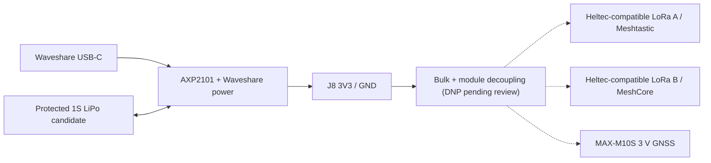
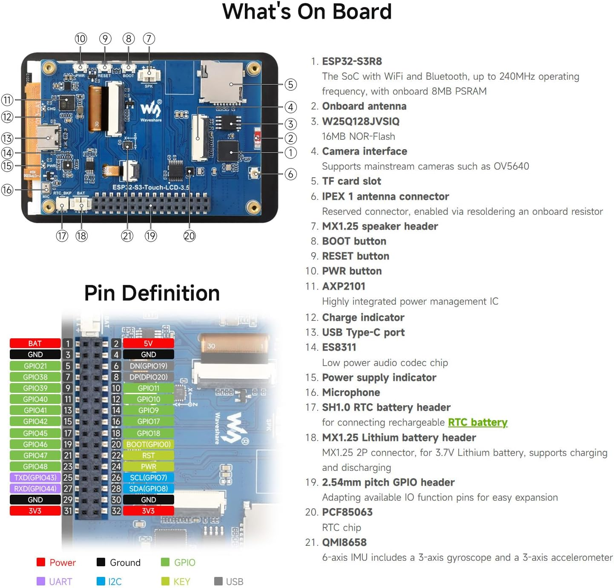
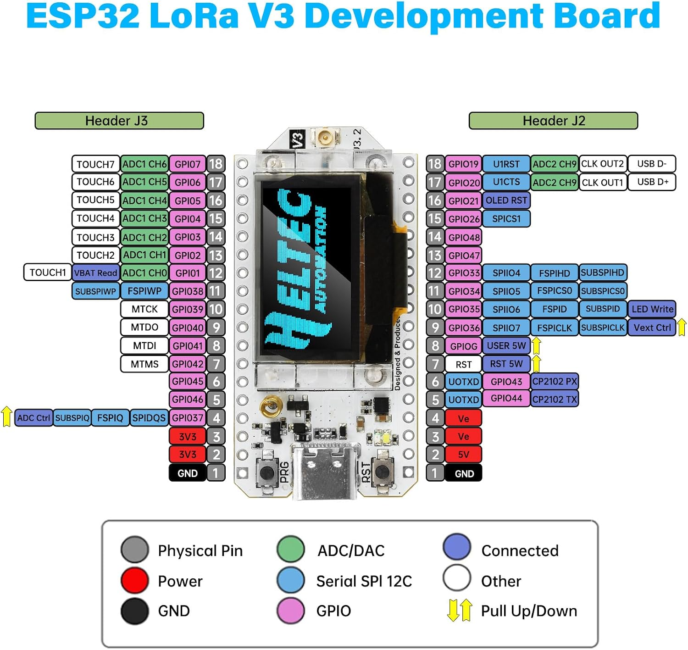

# Bench prototype: LoRa V3 wiring and shopping guide

[Back to README](../README.md)

**Current selection:** Waveshare ESP32-S3-Touch-LCD-3.5 + two ESP32-S3/SX1262 LoRa V3 boards from the Aideepen two-pack + Uputronics MAX-M10S breakout (3 V variant) with Bingfu 4-System active GNSS helix antenna (validation pending) + onboard microSD.

**Status: proposed wiring, not bench-tested.** No working central firmware or tested MeshCore UART build is supplied yet. This revision replaces the previous modular radio assembly and its IO adapters. Do not combine its old connector instructions with this guide.

## V1 portable-power design — supersedes earlier bench USB supply arrangement

**Selected for electrical validation, not yet approved for energizing the whole assembly:** the Waveshare onboard AXP2101 manages a protected LiPo 1S battery and USB-C charging. Power both LoRa nodes and the Uputronics MAX-M10S from the **Waveshare J8 3V3 / GND expansion rail**, after verifying the shipped revision and spare current. A separate BQ25185 charger and external buck-boost are **not part of the selected V1 BOM**.

**Power connection is proposed, not bench-tested.** The Heltec family 3V3 pin and actual Aideepen boards' 3V3 reverse-current/USB path must be verified. Do not connect their USB and shared 3V3 simultaneously unless proven safe. UART and I2C lines can backpower unpowered modules; consider powered-off-safe isolation. The AXP2101 DCDC1 2 A datasheet limit is **not a documented J8 spare-current rating**. Refer to [complete power study and mandatory tests](power-architecture.md).

**Capacitor footprints, initial DNP options:** 220–470 uF at the shared carrier input; each radio 47–100 uF + 10 uF + 100 nF; GNSS 10 uF + 100 nF. Verify output stability, inrush, ESR, actual rail source and thermal headroom prior to population. Capacitors cannot offset an undersized regulator during a LoRa packet.

**Bench bring-up:** separate USB supplies still permitted while verifying UART firmware and actual board pinout. **Do not use the historical independent-USB test drawings as final shared-battery wiring instructions.**

## 1. Identify the purchased boards

| Controller: selected Amazon listing | Radios: selected two-pack |
|:---:|:---:|
|  |  |

These are original listing images. Product screens are vendor examples. [Image sources and rights](images/amazon/README.md).

| ID | Selected component | Purchase reference | Verification on receipt |
|---|---|---|---|
| U1 | Waveshare ESP32-S3-Touch-LCD-3.5, standard/no camera | [Amazon B0F3WS2W5R](https://www.amazon.com/dp/B0F3WS2W5R) | Exact model, PCB revision, 32-pin expansion connector and GPIO labels; V2 preferred, not established by the listing |
| A | LoRa V3 ESP32-S3FN8 + SX1262, 863–928 MHz | First board from [Aideepen two-pack B0DRSJV1ZL](https://www.amazon.com/dp/B0DRSJV1ZL), option **Lora-V3 2Pcs** | Identify revision and compare to Heltec V3 schematic before using its firmware target |
| B | Same as A | Second board from the same pack | Same checks; will run MeshCore rather than Meshtastic |
| G1 | Uputronics u-blox MAX-M10S breakout, **3 V variant** | [Wegmatt selection](https://shop.wegmatt.com/products/uputronics-ublox-max-breakout-for-active-antennas?variant=44060220489751) | Verify 3 V board, pin labels/orientation (SDA/SCL, TX/RX, VCC/GND), supply range and SMA antenna power capability |
| ANT-G | **Bingfu 4-System GNSS Helix active antenna** | [Amazon B0FL7PVF16](https://www.amazon.com/dp/B0FL7PVF16) | **Selected for test, not confirmed compatible**; seller advertises SMA male, 50 ohm, GNSS L1, 2.8–3.3 V LNA supply and up to 30 mA; verify specifications and antenna bias available at G1 SMA |
| S1 | One microSD card | U1's onboard card slot | Format and driver support need validation |
| ANT-A/B | LoRa antennas and pigtails shown in the two-pack | Use the supplied pair initially | Verify received contents and suitability for US915 |

The seller lists the radio brand as Aideepen; original Heltec manufacture and identical pin routing are **not established**. The primary Heltec V3 documentation is a design reference, not proof about every board sold as “V3.” If the received radio differs, remap or replace it before proceeding.

The listing describes CP2102 in its detailed specifications, despite “CP2012” in its title. The package photo shows loose header strips and the board close-up shows a **V3.2** marking. **Plan to solder the supplied headers**; soldering is acceptable for this build. Inspect the actual shipment rather than assuming its revision or assembly matches every listing illustration. Neither a separate radio baseboard nor an IO expansion adapter is required for this proposed assembly.

## 2. Shopping list and budget

**Price record: October 24, 2026, USD.** The two Amazon amounts below are from the user's supplied listing screenshots, not guaranteed live checkout prices. Accessory prices are reference retail amounts from their linked sellers. Shipping, taxes, import charges, tools, soldering labor, and mounting hardware are excluded. Reuse suitable parts already owned.

| Qty | Component and buying link | Selection | Unit/package price | Line total |
|---:|---|---|---:|---:|
| 1 | [Waveshare touch controller](https://www.amazon.com/dp/B0F3WS2W5R) | ESP32-S3-Touch-LCD-3.5; 8 MB PSRAM / 16 MB flash | $35.99 | $35.99 |
| 1 pack | [Aideepen LoRa V3 two-pack](https://www.amazon.com/dp/B0DRSJV1ZL) | **Lora-V3 2Pcs**, 863–928 MHz; two boards and antenna sets as pictured | $39.99 per pair | $39.99 |
| 1 | [Uputronics MAX-M10S breakout](https://shop.wegmatt.com/products/uputronics-ublox-max-breakout-for-active-antennas?variant=44060220489751) | **3 V version**, SMA socket | $36.00 | $36.00 |
| 1 | [Bingfu 4-System GNSS Helix active antenna](https://www.amazon.com/dp/B0FL7PVF16) | Candidate for prototype testing; direct SMA mounting or suitable coax support | $21.69 | $21.69 |
| 1 | [microSD 1 GB, Class 4](https://www.sparkfun.com/microsd-card-1gb-class-4.html) | COM-15107; economical messaging/logging candidate, not a map-storage commitment | $5.50 | $5.50 |
| 1 pack | [Female/male jumpers, 20 × 150 mm](https://www.adafruit.com/product/1954) | Female ends for radio male headers; male ends for U1 sockets or breadboard | $1.95 | $1.95 |
| 1 pack | [Male/male jumpers, 20 × 150 mm](https://www.adafruit.com/product/1957) | U1 socket to ground distribution; short breadboard links | $1.95 | $1.95 |
| 1 | [400-point breadboard](https://www.adafruit.com/product/64) | Common-ground distribution and temporary connections | $4.95 | $4.95 |
| | **Parts subtotal, reusing USB supplies/cables** | | | **$148.02 (RF accessories excluded)** |

Use one suitable larger microSD instead if already available; do not buy both. No additional OLED, LoRa antennas, or pigtails are budgeted. Verify package contents before adding duplicates. The GNSS breakout **requires a separate active external antenna**. The Bingfu is budgeted, but electrical compatibility remains to be verified before connecting it.

### Power and test peers: buy only what is missing

| Additional quantity | Item | Unit/package price | Maximum additional cost |
|---:|---|---:|---:|
| 3 | [SparkFun 5 V / 2 A USB-A wall charger, TOL-16893](https://www.sparkfun.com/usb-wall-charger-5v-2a.html) | $9.50 | $28.50 |
| 3 | [USB-A to USB-C data/power cable, Adafruit 4474](https://www.adafruit.com/product/4474) | $4.95 | $14.85 |
| 1 optional pack | [Second identical LoRa V3 two-pack](https://www.amazon.com/dp/B0DRSJV1ZL) for two remote test peers | $39.99 | $39.99 |
| 2 optional | Same USB wall charger for remote peers | $9.50 | $19.00 |
| 2 optional | Same USB-A to USB-C cable for remote peers | $4.95 | $9.90 |

USB cables are **not assumed included** in the Amazon two-pack. Deduct any suitable supplied or already-owned cables and chargers. The optional peers operate by radio and do not connect to U1 by jumpers.

| Scenario | Total before shipping/taxes |
|---|---:|
| Terminal components and assembly accessories, reuse USB power/cables | **$148.02 + optional RF accessories** |
| Same terminal + three new chargers and three new cables | **$191.37 + optional RF accessories** |
| Complete bench above + two remote peers, two new chargers and two new cables | **$260.26 + optional RF accessories** |

The terminal contains **two radio boards**. The complete test bench contains four radio boards, bought as two two-packs. These totals assume usable supplied header strips; connector replacements, a card reader, and instruments are not included. A hardware purchase does not establish an operational firmware integration.

## 3. Controller GPIOs and the connector-numbering correction

The original listing pinout above identifies the GPIOs. The project diagram below selects the signals used by MeshCrossway.

**Use GPIO names as the electrical identity.** The 32-pin numbered photo from the Waveshare Amazon listing and the Rev2 PDF label the two positions in each row oppositely. Numbers in the “listing photo” column below follow that exact photo, viewed as shown, with BAT/5V at the top. They are not a universal numbering system for every board revision.

| Function | U1 GPIO/signal | Listing photo position | Rev2 PDF J8 position | Destination |
|---|---|---:|---:|---|
| Meshtastic TX | GPIO39 | 9 | 10 | A GPIO4 / RX |
| Meshtastic RX | GPIO40 | 11 | 12 | A GPIO5 / TX |
| MeshCore TX | GPIO17 | 16 | 15 | B GPIO4 / RX |
| MeshCore RX | GPIO18 | 18 | 17 | B GPIO5 / TX |
| GNSS SDA | GPIO21 | 5 | 6 | G1 SDA |
| GNSS SCL | GPIO38 | 7 | 8 | G1 SCL |
| Common ground | GND | 29 or 30 | 29 or 30 | A GND, B GND, G1 GND |
| GNSS supply | 3V3 | 31 or 32 | 31 or 32 | G1 3.3 V, after rail/load verification |

Do not silently substitute a photo position for a PDF connector number. Check the actual PCB signal labels and ground continuity before applying power. GPIO43/44 remain reserved for UART0 diagnostics and are not used for either radio in this plan.

Assign ESP32 UART1 to GPIO39 TX / GPIO40 RX and UART2 to GPIO17 TX / GPIO18 RX. These are project-selected peripheral mappings, not automatic defaults.

**Leave the camera absent and its driver disabled:** the selected GPIOs are shared with camera nets. Reserve GPIO19/20 for native USB, GPIO43/44 for UART0 diagnostics, GPIO7/8 for the onboard I2C bus, and GPIO9/10/11 for microSD. Do not attach jumpers to the boot/reset/power-control signals or other unused pins.

Sources: [Waveshare Rev2 PDF](https://files.waveshare.com/wiki/ESP32-S3-Touch-LCD-3.5/ESP32-S3-Touch-LCD-3.5_Rev2.0.pdf), [manufacturer resources](https://docs.waveshare.com/ESP32-S3-Touch-LCD-3.5/Resources-And-Documents), and the numbered photo supplied from [the selected Amazon listing](https://www.amazon.com/dp/B0F3WS2W5R). The photo does not prove the shipment's revision.

## 4. Radio wiring: same GPIO assignment on A and B

**Positions in the pictured pinout:** J3.15 = GPIO4; J3.16 = GPIO5; J3.1 and J2.1 = GND. These connector references apply to that illustration; match the actual PCB before soldering. Install the header strips straight, inspect for bridges, and check continuity with all power disconnected.

The Heltec V3 pin map exposes GPIO4 and GPIO5 without assigning them to the onboard LoRa SPI or OLED. The selected seller's boards must match that routing. **RX4/TX5 is our proposed configuration, not a stock UART pin assignment.** The table gives GPIO identities and the J3 positions shown in the original listing pinout.

| Wire | From | To | Direction |
|---|---|---|---|
| A-TX | U1 GPIO39, listing photo 9 | A GPIO4 / configured RX, J3.15 | Host to Meshtastic |
| A-RX | A GPIO5 / configured TX, J3.16 | U1 GPIO40, listing photo 11 | Meshtastic to host |
| A-GND | U1 ground distribution | A GND, J3.1 or J2.1 | Signal reference |
| B-TX | U1 GPIO17, listing photo 16 | B GPIO4 / configured RX, J3.15 | Host to MeshCore |
| B-RX | B GPIO5 / configured TX, J3.16 | U1 GPIO18, listing photo 18 | MeshCore to host |
| B-GND | U1 ground distribution | B GND, J3.1 or J2.1 | Signal reference |

Use three wires per radio: TX, RX, and ground. Each radio is independently USB-powered. Leave its 3V3, 5V, battery, reset and unused GPIO pins disconnected from U1. Do not connect A directly to B.

### A: Meshtastic firmware configuration

After confirming compatibility, use the upstream **Heltec V3** firmware target. Configure the serial module with **enabled = true, mode = PROTO, RXD = 4, TXD = 5, baud = 115200**. Match the host to **115200, 8N1**, no hardware flow control. Keep physical GPS disabled because G1 belongs to the host.

PROTO is the binary Protobuf client API. It is not a plain-text chat interface. Keep logging off this UART. Verify device configuration, one send, one receive, and reconnection before adding B.

### B: MeshCore firmware configuration

The upstream Heltec V3 target provides Companion builds. The reviewed Companion source also contains an ESP32 hardware serial transport selected by **SERIAL_RX** and **SERIAL_TX**, initialized at 115200 baud. Our proposed custom build uses **SERIAL_RX=4** and **SERIAL_TX=5**, with the appropriate Heltec V3 Companion environment.

These are **build configuration requirements**, not an included compiled binary. Freeze a source commit that contains this interface, inspect its active options, compile, and verify operation on the actual board. A historical release or stock USB/BLE image may not enable this hardware UART. Keep USB/debug output separate; confirm 8N1 and serial framing on the selected build. Do not confuse this interface with the repeater's RS232 bridge or a KISS modem.

Sources: [Meshtastic serial module](https://meshtastic.org/docs/configuration/module/serial/), [Heltec V3 hardware reference](https://meshtastic.org/docs/hardware/devices/heltec-automation/lora32/), [MeshCore Heltec V3 environments](https://github.com/meshcore-dev/MeshCore/blob/main/variants/heltec_v3/platformio.ini), [Companion UART implementation](https://github.com/meshcore-dev/MeshCore/blob/main/examples/companion_radio/main.cpp).

## 5. MAX-M10S external-antenna GNSS and bench power

**Hardware selection updated October 24, 2026.** G1 is now the [Uputronics MAX-M10S breakout, 3 V option](https://shop.wegmatt.com/products/uputronics-ublox-max-breakout-for-active-antennas?variant=44060220489751), not the SparkFun SAM-M10Q. The previously drawn GNSS diagram (`images/gnss-and-power.svg`) depicts the superseded Qwiic board and **must not be used as the wiring reference** until redrawn.

**Selected antenna for bench validation:** [Bingfu 4-System GNSS Helix, Amazon B0FL7PVF16](https://www.amazon.com/dp/B0FL7PVF16), screenshot price **$21.69**. Its seller advertises an SMA male connector, 50-ohm impedance, GPS L1 and other GNSS constellations, a 2.8–3.3 V active LNA and up to 30 mA supply current. These are seller claims and not measurements. The MAX-M10S chip's VCC_RF specifications **do not alone prove** that the assembled Uputronics breakout supplies the required voltage and current at its SMA socket. Confirm the breakout schematic or measure the antenna bias at the SMA center conductor (using appropriate RF-safe procedures) before connecting and powering the antenna. Confirm SMA gender and standard vs RP-SMA, and avoid mechanical stress from the antenna on the PCB connector. The MAX-M10S is single-frequency GNSS; the antenna's wider-frequency marketing does not make the receiver RTK-capable.

The selected breakout exposes a row of through-holes labelled **SDA, SCL, TX, RX, TP, GND, VCC** (confirm physically on the delivered board). It has an SMA female connection intended for a suitable external **active GNSS antenna**. No Qwiic socket or onboard GNSS patch antenna should be assumed. The antenna is a **separate, not-yet-selected purchase**.

| U1 | G1 MAX-M10S breakout | Status |
|---|---|---|
| GPIO21 | SDA | Proposed I2C data connection; verify actual pinout and voltage |
| GPIO38 | SCL | Proposed I2C clock connection; verify actual pinout and voltage |
| GND | GND | Common reference |
| 3V3 | VCC | **Only after** confirming G1 3 V variant's acceptable supply range and available host rail current |
| Not connected initially | TX, RX, TP | Reserve UART and timepulse for future testing |

Use a separate host I2C bus on GPIO21/38, provisionally at 100 kHz. The u-blox M10 default I2C address is commonly **0x42 (7-bit)**; verify actual device configuration before depending on this address. Inspect on-board I2C pull-ups before adding external ones. Keep the Waveshare onboard I2C peripheral on its own assigned pins.

The selected external **active** Bingfu antenna must support the intended GNSS bands and the breakout's *actual antenna-bias voltage and current limit*. The 3 V board selection is not a claim that every 3 V or 5 V active antenna is compatible. Check RF connector gender/polarity (including standard vs reverse-polarity SMA), grounding, cable loss, strain relief and placement; route it away from the two LoRa antennas, their coax runs, and switching regulators.

For **initial isolated bench bring-up only**, supply U1, A and B independently over USB while testing serial interfaces. After verifying pinouts, current headroom, and powered-off/USB backfeed behavior, the **V1 portable carrier candidate** supplies A, B and G1 from the Waveshare J8 3V3 rail with local decoupling. The Waveshare AXP2101 remains the only LiPo charger. Do not join radio USB power and the shared rail without verified isolation. See [power study](power-architecture.md).

| Device | Power entry | Connections to other boards |
|---|---|---|
| U1 | Its own USB-C supply | Verified 3.3 V supply to G1 only |
| A | Its own USB-C supply | UART and common ground only |
| B | Its own USB-C supply | UART and common ground only |
| G1 | U1 verified 3.3 V rail, subject to range/current check | I2C and common ground |

**Power-off isolation:** a live UART can parasitically power an unpowered radio board. Isolate TX/RX during independent power-off bench tests; a future switchable carrier board needs powered-off-protected signal buffering or an equivalent validated solution.

Product reference: [Uputronics MAX-M10S breakout](https://shop.wegmatt.com/products/uputronics-ublox-max-breakout-for-active-antennas?variant=44060220489751). Manufacturer module family: [u-blox MAX-M10](https://www.u-blox.com/en/product/max-m10-series).

## 6. Display, touch, microSD and antennas

The display, touch and card slot are already wired on U1. Use the matching vendor BSP and initialize the PMIC/IO expander as required; no external display wires are needed.

| Onboard function | Rev2 schematic connection |
|---|---|
| LCD SPI | MOSI GPIO1, MISO GPIO2, clock GPIO5, DC GPIO3 |
| LCD control | Backlight GPIO6; reset via TCA9554 EXIO1 |
| Touch | I2C SDA GPIO8 / SCL GPIO7; interrupt via EXIO2 |
| microSD | D0 GPIO9, CMD GPIO10, CLK GPIO11; corresponding 1-bit SDMMC interface |
| V2 card detect | EXIO3; shared/optional interrupt connections need BSP handling |

The same GPIO number on two separate boards is not a shared electrical net. For example, U1 GPIO5 drives its LCD while **radio** GPIO5 is its proposed UART TX.

Attach each supplied LoRa antenna through its pigtail to the radio's U.FL/IPEX LoRa port before transmission. The radio's small spring antenna serves Wi-Fi/BLE, not LoRa. Place G1's **external active GNSS antenna** away from nearby transmitters and switching power wiring. Begin with approximately 1 m between radio antenna assemblies as a repeatable bench geometry; measure interference before reducing spacing. Configure lawful regional profiles before enabling RF.

## 7. Bring-up sequence and open items

1. Confirm the actual boards, revision markings, header assembly and GPIO routing. Resolve U1 photo-versus-PDF numbering before wiring.
2. Test U1 display, touch and card using vendor examples. Identify/flash each radio independently with its antenna attached.
3. Power everything off. Connect ground, then A's TX/RX pair. Check for shorts and header offsets.
4. Configure Meshtastic PROTO on RX4/TX5. Verify client identification and bidirectional messaging with a compatible remote peer.
5. Compile B's MeshCore Companion UART target. Verify it on GPIO4/5, then add its host connection and test the second peer.
6. Confirm the G1 pinout and 3 V power specifications, verify the 3V3 rail, attach the Bingfu antenna **only after bias verification**, then add G1 and test GNSS communications (I2C address 0x42 if configured) and position fix. Detection alone is not a position fix.
7. Operate both UARTs, display, touch, microSD and GNSS together. Measure supply margin, latency and cross-radio interference.
8. Test recovery using signal isolation before power removal. The unaffected network and stored history should stay accessible.
9. Record PCB revisions, firmware hashes, build flags, baud/framing, measured power and departures from this proposal.

Still unverified: received-board authenticity/routing, soldered headers, Waveshare revision, central firmware, compiled MeshCore UART target, storage recovery, energy budget and RF coexistence. The browser simulator is not evidence of any of these functions working on hardware.
