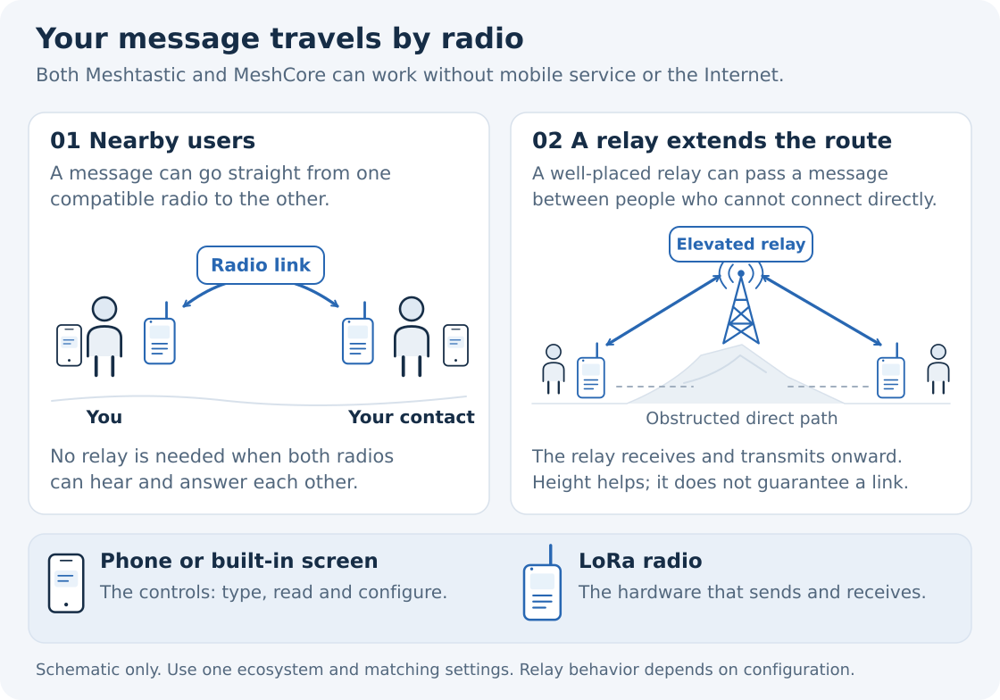
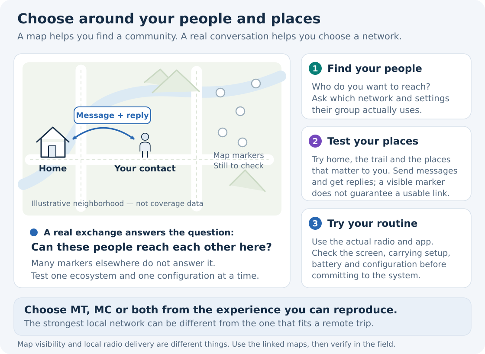
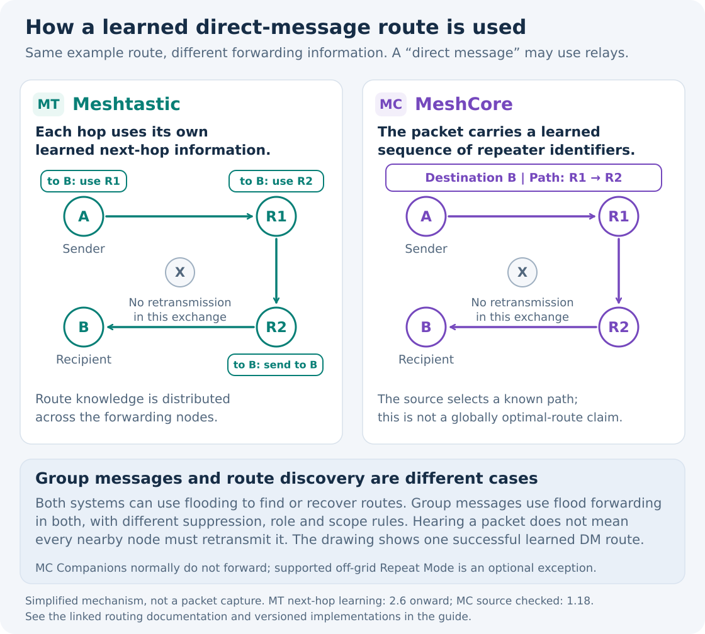
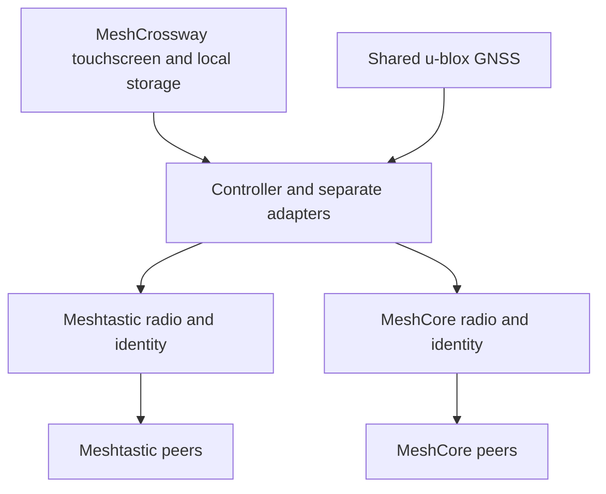

# Meshtastic vs MeshCore: from the basics to the technical details

> **MeshCrossway architecture update (2026-10-28):** The latest product uses a BLE Central Core and two separate battery-powered Radio Pods. Historical UART comparisons below describe the archived integrated variant, not the current implementation. [Modular baseline](modular-architecture.md).

[Back to MeshCrossway](../README.md) · [Maps and regional checks](mesh-maps-and-regional-check.md) · [Radio integration](radio-firmware-strategy.md)

[Future exploration: Reticulum](reticulum-future-integration.md) has a separate guide covering its architecture and a possible later integration.

**Meshtastic (MT) and MeshCore (MC) let small radios exchange short messages without cellular service or an Internet connection between the radios.** The useful choice depends on the people you want to reach, the places you use the equipment and the features you need. [Meshtastic introduction][MT-intro] · [MeshCore overview][MC-project]

This guide starts with everyday questions, then looks at real experiences, and finishes with the engineering details. You can read it in order or jump to the level you need.

| Reading stage | What you will find |
|---|---|
| **[1. Start with the basics](#part-1-start-with-the-basics)** | How the equipment works, the practical differences, illustrations and maps to help you choose locally. |
| **[2. Experiences from real users](#part-2-experiences-from-real-users)** | The supplied video, people who preferred each system, people who use both, and what their experiences can teach you. |
| **[3. Technical deep dive](#part-3-technical-deep-dive)** | Firmware versions, the complete 44-criterion table, routing, radio settings, security, integrations and testing. |

**Technical review: October 26, 2026.** Specific versions and evidence limits are explained in Part 3. MeshCrossway's own radio integration remains a design and simulator project.

## Part 1: Start with the basics

### What you need to send a message

Think of either system as a way to send a small text message over a radio link. A typical setup uses a phone as the keyboard and screen, connected to a nearby LoRa radio. **The radio carries the message over the air; the phone alone does not become a LoRa radio.** Some devices have their own screen and controls, so the phone is optional. [MT introduction][MT-intro], [MC project][MC-project]

Four words make the rest easier to follow:

- **Radio or node:** a device that sends and receives messages.
- **Relay or repeater:** a radio that passes a message onward so it can reach somewhere the sender cannot reach directly.
- **Mesh:** a network of radios that can use those intermediate links; the devices do not all need the same job.
- **Channel:** a group conversation within a system. The radios also need compatible radio settings, even if the group name looks the same.

Sources for the device roles and channel distinction: [MT roles][MT-roles], [MT channels][MT-channels], [MC FAQ][MC-faq], [MC channel configuration][MC-api].

*Two ways a conversation can travel. These are explanatory scenes, not a coverage prediction. Each scene assumes compatible radios running the same system.*

Two nearby users can communicate directly in **either** system when the radio link works. A relay becomes useful when there is no usable direct link. A well-placed relay can help a route reach farther, but a hill, a building or a poor antenna can still interrupt it. [MT routing][MT-routing], [MC routing][MC-mesh], [radio propagation factors][MT-radio]

### The everyday differences

The most noticeable difference is often **how people arrange the network**. MT allows ordinary portable radios to help pass messages along. MC normally gives that job to dedicated repeaters while users carry their own personal radios. Current MC versions also offer optional portable relaying in supported configurations. Neither description means that every device always forwards, or that MC needs a repeater for every conversation. [MT roles][MT-roles], [MC roles][MC-project], [MC portable relaying][MC-repeat]

| Everyday question | Meshtastic (MT) | MeshCore (MC) |
|---|---|---|
| Can we exchange messages without cell service? | Yes, when a compatible radio path connects you. | Yes, when a compatible radio path connects you. |
| Can our portable radios help one another? | Yes. Common user-radio configurations can pass messages along. | Yes in supported optional Repeat Mode; ordinary personal-radio mode does not pass other users' messages along. |
| Can it reach people across a region? | Yes, where the network has usable links and suitable relay sites. | Yes, where the network has usable links and suitable relay sites. Dedicated repeaters are the usual foundation. |
| Can I share location or sensor readings? | Yes, with a broad set of documented features. | Yes, with support depending on the device, software and app. |
| Do I always need a phone? | No. Some supported devices have their own interface. | No. Some supported devices have their own interface. |
| Can I retrieve posts sent while my radio was off? | An optional message-history service can recover some channel history, subject to its limits. | A Room Server can store posts. Ordinary channel chat does not automatically provide that history. |
| Can I send a native message to the other system? | An MT radio talks to MT peers. | An MC radio talks to MC peers. |

These are simplified descriptions. Feature support, message-history limits and the exact forwarding rules are expanded in the [complete comparison table](#complete-comparison-table) and [technical sections](#part-3-technical-deep-dive). Sources: [MT modules][MT-telemetry], [MT history][MT-history], [MT software][MT-software], [MC sensors][MC-sensor], [MC Room Server][MC-room], [MC FAQ][MC-faq].

**Using the same frequency band does not make MT and MC compatible.** Switching a supported radio between them normally means installing the other firmware—the software running on the radio—and setting it up for that network. MeshCrossway instead plans to use two separate radios. [Radio compatibility](#shared-radio-foundations) · [MeshCrossway architecture](#implications-for-meshcrossway)

### Which should you choose?

Start with **who you want to contact and where you will be**. The suggestions below are practical judgments based on the documented behavior, not results of a MeshCrossway field comparison.

| Your situation | A useful starting point | The check that matters |
|---|---|---|
| Friends or a local community already use one system | Start with their system. | Exchange messages from the places you actually use. |
| A few friends will travel together away from installed repeaters | MT is a straightforward option to evaluate; MC also supports nearby direct communication and optional portable relaying. | Confirm that the middle radios really forward when the group spreads out. |
| You want to talk across town or a larger region | Compare the maintained networks in that area; MC's usual repeater arrangement is worth evaluating alongside MT. | Find an actual working route to your intended contacts. |
| Location, sensors or an existing app are central to your plans | Check the feature on your exact device in both systems; MT's documented modules are a useful starting point. | Try the complete workflow, including what the receiving person sees. |
| You want a device with its own screen | Compare the actual device interface. | Try sending, reading, configuring and sharing a location without the phone. |
| You want to control when the radio transmits | Check both background messages and forwarding settings. | Verify what the device sends even when you are not typing. |
| Home and travel contacts use different systems | Keeping access to both may be useful. | Accept that you will manage two networks and two sets of settings. |

**For a hiking group**, everyone can bring compatible radios and start with nearby communication. If the group spreads beyond direct reach, intermediate radios must be configured to help. **For conversations across town**, the location and maintenance of relay sites may matter more than the number of devices shown online. These are reasons to test your intended use, rather than choose from a feature list alone.

### Maps and choosing your local network

Maps help you find nearby activity and communities to contact. Start with your home, regular routes and the people you want to reach.

| Network or area | Useful map links |
|---|---|
| MeshCore activity | [LetsMesh — the supplied Colorado view](https://analyzer.letsmesh.net/map?lat=39.73477&long=-105.7708&zoom=6) · [Official MeshCore map](https://map.meshcore.io/) |
| MeshCore sampled coverage | [MeshMapper worldwide](https://meshmapper.net/) · [Denver](https://den.meshmapper.net/) · [Colorado](https://co.meshmapper.net/) |
| Meshtastic activity | [Official Meshtastic map](https://map.meshtastic.org/) · [MeshMap](https://meshmap.net/) · [Liam Cottle's map](https://meshtastic.liamcottle.net/) |
| How to interpret the results | [Map directory, data sources and regional checks](mesh-maps-and-regional-check.md) |

*A useful local choice combines contacts, a workable radio path and your own test. The scene is illustrative; it does not display measured coverage.*

A map marker may represent a device someone registered, a transmission someone heard or an old report. An empty area may simply have no reporting devices. **A dot on a map does not promise a working conversation from your house.** The [map guide](mesh-maps-and-regional-check.md) links each service's data source and explains the differences.

Use the maps to find a local group, ask for its current radio settings, and arrange a few messages in **both directions**. Also try the app or screen you will carry. The experiences in Part 2 show why local activity, equipment and ease of use can lead sensible people to different choices.

## Part 2: Experiences from real users

### What users report

People can make different choices after trying the same two systems. Their nearby users, available repeaters, equipment and everyday habits change the result. The accounts below show those differences in practice.

**These are attributed summaries, not quotations or a controlled comparison.** A firsthand report tells us what happened in one setup. Official documentation and versioned source, discussed in Part 3, explain which behavior the software actually supports. Keep that distinction in mind when someone describes a network as better, easier or more reliable.

#### The supplied video: why one community moved to MeshCore

[**Why we're switching from Meshtastic to MeshCore — The Comms Channel**](https://www.youtube.com/watch?v=guDoKGs02Us), published December 6, 2025, is the video suggested for this guide.

In its published description, the creator says he consulted active MC communities in Boston, Southern California, the Pacific Northwest, Austin and Omaha. He summarizes experiences favoring MC for regional messaging through installed repeaters, while recognizing MT use cases for smaller groups moving together. The description also promotes the TennMesh community.

**What a newcomer can take from it:** if people maintain suitable repeater sites around your town, their network may be very useful for reaching friends across the area. Ask your own local operators what works for them and try those routes yourself.

**What was verified:** this review accessed the published description and metadata, not the full video transcript or its YouTube comments. It does not attribute any unverified quotation, timestamp or individual comment to the video. The description collects selected migration experiences and predates several 2026 changes covered later in this guide.

#### Colorado: finding people matters as much as choosing software

**AJ Quick, August 22, 2026**, describes running two LoRa radios and preferring MC after finding an active network locally. During his MT trial, contacts disappeared after a radio-setting change that nearby users had not all adopted. He acknowledges that his MT trial was short and that coordination contributed to the result. [Read the firsthand account][USER-colorado]

**Practical lesson:** ask the local group for its current settings before concluding that a radio or network is broken. Two compatible devices can stop hearing each other when they use different radio configurations. This report supports checking local activity and coordination; it does not establish that MC always reaches farther or has a particular advantage in user numbers.

#### Tennessee: the same video led to staying with Meshtastic

An operator near Chattanooga describes being motivated by the same video to investigate MC and possible repeater sites. A later update says the Seeed solar node's MT interface better served the operator's needs, so the group would stay with MT for the time being. The page is organized under 2026. [Read the operator's account][USER-tennessee]

**Practical lesson:** try the actual screen, app and configuration workflow you will use. A network can look attractive on paper while another setup makes your everyday tasks easier. This is one operator's experience with particular equipment and software at that time; it is not a verdict on every MC interface.

#### Pittsburgh and Phoenix: useful reasons to keep both

In an August 2026 discussion, **u/Snoo_22440** reports using both systems in Pittsburgh, with MT reaching the desired contacts more effectively at that time. **u/georged486** reports choosing MC around Phoenix and MT for trips where repeater infrastructure is inconsistent. [Pittsburgh comment][USER-pittsburgh], [Phoenix comment][USER-phoenix]

**Practical lesson:** your home network and your travel network may be different. A well-served city, a hiking group and a trip away from maintained repeaters pose different questions. These reports explain why someone might keep both systems, as MeshCrossway plans to support. They do not show that one protocol is automatically suitable for every city or every trail.

#### A two-site test: receiving a message does not prove you can reply

A user testing EU868 settings with **four LoRa devices at two sites 2.7 km apart** reported MC messages working in one direction more successfully than the other, while MT worked in both directions in that setup. The discussion describes trying different radio settings and antennas, and investigating different levels of background radio noise. The linked updates did not establish a final cause. [User's update][USER-asymmetric], [follow-up][USER-asymmetric-followup]

**Practical lesson:** ask someone to reply from the place you need to reach. Seeing their device or receiving one of their transmissions is only part of a working conversation. This report is useful because it documents a disappointing outcome as well as attempts to investigate it. It does not prove an inherent difference in radio sensitivity between the two protocols.

#### A manufacturer's field report: temporary MeshCore relaying

**Seeed Studio, October 23, 2026**, describes a small test with three Wio Tracker L1 Pro devices using MC's optional Companion Repeat Mode. That mode allows a supported user radio to help pass messages onward after it has been configured. Moving the middle device to a higher, more open position improved delivery in the reported test; forwarding also continued after its phone connection was disconnected. [Read the field report][MC-repeat-test]

**Practical lesson:** where you put the middle radio can change the result. It is also useful to know that recent MC versions offer temporary relaying on supported configurations. Part 3 explains the [Repeat Mode requirements](#the-2026-exception-companion-repeat-mode).

**Evidence limit:** the hardware manufacturer authored this report, tested one arrangement and did not run a matched MT comparison. It demonstrates an available workflow and a placement lesson, not a general success rate or a protocol winner.

#### Turn a testimonial into questions for your own test

Before applying someone else's recommendation, ask:

- **Who could they reach?** Were the people they wanted already using that network?
- **What helped the message travel?** Were there maintained repeaters, temporary relay radios or only two nearby devices?
- **What equipment and settings were used?** Record the antennas and software versions as well as the board name.
- **Did both directions work?** Distinguish a radio's delivery confirmation from a person actually reading and replying.
- **What failed?** Look for unsuccessful attempts and changes of location, not just the longest successful contact.

Keep the report's place, date and setup attached to its conclusion. The next part explains the mechanisms behind these experiences and provides the detailed comparison table, so you can connect an operator's observation to a feature or limitation you can test.

## Part 3: Technical deep dive

This part explains the mechanisms behind the practical differences. It is intended for readers choosing firmware, planning relay sites, comparing security or integrating a radio with another device. The earlier sections remain usable without knowing these details.

The guide distinguishes **documented behavior**, **attributed experiences** and **engineering recommendations**. It is not a controlled MT/MC benchmark. Features in the table belong to the upstream projects; they are not all implemented in MeshCrossway.

Here, **DM** means a direct message addressed to one recipient, **ACK** means a protocol acknowledgment, and **RF** means radio frequency. A DM can still travel through relays; an ACK does not establish that a person read the text. [MT routing][MT-routing], [MC messaging implementation][MC-chat]

### Technical contents

1. [Version baseline](#version-baseline)
2. [Shared radio foundations](#shared-radio-foundations)
3. [Complete comparison table: 44 criteria](#complete-comparison-table)
4. [How forwarding actually works](#how-forwarding-actually-works)
5. [Range, speed and congestion](#range-speed-and-congestion)
6. [Position, telemetry and message history](#position-telemetry-and-message-history)
7. [Security and privacy](#security-and-privacy)
8. [Implications for MeshCrossway](#implications-for-meshcrossway)
9. [A fair test before committing](#a-fair-test-before-committing)
10. [Sources and maintenance](#sources-and-maintenance)

### Version baseline

A comparison made in late 2025 can omit important 2026 changes. Firmware, mobile apps, standalone UIs and map services also have separate release cycles.

| Component reviewed | Baseline | How to interpret this guide |
|---|---|---|
| Meshtastic widely published release track | **2.7.26.54e0d8d Beta**, listed as Latest during this review | Do not assume every deployed node has 2.8 features |
| Meshtastic newer feature track | **2.8.1.8e6a88d Alpha**, October 1, 2026 | New signing, optional channel AEAD and other 2.8 behavior are explicitly qualified here |
| MeshCore | **Companion / Repeater / Room Server 1.18.0**, October 15, 2026 | Role and protocol details were checked against the 1.18 source, with client-dependent behavior distinguished |

Sources: [MT releases][MT-releases], [MT 2.8.1][MT-alpha], [MC 1.18 release][MC-release].

The MT documentation currently describes 2.8, while existing meshes may still run 2.7. Revoked MT 2.8.0 builds should not be treated as the baseline. MC's FAQ contains some older descriptions that do not cover newer Companion Repeat Mode and sensor features; dated release notes and versioned source take precedence where they conflict.

### Shared radio foundations

**LoRa is the modulation; Meshtastic and MeshCore are different protocols using it.** Both can operate without cellular service or an Internet connection. A phone typically provides the interface to a nearby radio over Bluetooth or another local connection; the phone alone does not become a LoRa node. These systems also differ from LoRaWAN: an ordinary LoRaWAN gateway does not automatically relay their traffic. See the [MT introduction][MT-intro] and [MC project][MC-project].

There are three separate compatibility questions:

1. **Hardware:** does the board and antenna cover the intended frequency band, and does the firmware support its exact revision?
2. **Radio parameters:** do frequency, bandwidth, spreading factor, coding rate and other required PHY settings match?
3. **Protocol and application:** are the devices running the same ecosystem and compatible channel, identity and security settings?

A label such as “915 MHz” answers only part of the first question. Two devices in the same band can be unable to communicate because they use different presets. A shared chat-channel name does not repair that mismatch. MT's logical channels share the node's radio configuration; MC also has application channels above its radio settings. Sources: [MT LoRa configuration][MT-lora], [MT channels][MT-channels], [MC radio presets][MC-presets].

Changing a preset is a community coordination decision. For example, the MT 2.8.1 release changed the default for **first-time US region selection through the device screen** to LongTurbo. It did not automatically move every existing installation. LongTurbo and LongFast cannot hear each other. That distinction is more useful to a newcomer than assuming a historic default is still universal. [MT release notice][MT-alpha]

### Complete comparison table

The 44 criteria are divided into four tables for readability. Its entries describe upstream capabilities, **not features already implemented in MeshCrossway**. Detailed qualifications and sources follow.

#### Network architecture and routing

| Criterion | Meshtastic (MT) | MeshCore (MC) |
|---|---|---|
| Core local operation | Off-grid LoRa messaging and data | Off-grid LoRa messaging and data |
| Internet requirement | Optional for gateways and online services | Optional for observers, maps and integrations |
| Broadcast/group routing | Managed flooding with suppression and role-dependent forwarding | Flood routing; scopes and repeater policies can limit propagation |
| Direct-message routing | Learned next-hop routing since 2.6, with discovery/fallback flooding | Flood discovery when needed; subsequent packets can carry a learned explicit path |
| Ordinary portable-node forwarding | CLIENT can relay; CLIENT_MUTE does not relay others | Normal Companion mode does not relay others |
| Temporary mobile relaying | Available through appropriate roles and settings | Optional Companion Repeat Mode on supported off-grid settings |
| Fixed infrastructure | CLIENT_BASE, ROUTER and ROUTER_LATE serve different purposes | Dedicated Repeater firmware is the normal backbone component |
| Need a repeater for two nearby users? | No, if they have a usable direct link | No, if they have a usable direct link |
| Meaning of “direct message” | Addressed to one recipient; may use relays | Addressed to one recipient; a direct route may contain relays |
| Hop/path limit | Hop counter 0–7; eligible zero-cost infrastructure hops complicate physical-hop counting | Bounded path storage, encoded count and hash width; not unlimited |
| Moving or failed relays | Learned next-hop can fail; rediscovery/fallback costs airtime | Stored path can become stale; retry/reset/rediscovery depends on client and configuration |
| Native MT–MC interoperability | No | No |

Sources: [MT routing][MT-routing], [MT next-hop source][MT-next-hop], [MT roles][MT-roles], [MT zero-cost hops][MT-zero], [MC routing source][MC-mesh], [MC chat source][MC-chat], [MC Repeat Mode][MC-repeat], [MC packet format][MC-packet].

#### Messaging, applications and integration

| Criterion | Meshtastic (MT) | MeshCore (MC) |
|---|---|---|
| One-to-one text | Supported | Supported |
| Public and private groups | Logical channels; up to eight channel slots sharing the same radio settings | Public, name-derived and private-secret channel models; limits depend on build/client |
| Message-size budget | Small frames; protobuf, metadata and security overhead reduce useful text | Core text buffer is about 160 bytes, with sender-name/format overhead; not 160 guaranteed Unicode characters |
| Delivery feedback | Distinguishes relay/broadcast evidence and recipient DM acknowledgments | DM acknowledgments and path information; group traffic does not acknowledge every member |
| Human read receipt guaranteed by radio ACK? | No | No |
| Message history after absence | Optional Store & Forward service, with hardware/channel limitations | Room Server posts/history; ordinary repeaters are not general mailboxes |
| GNSS/location | Node/phone position, fixed position and smart broadcasts | Position/adverts, GNSS and telemetry according to board, build and client |
| Sensors and telemetry | Documented modules for device, environmental and other sensor data | Sensor-node examples, telemetry queries and permissions; 1.18 adds push subscriptions |
| Standalone operation | Supported on suitable device/UI builds | Supported on suitable device/UI builds; feature availability differs |
| Phone/computer clients | Android, Apple, web and developer tools | Native, web and community clients; check platform and transport support |
| Host/controller API | Protobuf PhoneAPI over BLE is the selected MeshCrossway link | BLE Companion API is the selected MeshCrossway link |
| BLE, USB and network links | Availability depends on board and build | Interface variants; 1.18 adds BLE+Wi-Fi on selected boards, on supported hardware |
| MQTT/online integration | Built-in module and supported client proxy configurations | Observer/upload/bridge projects; behavior depends on the integration |
| TAK and other integrations | Published integrations including ATAK and CalTopo/SARTopo | Assess the specific third-party integration; do not assume native feature parity |

Sources: [MT software][MT-software], [MT client API][MT-api], [MT integrations][MT-integrations], [MT position][MT-position], [MT telemetry][MT-telemetry], [MT history][MT-history], [MT MQTT][MT-mqtt], [MC Companion API][MC-api], [MC text source][MC-chat-header], [MC sensor introduction][MC-sensor], [MC 1.18 notes][MC-release-notes], [MC Home Assistant integration][MC-ha].

#### Security and privacy at a glance

| Criterion | Meshtastic (MT) | MeshCore (MC) |
|---|---|---|
| Private DM key model | Pairwise secret derived from public/private node keys | Pairwise secret derived from public/private node keys |
| Conventional group protection | Shared-key AES-CTR; optional AES-CCM/AEAD in 2.8.1 Alpha | Shared-secret encrypted group payloads |
| Default public channel confidentiality | Published key; assume public readability | Published key; assume public readability |
| Current payload cryptography reviewed | Modern DMs use X25519 and AES-256-CCM | 1.18 source uses AES-128 block encryption and a truncated HMAC |
| Authenticated broadcasts | 2.8 adds signatures, with size/hardware/policy qualifications | Signed adverts; a group sender name is not an individual signature |
| Exposed information | Routing headers; public/shared-channel data according to configuration | Routing/path metadata; adverts can include readable name and location |
| History-service trust | Server can retain the traffic it is able to receive/decrypt | Room Server processes posts and is a trusted content endpoint |
| Complete anonymity or future key-compromise protection | Do not assume either | Do not assume either |
| Public-map privacy | Publishing and MQTT choices affect visibility | Advert/map/observer choices affect visibility |

Sources: [MT encryption][MT-crypto], [MT limitations][MT-security-limits], [MT versioned crypto][MT-crypto-code], [MC identity][MC-identity], [MC crypto implementation][MC-utils], [MC payloads][MC-payloads], [MC room source][MC-room].

#### Hardware, operation and project fit

| Criterion | Meshtastic (MT) | MeshCore (MC) |
|---|---|---|
| Guaranteed range | None from the protocol name alone | None from the protocol name alone |
| Practical capacity | Depends on airtime, topology, traffic and configuration | Same dependencies; explicit DM paths do not eliminate group floods |
| Battery runtime | Board, GNSS, display, host links and radio workload dependent | Same dependencies; default non-forwarding may reduce one source of work |
| Hardware selection | Check exact board/revision and firmware target | Check exact board/revision and Companion/Repeater/UI target |
| Firmware openness | Core firmware repository is GPL-3.0 | Core firmware/library is MIT |
| All ecosystem software under one license? | No; inspect each client and dependency | No; native apps and Ripple/T-Deck GUI have different terms/source availability |
| Software cost | Core open-source software; hardware and operating costs remain | Core messaging is free; some client/UI extras use optional paid unlocks |
| Switching an existing radio | Possible when both projects support that exact hardware; back up settings/keys | Same; changing firmware does not preserve protocol identity or chat interoperability automatically |
| MeshCrossway role | Independent native radio and adapter | Separate independent native radio and adapter |

Sources: [MT hardware][MT-hardware], [MT firmware license][MT-license], [MC firmware license][MC-license], [MC FAQ on clients and optional features][MC-faq], [MT flasher][MT-flasher], [MC flasher][MC-flasher]. Range/capacity/energy rows are engineering implications, not measured winner claims.

### How forwarding actually works

*Conceptual routes, not a packet capture or a performance ranking. The illustration shows successful learned DM routes; discovery, failure recovery and group messages are explained below.*

#### Meshtastic: selective rebroadcasting and learned next hops

For group broadcasts, eligible nodes wait before forwarding and can cancel a redundant transmission after hearing another relay. Role and reception conditions influence those decisions. “Every node repeats every message” is therefore a poor description of managed flooding. [Official algorithm][MT-routing]

For a DM, successful exchanges can teach the forwarding nodes which neighbor to try next. This is **hop-by-hop learning**: each stage uses its own next-hop information. Unknown or failing routes can fall back to flooding, so mobility recovery and extra network traffic are linked. This behavior is present in the [versioned next-hop implementation][MT-next-hop].

A broadcast's implicit ACK means the sender heard another node retransmit it, even if that relay cannot decrypt the channel. It does not confirm receipt by every group member. A recipient DM ACK is a different, end-to-end protocol event; losing the return ACK can leave the sender uncertain even when the message arrived. [Acknowledgment behavior][MT-routing]

Roles are operational choices. A handheld inside a building should not become a high-priority infrastructure router simply because the name sounds more powerful. CLIENT_BASE can help a household's weaker nodes; ROUTER and ROUTER_LATE have different infrastructure uses. REPEATER is a historical role, deprecated since 2.7.11. Follow the [role documentation][MT-roles] and [deployment guidance][MT-tips].

#### MeshCore: learned paths and deliberate relay roles

When a contact has no usable stored path, a DM can be flooded to find it. A return exchange supplies a path; later messages can embed the sequence of repeater identifiers. This is **source/path routing**. It avoids asking every available repeater to disseminate each successful targeted exchange, but it does not establish a globally optimal route. The path can stop working when a relay moves or fails. [Versioned chat implementation][MC-chat]

Group channels are a different case: public and private channel messages use flood forwarding. A private key changes who can read the message, not the fact that repeaters may retransmit it. Scopes provide a way to constrain dissemination when participating infrastructure is configured accordingly; they are not encryption boundaries. [Forwarding implementation][MC-mesh], [region filtering][MC-regions], [default scope][MC-scope]

The normal division between Companion and Repeater helps separate user endpoints from forwarding infrastructure. A Room Server is another service, for stored posts; it is not a requirement for a two-person chat. [Project applications][MC-project]

#### The 2026 exception: Companion Repeat Mode

MC now has an optional mode for temporary off-grid relaying. The middle device can remain a Companion and forward after the setting is saved. Ordinary public-mesh Companion operation still defaults to no forwarding. Supported off-grid radio settings must be coordinated across the group; selecting a different frequency on a single radio also means leaving the previous public network. [Developer explanation][MC-repeat], [1.18 Companion implementation][MC-companion], [default preferences][MC-prefs]

The [manufacturer field report in Part 2](#a-manufacturers-field-report-temporary-meshcore-relaying) illustrates this behavior. Its results describe one setup, not a matched MT/MC benchmark.

#### Why “7 hops versus 64 hops” is incomplete

In MT, the hop field is bounded, but eligible **zero-cost hops** between deliberately configured infrastructure nodes can preserve its value. The counter is not a universal count of physical retransmitters. A zero-cost hop still consumes airtime and adds a point where a message may be lost. [Feature explanation][MT-zero], [versioned routing rules][MT-router]

MC allocates up to **64 path bytes**. Current encoding also has a six-bit path count, and 1-, 2- or 3-byte path entries change the usable route budget. Wider hashes help distinguish repeaters, but require compatible firmware and spend more bytes per entry. Its FAQ's shorthand “64 hops” is not a promise of 64 working relay stages. Prefer the actual [packet encoding][MC-packet] and [versioned Packet source][MC-packet-code] when implementing or testing.

A longer permissible route does not make every link reliable. Even a path that works well individually at each stage can suffer accumulated delay, retries and loss. Use observed end-to-end delivery and recovery behavior to judge a regional route.

### Range, speed and congestion

#### Separate physical reach from network reach

**Physical reach** is whether one transmitter can reach one receiver. **Network reach** is whether a usable sequence of links reaches the destination. An operator reporting a very long regional conversation may have used multiple elevated repeaters; it is not evidence that a handheld reaches that distance directly.

Frequency, bandwidth, spreading factor, coding rate, antenna efficiency, height, obstructions, interference and receiver implementation affect the RF link. A protocol comparison using different presets is simultaneously comparing different radio settings. Faster settings may reduce airtime while sacrificing some link margin. Extreme range records describe particular hardware and paths, not an everyday urban coverage radius. [MT radio settings][MT-radio], [documented range tests][MT-range]

| Radio term | Meaning for the decision |
|---|---|
| Bandwidth (BW) | The spectral width used by the signal; changing it affects throughput, sensitivity and occupied spectrum. |
| Spreading factor (SF) | A modulation setting that trades symbol duration and data rate against reception margin. Higher SF is not a free range upgrade. |
| Coding rate (CR) | Error-correction redundancy; more redundancy spends additional airtime. |
| RSSI | Received signal strength. A strong signal alone does not establish successful decoding or a usable return path. |
| SNR | Signal relative to noise. Interpret it with the modem settings and actual delivery results. |

Definitions and preset relationships: [official radio overview][MT-radio].

The [two-site user report in Part 2](#a-two-site-test-receiving-a-message-does-not-prove-you-can-reply) illustrates why direction matters. Different antennas, settings and noise conditions must be investigated before attributing a result to the protocol.

Increasing transmit power on your own node cannot, by itself, fix a weak return link from the other endpoint. Test replies and acknowledgments, not merely reception of a distant advertisement.

#### Airtime is the common bottleneck

A packet occupies the channel while transmitted. Discovery, relays, acknowledgments, retries, adverts, positions and telemetry all spend that resource. A low message rate per person can still become a large combined load.

**Illustrative calculation, not a measured MT/MC result:**

- Assume 20 people send one position every 30 seconds: **40 original packets/minute**.
- Assume each packet also triggers three relay transmissions: **160 transmissions/minute**.
- Assume each transmission takes 0.5 seconds: **80 seconds of aggregate airtime per minute**, before acknowledgments and retries.

Under the simplified assumption that all of this traffic competes in the same interference area, the offered load cannot be serialized into one minute. Real networks have spatial reuse and different frame durations; the example demonstrates why aggressive tracking cannot be approved merely because each user sends “only twice a minute.”

MC's reusable DM paths can reduce unnecessary distribution for targeted traffic. Its group floods still need limits. MT has both duplicate suppression and newer traffic-management mechanisms; 2.8 changes position/telemetry defaults to opt-in. Neither architecture removes the need to measure and control traffic. [MC flood controls][MC-cli], [MT 2.8 changes][MT-alpha]

For a group deployment, first remove unnecessary automatic traffic, coordinate appropriate forwarding roles, and set conservative location intervals. Prefer movement thresholds and session expiry over continuous updates. Limit retries and keep ordinary messages usable. A private channel still shares RF airtime with other traffic using the same radio settings.

#### Energy follows the whole device

Neither protocol provides a fixed battery duration. An ESP32 with an illuminated touchscreen and continuous GNSS may have a different power budget from a sleeping nRF52 node even before routing matters. Wi-Fi, Bluetooth, power amplifiers, receive duty, retransmissions and battery conversion losses add further differences. Hardware selection and configuration therefore belong in any runtime comparison. [MT hardware overview][MT-hardware], [MC power-management documentation][MC-power]

For MeshCrossway, measure the display controller, each radio and GNSS separately, then measure the assembled system. Default MC endpoint behavior can avoid forwarding work, but that alone cannot predict the dual-radio terminal's runtime.

### Position, telemetry and message history

#### Location: receiving a fix is not publishing it

MT supports node- or phone-provided positions, fixed locations and movement-aware broadcasts. Position sampling, local display updates and radio publication are separate activities. Its supported fields can carry timing and quality-related information; configuration controls what is sent. [Position documentation][MT-position]

MC also supports location. It can appear in adverts and telemetry, with behavior depending on hardware, build and client. Sensor examples and 1.18 push subscriptions expand the available workflows. “MeshCore has no GPS or telemetry” is outdated. Public advert coordinates, however, are not a private live-tracking session. [Sensor introduction][MC-sensor], [telemetry payloads][MC-payloads], [1.18 release notes][MC-release-notes]

MT's telemetry modules cover a documented set of sensor types and metrics. MC provides its own sensor architecture and integrations. Compare the actual measurement and delivery workflow you need, including permissions and client display, rather than marking both with a feature checkbox and assuming interchangeability. [MT sensor support][MT-telemetry], [MC integration example][MC-ha]

**Direct Tracking in MeshCrossway remains a proposal.** “Direct” in either protocol can mean a routed DM. The project needs verified zero-repeater behavior, explicit recipient consent, bounded sessions and a radio budget before offering a strict Direct Only mode. Group transmission needs separate validation. See [navigation and sharing](navigation-and-sharing.md) and [firmware gates](radio-firmware-strategy.md).

#### Offline history: specify which component was online

MT has an optional Store & Forward server. The documented server requires suitable ESP32 hardware with PSRAM, can return heard text history, and has channel and request limits. It is not a promise that every private DM is retained while its recipient is off. Replaying history can also create a burst of radio traffic. [MT Store & Forward][MT-history]

MC's Room Server provides a different, BBS-like post/history service. It must be available to accept the post and later serve it; storage is bounded. Ordinary channel chat and ordinary repeaters do not become persistent mailboxes simply because the network is called a mesh. [Room-server source][MC-room]

For either system, distinguish a phone disconnected from a still-powered radio from a radio that was fully switched off. Also distinguish history cached in a local client from history actually recoverable over RF. Those are different user experiences.

#### Internet services are optional additions

MT's MQTT module can connect radio traffic to online services under configured uplink/downlink policies. MC has observer, upload and bridge integrations, including an integration in its official GitHub organization. Their capabilities and traffic directions are not identical. [MT MQTT][MT-mqtt], [MC Home Assistant][MC-ha], [community MC MQTT bridge][MC-mqtt]

An online map can keep showing yesterday's position during an Internet outage. Conversely, an offline private group can communicate successfully without ever appearing on a map. Online visibility and local radio delivery are separate questions.

### Security and privacy

#### Public, private and individually addressed are different

Both ecosystems have published default channel keys. Treat their public channels as readable by strangers. A name-derived or widely distributed group key should not be presented as confidential. A private group needs a strong secret distributed through a trusted method; anyone holding it is inside that group's content boundary. [MT channels][MT-channels], [MC channel types][MC-api]

DM encryption uses node identities and pairwise secrets. That does not automatically verify the person's real-world identity. Confirm important contacts through an independent trusted exchange, particularly before sending sensitive locations.

#### Meshtastic's version-dependent protections

Modern MT DMs use X25519-derived AES-256-CCM. Conventional channel traffic uses shared-key AES-CTR; **2.8.1 Alpha** adds optional channel AEAD, with compatible configuration required on every participant that needs to read that channel. The 2.8 track also introduces broadcast signatures, subject to size, hardware and policy limitations. Headers remain visible. [Encryption overview][MT-crypto]

The versioned implementation includes authenticated DM acknowledgment proof. This is stronger evidence of protocol receipt, but is not a human read receipt. Do not assume every 2.7 peer offers all 2.8 protections. [Crypto implementation][MT-crypto-code], [reliable routing][MT-reliable]

Key compromise, first-contact trust and stored plaintext still matter. MT documents the absence of forward secrecy; a newly generated strong key does not retroactively protect recorded traffic encrypted under a compromised old key. [Forward-secrecy explanation][MT-crypto], [identity and key-trust limitations][MT-security-limits]

#### MeshCore's security model and tradeoffs

MC uses public/private node identities, pairwise DM secrets and shared channel secrets. The reviewed 1.18 implementation applies AES-128 independently to 16-byte blocks (**ECB-style**), followed by **HMAC-SHA256 truncated to two bytes**, for standard encrypted payloads. Repeated identical plaintext blocks under the same key can therefore produce identical ciphertext blocks. The short integrity tag is a separate design tradeoff. This construction should not be equated with a modern messaging protocol's full authentication design simply because both use AES. [Identity code][MC-identity], [crypto code][MC-utils], [protocol constants][MC-constants]

Adverts are signed but can expose name, public key and coordinates. Group sender names do not independently authenticate each human participant. A Room Server receives and processes posts, so its operator/device is part of the content trust boundary. An ordinary relay and a message-history server should not be treated as equivalent privacy roles. [Payload definitions][MC-payloads], [room-server implementation][MC-room]

No complete security winner is claimed here. AES key length alone does not compare identity verification, integrity tags, metadata exposure, replay handling, forward secrecy, endpoint storage and update discipline. Neither ecosystem should be assumed to provide all properties of an audited modern private messenger.

#### The terminal also matters

MeshCrossway's controller will receive application data from both radio nodes. Stored conversations, diagnostic exports, local access and key backups therefore matter in addition to radio encryption. Keep the selected audience visible, avoid putting coordinates into public diagnostics, and preserve protocol identity.

Automatic bridging would decrypt and re-encrypt content at a trusted gateway. It would not create native MT-to-MC end-to-end encryption. Any future bridge would need explicit forwarding rules, identity mapping, duplicate and loop prevention, and handling of private messages and location audiences. The initial design does not automatically bridge networks.

### Implications for MeshCrossway

The planned architecture keeps the upstream protocols on **separate radios**, with one controller providing a common interface:

The dedicated MT node is planned to use the [serial PROTO client API][MT-serial]. The MC node uses the [Companion interface][MC-api]. The selected **Seeed XIAO ESP32-S3 + Wio-SX1262 B2B kits** still need external-UART validation: proposed XIAO D7/GPIO44 RX and D6/GPIO43 TX; stock USB or BLE availability does not prove the intended pin-level API connection. The upstream ESP32 implementation exposes build-time UART choices, but the build must be checked on the delivered board. [Companion entry point][MC-main], [hardware and wiring](hardware-wiring.md)

This arrangement supports an interface that can show both ecosystems while preserving their differences:

1. **Separate identity and audience.** A person's MT contact and MC contact are distinct; matching display names do not prove they are the same person.
2. **Accurate message state.** Queued, accepted by radio, transmitted, relay heard, recipient acknowledged and read are different claims.
3. **Independent queues and recovery.** A stalled adapter must not block the other, navigation or local history.
4. **Visible position age and source.** An old advert or cached fix must not look like a live teammate.
5. **Per-radio congestion policy.** Tracking and retries need budgets even when the terminal can use two networks.
6. **RF coexistence tests.** Nearby transmitters can impair reception. Two radios are not a guarantee of uninterrupted simultaneous service.
7. **Versioned build records.** Keep firmware versions, targets and configuration reproducible; do not silently rely on an Alpha feature.

These are project requirements and engineering judgments. No working cross-protocol bridge, tested zero-hop tracking or operational field coverage is claimed. See the [firmware strategy](radio-firmware-strategy.md).

### A fair test before committing

There are two different questions worth testing: **which existing network serves me better?** and **how do the protocols behave under comparable conditions?** The first includes local infrastructure as part of the result. The second must control it.

For a useful local evaluation:

1. Record exact hardware, antenna, firmware/app, frequency, BW/SF/CR, power and forwarding role.
2. Use the actual places and carrying positions that matter: house, vehicle, trail, workplace and destination.
3. Agree on a small number of numbered messages with a peer. Record receipt at the far end and return replies separately.
4. Compare direct RF and relayed operation. If testing offline paths, disable Internet bridges in the test setup and document what infrastructure remains.
5. Repeat after moving or removing a relay and at another time of day. Record recovery time and missed messages, not just best-case successes.
6. Evaluate the UI and battery under the same practical workload.

A 20-message trial can be a starting sample, not a guarantee of reliability. Space traffic conservatively and coordinate with the community rather than load-testing a public mesh unannounced. Useful measures are application delivery ratio in each direction, latency distribution, retries, RF airtime, route recovery and energy use. A single average or a successful long-distance message hides too much.

For rescue or remote-field planning, evaluate the specific route, backup communications and operating procedure. Neither community map nor this unvalidated prototype establishes emergency-service availability. This follows the project's existing [operating boundaries](project-reference.md#operating-boundaries).

### Sources and maintenance

Links throughout the guide point to official documentation, versioned source or the original operator report. The following are useful starting points:

| Source family | Main references |
|---|---|
| MT releases and internals | [Releases][MT-releases], [routing][MT-routing], [roles][MT-roles], [security][MT-crypto] |
| MC releases and internals | [1.18 release][MC-release], [release notes][MC-release-notes], [packet format][MC-packet], [versioned chat code][MC-chat] |
| Apps and integrations | [MT software][MT-software], [MT API][MT-api], [MC Companion protocol][MC-api], [MC sensor examples][MC-sensor] |
| Community evidence | [Supplied video description](https://www.youtube.com/watch?v=guDoKGs02Us), [Colorado][USER-colorado], [Tennessee][USER-tennessee], [Pittsburgh][USER-pittsburgh], [Phoenix][USER-phoenix], [asymmetric-link report][USER-asymmetric] |
| Coverage evidence | [Maps, methods and regional checks](mesh-maps-and-regional-check.md) |

When revising this page, update the review date and release baseline, check default-role behavior, routing and security changes, and distinguish stock firmware from optional builds and app features. Preserve the date and context of historical reports. Do not turn a personal opinion into a specification or an estimated path into guaranteed coverage.

MeshCrossway is independent of both upstream projects. Third-party code and documentation retain their respective licenses; MeshCrossway's MIT license does not relicense them.

[MT-intro]: https://meshtastic.org/docs/introduction/
[MT-releases]: https://github.com/meshtastic/firmware/releases
[MT-alpha]: https://github.com/meshtastic/firmware/releases/tag/v2.8.1.8e6a88d
[MT-routing]: https://meshtastic.org/docs/overview/mesh-algo/
[MT-next-hop]: https://github.com/meshtastic/firmware/blob/v2.8.1.8e6a88d/src/mesh/NextHopRouter.cpp
[MT-roles]: https://meshtastic.org/docs/configuration/radio/device/
[MT-tips]: https://meshtastic.org/docs/configuration/tips/
[MT-zero]: https://meshtastic.org/blog/zero-cost-hops-favorite-routers/
[MT-router]: https://github.com/meshtastic/firmware/blob/v2.8.1.8e6a88d/src/mesh/Router.cpp
[MT-lora]: https://meshtastic.org/docs/configuration/radio/lora/
[MT-channels]: https://meshtastic.org/docs/configuration/radio/channels/
[MT-radio]: https://meshtastic.org/docs/overview/radio-settings/
[MT-range]: https://meshtastic.org/docs/overview/range-tests/
[MT-crypto]: https://meshtastic.org/docs/overview/encryption/
[MT-security-limits]: https://meshtastic.org/docs/about/overview/encryption/limitations/
[MT-crypto-code]: https://github.com/meshtastic/firmware/blob/v2.8.1.8e6a88d/src/mesh/CryptoEngine.cpp
[MT-reliable]: https://github.com/meshtastic/firmware/blob/v2.8.1.8e6a88d/src/mesh/ReliableRouter.cpp
[MT-position]: https://meshtastic.org/docs/configuration/radio/position/
[MT-telemetry]: https://meshtastic.org/docs/configuration/module/telemetry/
[MT-history]: https://meshtastic.org/docs/configuration/module/store-and-forward-module/
[MT-mqtt]: https://meshtastic.org/docs/configuration/module/mqtt/
[MT-software]: https://meshtastic.org/docs/software/
[MT-api]: https://meshtastic.org/docs/development/device/client-api/
[MT-serial]: https://meshtastic.org/docs/configuration/module/serial/
[MT-integrations]: https://meshtastic.org/docs/software/integrations/
[MT-hardware]: https://meshtastic.org/docs/hardware/devices/
[MT-license]: https://github.com/meshtastic/firmware/blob/v2.8.1.8e6a88d/LICENSE
[MT-flasher]: https://flasher.meshtastic.org/
[MC-project]: https://github.com/meshcore-dev/MeshCore
[MC-release]: https://github.com/meshcore-dev/MeshCore/releases/tag/companion-v1.18.0
[MC-release-notes]: https://blog.meshcore.io/2026/10/15/release-1-18-0
[MC-faq]: https://docs.meshcore.io/faq/
[MC-chat]: https://github.com/meshcore-dev/MeshCore/blob/companion-v1.18.0/src/helpers/BaseChatMesh.cpp
[MC-chat-header]: https://github.com/meshcore-dev/MeshCore/blob/companion-v1.18.0/src/helpers/BaseChatMesh.h
[MC-mesh]: https://github.com/meshcore-dev/MeshCore/blob/companion-v1.18.0/src/Mesh.cpp
[MC-companion]: https://github.com/meshcore-dev/MeshCore/blob/companion-v1.18.0/examples/companion_radio/MyMesh.cpp
[MC-main]: https://github.com/meshcore-dev/MeshCore/blob/companion-v1.18.0/examples/companion_radio/main.cpp
[MC-prefs]: https://github.com/meshcore-dev/MeshCore/blob/companion-v1.18.0/examples/companion_radio/NodePrefs.h
[MC-room]: https://github.com/meshcore-dev/MeshCore/blob/companion-v1.18.0/examples/simple_room_server/MyMesh.cpp
[MC-packet]: https://docs.meshcore.io/packet_format/
[MC-packet-code]: https://github.com/meshcore-dev/MeshCore/blob/companion-v1.18.0/src/Packet.h
[MC-constants]: https://github.com/meshcore-dev/MeshCore/blob/companion-v1.18.0/src/MeshCore.h
[MC-payloads]: https://docs.meshcore.io/payloads/
[MC-identity]: https://github.com/meshcore-dev/MeshCore/blob/companion-v1.18.0/src/Identity.cpp
[MC-utils]: https://github.com/meshcore-dev/MeshCore/blob/companion-v1.18.0/src/Utils.cpp
[MC-api]: https://docs.meshcore.io/companion_protocol/
[MC-presets]: https://docs.meshcore.io/radio_presets/
[MC-cli]: https://docs.meshcore.io/cli_commands/
[MC-regions]: https://blog.meshcore.io/2026/01/20/region-filtering
[MC-scope]: https://blog.meshcore.io/2026/04/17/default-scope
[MC-repeat]: https://blog.meshcore.io/2026/02/13/off-grid-client-repeat-mode
[MC-repeat-test]: https://blog.meshcore.io/2026/10/23/repeat-mode-tracker-l1-pro
[MC-sensor]: https://blog.meshcore.io/2026/09/14/sensor-intro
[MC-power]: https://docs.meshcore.io/nrf52_power_management/
[MC-ha]: https://github.com/meshcore-dev/meshcore-ha
[MC-mqtt]: https://github.com/ipnet-mesh/meshcore-mqtt
[MC-license]: https://github.com/meshcore-dev/MeshCore/blob/companion-v1.18.0/license.txt
[MC-flasher]: https://flasher.meshcore.io/
[USER-colorado]: https://www.ajquick.com/articles/meshcore-vs-meshtastic-what-i-found-running-both
[USER-tennessee]: https://www.dornbush.net/01-06-meshtasticcore.html
[USER-pittsburgh]: https://www.reddit.com/r/meshcore/comments/1vsu15b/comment/p4ov1rt/
[USER-phoenix]: https://www.reddit.com/r/meshcore/comments/1vsu15b/comment/p4o7vmw/
[USER-asymmetric]: https://www.reddit.com/r/meshcore/comments/1r7yaa1/comment/o9mvl4a/
[USER-asymmetric-followup]: https://www.reddit.com/r/meshcore/comments/1r7yaa1/comment/obzc4ep/
