# Navigation, location sharing, POIs and tracks

**Status:** product requirements and interactive browser simulation. No live GNSS, LoRa location-sharing scheduler, file-transfer service or companion app has been implemented or bench-validated.

## Illustrated location-sharing modes

Direct Only, Adaptive and mesh forwarding are policy concepts; zero-hop guarantees and group behavior remain subject to packet-level verification.

## User experience

The 480 × 320 touchscreen provides **Navigation** with a map/position view and large touch actions for **POIs**, **Tracks**, **Record**, **Share** and **Live share**. Map graphics and sample positions in the web simulator are illustrative, not geographic data. Detailed offline basemaps remain a future milestone.

### POIs and waypoints

- Create, name, categorize, edit, delete and view saved coordinates on the map.
- Record source, fix timestamp, accuracy/validity when available and optional notes.
- Share a single POI with a selected person, group or channel on a selected native network, where supported.
- Future: multiple-POI packages and proximity notifications. Use compact encoding; never assume a full GPX file fits a LoRa message.

### Tracks and GPX

- Start, pause, resume, stop and persist locally recorded tracks to microSD.
- Present distance, duration, point count, elevation where available, data age and integrity.
- Define recording intervals, movement thresholds, storage limits, coordinate precision and battery-use profiles.
- Plan GPX import/export, track simplification, on-map visualization and management.
- Prefer an authenticated Bluetooth companion connection for exchanging large GPX tracks. The web simulator's example GPX export is not a real recorded track. The Bluetooth file transfer and phone companion software do not exist yet.

### Live location sharing

**Default: OFF.** Requires deliberate user opt-in, an explicit network and recipient/channel selection, and a fresh valid GNSS fix.

| Setting | UI prototype options |
|---|---|
| Audience | One person or selected group/channel |
| Network | Meshtastic or MeshCore, with native identity preserved |
| Time interval | 30 s, 1 min, 5 min, 15 min, 30 min |
| Movement threshold | Any distance, 25 m, 50 m, 100 m, 250 m, 500 m |
| Trigger rule | Interval **OR** movement, or interval **AND** movement |
| Session expiration | 15 min, 30 min, 1 h, 4 h, 8 h |
| Session actions | Start, pause, resume, stop |

The threshold UI expresses a **proposed scheduling policy**, not a promise of a successful radio transmission. In the firmware, evaluate movement against the last eligible shared fix using geodesic distance, qualify GPS accuracy, suppress jitter, apply a minimum safe interval regardless of the OR rule, account for radio congestion and local duty/airtime budgets, and avoid repeated packets. Never substitute a stale fix silently. The session must expire on schedule even without connectivity and must show whether sharing is active, paused, expired, blocked, queued or failed. Reboot and recovery policy must be defined and must not restart sharing without valid consent.

**Privacy and safety:** Show network and audience prominently; warn before sharing to public/broadcast channels; do not imply group encryption or delivery guarantees. Display age of participants' last known position instead of marking stale positions as live. Allow immediate stop, with no guarantee already-transmitted information can be retracted. This is not a certified search-and-rescue or emergency tracker.

### Transport selection

| Payload | Preferred path | Notes |
|---|---|---|
| Current position or individual POI | Selected LoRa network | Protocol-native position or explicit compact message, only when supported |
| Few waypoints | LoRa, if practical | Apply size/rate bounds and potentially send only a summary |
| Track summary | LoRa | Name, end/start or selected coordinates, not raw GPX |
| Full GPX or large waypoint collection | Bluetooth companion (future) | Authenticated local transfer, progress, integrity and interruption recovery |
| Offline map assets | microSD or local bulk transfer | Licensing, formats and rendering remain to be designed |

Meshtastic and MeshCore are **not mutually bridged by default**. Any future cross-network forwarding needs a separate opt-in specification addressing loops, identifiers, security and consent.

## Direct Tracking: local one-hop location sharing (design proposal)

**Firmware policy:** implement rate budgets, consent and movement/time scheduling on the central ESP32, using protocol-native radio APIs. Prefer unmodified official firmware and adjust only UART build settings if required; enable Direct Only only after verifying actual zero-hop packet behavior. If a required per-packet control is not exposed, document the limitation and consider an upstream contribution rather than silently changing firmware. See [radio firmware strategy](radio-firmware-strategy.md).

**Default tracking mode: Direct Only.** This is a proposed protocol-aware application policy, **not a working feature or a new interoperable mesh protocol**. It is independent from ordinary messages, which may continue using normal multi-hop routing. A one-hop link is not a dedicated point-to-point frequency: everyone nearby sharing the channel can still experience contention, airtime consumption and collisions.

### Modes and fallback policy

| Mode | Route policy | When peers are out of direct range |
|---|---|---|
| **Direct Only** (recommended) | Explicit zero-relay/zero-hop transmissions only | Stop live updates for that peer; keep last position labeled with age / stale status. **Never automatically flood or reroute.** |
| **Adaptive** (optional, future) | Direct first; use multi-hop only after user confirms expanded scope | Require explicit consent with estimated airtime impact and expiration, no silent fallback |
| **Mesh Network** (opt-in, future) | Protocol-native mesh forwarding permitted with a low traffic budget | Respect routing behavior, network load and per-protocol limits |

**Important feasibility constraints:**

- Meshtastic uses managed flooding; a transmitted packet with **hop limit 0** is not rebroadcast by other nodes. The controller must confirm that its firmware/API actually allows setting hop limit **on the intended outgoing packet**, without changing the operating role or behavior of unrelated traffic. A receiving node in range does not imply reliable connectivity or confirmation of receipt. [Meshtastic mesh algorithm](https://meshtastic.org/docs/overview/mesh-algo/).
- MeshCore supports zero-hop direct packet formats, but direct routing **with a stored multi-hop path** is not equivalent to zero-hop. An existing path or default retry/fallback can cause routed or flooded traffic; **disable any fallback to flooding** for Direct Tracking and verify the outgoing packet's routing mode/path length in real firmware. MeshCore group channels normally flood, so a zero-hop group audience may require a separate compatible one-hop mechanism or individual transmissions. Do not advertise a supported group Direct Only mode until verified. [MeshCore packet format](https://github.com/meshcore-dev/MeshCore/blob/main/docs/packet_format.md) · [MeshCore FAQ](https://github.com/meshcore-dev/MeshCore/blob/main/docs/faq.md).
- **Direct-only does not guarantee no congestion, low power draw, privacy, delivery, or fixed range.** A one-hop broadcast is heard by all compatible listeners within RF range. Security and group identity remain specific to the chosen underlying protocol. Neither network's native messages automatically interoperate with the other.
- Recipient availability must not be inferred solely from last-heard timestamps or advertised positions: they can be stale, and a successful outbound transmission is not evidence that the peer received it.

### Planning range (not a guaranteed specification)

Expected direct range for 915 MHz portable LoRa devices varies drastically with antenna efficiency, transmit power, modem parameters, RF noise, vegetation and terrain. For early bench and hiking tests, **hundreds of meters to a few kilometers** is a planning envelope; obstructed indoor/dense forest links can be much shorter, and clear elevated line-of-sight can reach much farther. Do not hard-code a 500 m, 2 km, or any other cutoff in the UI. Display *distance between last valid GNSS positions* and last-heard age separately from estimated radio link quality (RSSI/SNR where available). Verify range with both intended boards/antennas in real terrain.

### Anti-congestion transmission policy

The settings in the UI are **requested triggers, not unconditional broadcast schedules**.

1. **Budget all tracking traffic per radio/network** with an airtime token bucket and a configurable conservative utilization ceiling. Reserve capacity for regular messaging. Actual budgets must be calibrated from modem presets, payload length, region and measurements; do not claim a universally safe packet rate.
2. Enforce a **hard minimum interval** even if movement triggers fire repeatedly. Compute movement since the **last transmitted position**, not each raw GNSS sample; require fix freshness and accuracy threshold/hysteresis so GPS jitter cannot generate bursts.
3. Default suggested *starting points for field measurement*: stationary at most once per **5 minutes**; walking at most once per **60 seconds or 100 m** (subject to the minimum interval); higher-speed movement not faster than **30–60 seconds**, only where RF budget permits. Treat these as candidate upper frequencies, not firmware guarantees.
4. Require a **single shared session and deduplicated position update per network** where feasible rather than sending a separate packet to every group member. If protocol-native group delivery implies flooding, do not use it in Direct Only; per-peer unicast may scale linearly with group size. Show group size/rate impact and cap recipients.
5. Apply channel-busy/backoff where supported, jitter intervals between devices, limit retries, prioritize human messages, and **slow down or skip updates** during congestion. Do not blindly replay missed tracking positions after reconnection; prefer the newest fix and record any skipped updates.
6. Respect each protocol's actual device-side rate limiting, queues and acknowledgments; coordinate host-level queuing to prevent repeated duplicates. LoRa packet acknowledgment, when available, is not proof the intended person viewed the position.
7. Auto-stop after the user-selected time, allow immediate pause/stop, reject old fixes, and suppress location if recipients or authorization cannot be verified. Never silently turn Direct Only into mesh-wide broadcast.
8. Include UI counters for **sent / suppressed / expired / queued**, last update age, network mode, approximate airtime and reason for suppression. Avoid presenting mere radio-node queue acceptance as a successful remote update.

**Trigger behavior:** "Time OR distance" can only send when the minimum gap and available budget permit; "Time AND distance" requires both to be met. In both cases a fresh valid GNSS fix and an unexpired session are mandatory. Treat channel availability as a gating condition, not a guarantee of delivery.

### Acceptance tests before hardware release

- Inspect packet routing fields to confirm **zero repeater hops**, with no unexpected retransmission, MeshCore path reuse or fallback flooding.
- Compare over-the-air packets, collisions and delivery performance with tracking OFF versus tracking ON; measure per-radio airtime and interference with simultaneous Meshtastic/MeshCore traffic.
- Test 1, 2, 5, and 10 participating devices, at multiple motion speeds and terrain types; verify how group delivery scales and whether the configured budget suppresses updates.
- Inject invalid/stale GNSS, position jumps, power loss, UART disconnects, radio restarts, congested channels, and expired consent; ensure tracking does not reactivate or transmit stale positions.
- Test privacy scenarios including public channels, group membership changes, revoked contacts and the distinction between sending one-hop radio packets and destination-only encryption.

**No formal range, delivery-rate, battery-life or SAR reliability claim** should be made until tests are repeatable. MeshCrossway is not a certified emergency communication or tracking system.

## Shared team positions (next milestone)

Plan map markers for participants with identity and network, last fix age, source quality, distance and bearing, opt-in access and an explicit stale/unknown status. Group coordination must use supported network primitives rather than inventing a common security model.

## Implementation boundary and validation

The central ESP32-S3 will eventually run a GNSS service, track logger, POI storage, location scheduler, radio-specific adapters and a transport router. Prove on actual hardware: UART adapter capabilities, update/airtime limits, RF coexistence, radio acknowledgments, GNSS power/accuracy, storage resilience, privacy across restarts, Bluetooth throughput/security and degraded/no-fix behavior.

See the [interactive simulator](https://renbrant.github.io/MeshCrossway/) and [UI prototype notes](ui-prototype/README.md). Demo interactions and settings are not proof of firmware feature completeness.

## Protocol interoperability boundary

For the actual Meshtastic/MeshCore serial API contracts, compatibility limits and firmware decision gate, see [Radio communication architecture](radio-communication-architecture.md). A normalized local `Position`/`Waypoint` model does **not** imply common over-the-air encoding. Prefer protocol-native positions for third-party compatibility; custom application payloads must be clearly identified as MeshCrossway-specific and may not render in normal upstream clients. Peer acknowledgement and packet acceptance are not evidence of a viewed position. Live-location consent must not be silently restored after restart; an expired or disabled session must never be replayed as a backlog of stale fixes.
