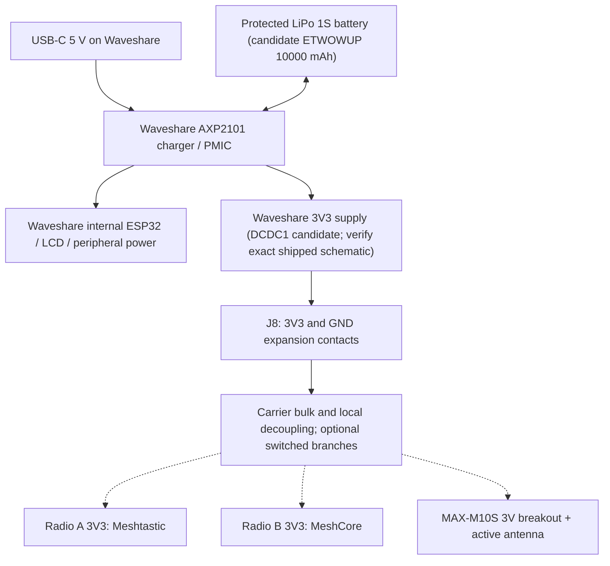

# MeshCrossway V1 power architecture — Waveshare 3V3 shared rail

**Decision (2026-10-24):** Prefer the Waveshare ESP32-S3-Touch-LCD-3.5 onboard AXP2101 battery charging and 3.3 V rail at its expansion connector J8 to power the two independent LoRa nodes and the MAX-M10S breakout. **This is a proposed architecture, not a validated current budget or a safe-to-build wiring approval.**

The previously selected **Adafruit BQ25185 #6092 is superseded**. Do not add a second LiPo charger, connect charger outputs together, or buy a separate buck-boost or power mux unless the bench tests show that the onboard rail is inadequate.

## Functional diagram

Dashed module connections are unapproved until supply pinouts and rail headroom are verified. Keep the Waveshare battery/USB connections as designed; do not feed external 3.3 V into its board or bridge 5V/BAT/3V3.

## Documented vs not documented

- Waveshare includes an AXP2101 and routes a 3V3 supply to J8; verify shipped PCB revision, schematic net and voltage.
- **AXP2101 DCDC1 is rated up to 2 A in its datasheet**, subject to the particular regulator mode, application circuit and operating conditions. **This is NOT a 2 A external-output specification for the Waveshare J8 pin.** Internal display/ESP32 loads consume part of the budget; connector/traces, thermal headroom and total PMIC input need verification.
- There is no sufficiently trustworthy published measurement of total Waveshare consumption for our firmware, LCD brightness, Wi-Fi/BLE, card and battery conditions. Measure on actual hardware.
- Candidate planning values for radio nodes: ~90 mA per node in receive and ~230 mA per node in LoRa transmit according to Heltec V3 family measurements under specific USB-powered conditions. These are **not guaranteed 3V3-input values for the Aideepen boards**.
- GNSS chip typically uses about 10–15 mA in its operating modes; active antenna can add load (tentatively 10–30 mA) and startup/inrush can be higher. Verify the actual breakout/antenna.
- Peripherals together: initial estimate ~200–220 mA receive/ordinary use; about ~505 mA for both radios TX plus GNSS antenna, with potentially higher transient/startup demands. Not validated, not a guaranteed worst case.
- Protected 1S battery ETWOWUP 10000 mAh remains **candidate only**; no verified independent datasheet for max discharge, charge rate, thermistor, dimensions or connector polarity.

## Capacitors — test candidates, not a substitute for regulator current

- Reserve pads at entry to carrier for bulk 220–470 µF, **DNP until regulator stability/inrush review**.
- Reserve per-radio footprints for 47–100 µF bulk + 10 µF ceramic + 100 nF ceramic, adjusted following regulator and module datasheets.
- Reserve GNSS local 10 µF and 100 nF with quiet ground/antenna placement.
- Check output capacitance and effective ESR against AXP2101 DCDC1 stability requirements, load-step response, startup surge and system-off behavior; do **not** automatically populate all footprints.
- An ideal 470 µF capacitor supplies an extra 300 mA for approximately **0.157 ms** with 0.1 V droop; it cannot substitute for enough continuous current during a LoRa packet.

## Required electrical sign-off before first carrier fabrication

1. [ ] Inspect actual Waveshare PCB revision and trace J8 3V3 back to its regulator on the matching schematic; review DCDC1 configuration and output caps/inductor.
2. [ ] Confirm J8 3V3 pin current allowance and estimated **remaining** current after the LCD, ESP32 and peripherals; examine regulator, connector and copper constraints.
3. [ ] Verify actual radio boards' 3V3 header input path (regulator reverse feed, USB plugging, diode/body-diode and 5V interaction). Do not combine external 3V3 with USB-powered radio outputs without validated isolation.
4. [ ] Verify GNSS 3 V breakout's supply range, I2C levels, SMA bias voltage/current and active-antenna compatibility.
5. [ ] Confirm battery protection, max discharge, charge profile, connector type **and polarity**, mechanical dimensions and cell thermal sensing arrangement.
6. [ ] Measure with a current-limited bench supply/electronic load, scoped J8 voltage at each node, Waveshare consumption by brightness/state, radio idle/RX/TX, simultaneous TX, GNSS acquisition, microSD writes.
7. [ ] Repeat with USB connected, battery-only, near-low-battery and USB insertion/removal; check charging status, battery charging current, PMIC temperature, droop, brownout and RF performance.
8. [ ] Test power off and load isolation. If a peripheral remains powered or back-powers another board over UART/I2C, add power switches and powered-off-safe buffering.
9. [ ] Confirm the full load-step and additional capacitance do not destabilize the PMIC and that the connector/traces remain within thermal/current limits.
10. [ ] If the rail fails, consider a separately managed buck-boost or a power-path alternative; select only after measurements.

## Bench-test order

Start with the host alone, then GNSS alone, one radio RX, both RX, one radio TX, both TX, and finally peripherals plus LCD at full brightness and microSD activity. Record voltage/current with a scope across startup and transmission, not only an average multimeter reading. Begin with separate USB supplies for radio firmware flashing and UART bring-up to avoid unverified shared-rail connections.

## Sources

- [Waveshare product and electrical resources](https://docs.waveshare.com/ESP32-S3-Touch-LCD-3.5/Resources-And-Documents)
- [Waveshare Rev2 schematic PDF](https://files.waveshare.com/wiki/ESP32-S3-Touch-LCD-3.5/ESP32-S3-Touch-LCD-3.5_Rev2.0.pdf)
- [AXP2101 PMIC reference](https://docs.waveshare.com/ESP32-S3-Touch-LCD-3.5)
- [Heltec V3 hardware](https://heltec.org/project/wifi-lora-32-v3/)
- [Uputronics MAX-M10S breakout](https://shop.wegmatt.com/products/uputronics-ublox-max-breakout-for-active-antennas?variant=44060220489751)
- [Historical, now superseded: Adafruit BQ25185 #6092](https://www.adafruit.com/product/6092)

## Illustrated power distribution

Illustrative only: J8 3V3 spare capacity, USB/battery isolation, startup surges and powered-off I/O require measurement before carrier PCB approval.
