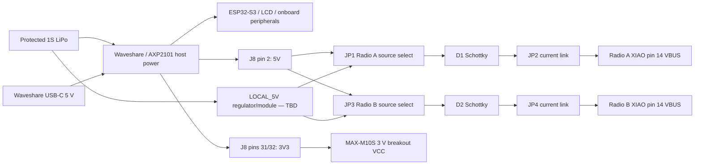

# MeshCrossway Rev A power architecture — selectable 5 V to XIAO VBUS

> **SUPERSEDED (2026-10-28):** The integrated single-carrier / UART architecture below remains only a bench reference. The approved MeshCrossway design has [three independently powered detachable devices connected primarily via BLE](modular-architecture.md). Do not treat the following design as the current production baseline.

[README](../README.md) · [Hardware wiring](hardware-wiring.md) · [Rev A pin allocation](pcb-rev-a-pin-allocation.md) · [Official hardware sources](hardware-sources.md)

> **Status: engineering baseline, not fabrication approval.** The earlier proposal to feed both XIAO/Wio radios from the Waveshare J8 3V3 rail has been retired. Rev A powers each XIAO at **pin 14 / VBUS / 5V** through a selectable and measurable carrier path. J8 3V3 remains available for the 3 V GNSS breakout and optional I2C pull-ups.

## 1. Rev A power topology

The Waveshare remains the host, battery charger/power manager and one candidate 5 V source. Each radio branch can independently select either Waveshare J8 5 V or a local carrier-generated 5 V rail.

The two 1x3 source selectors are intentionally independent so Rev A can compare J8 5 V, local 5 V and mixed-source operation without PCB rework.

## 2. Why the radios are fed at VBUS/5V

The XIAO carrier interface exposes:

- pin 14 = **VBUS / 5V** — normal external 5 V injection point;
- pin 13 = **GND**;
- pin 12 = **3V3_OUT** — regulated output/test node, not the normal Rev A carrier power input.

Seeed's XIAO ESP32-S3 documentation explicitly discusses external 5 V powering and calls for diode isolation between the external source and the XIAO 5 V pin. Rev A therefore retains a Schottky in each branch rather than relying only on the mechanical source-selection jumper.

Do **not** connect XIAO USB-C and carrier external power simultaneously until the exact XIAO revision's USB/VBUS backfeed behavior is verified on the bench.

## 3. Radio branch components

For each radio:

1. **1x3, 2.54 mm pin-header source selector**
   - pin 1: `J8_5V`
   - pin 2: branch common
   - pin 3: `LOCAL_5V`
2. **Schottky diode** from selected source toward XIAO VBUS.
3. **Removable 1x2 current link** after the diode. Normal operation uses a shunt; remove it and insert an ammeter for characterization.
4. **Local decoupling at the XIAO VBUS/GND socket**
   - 100 nF populated
   - 10 uF populated
   - 47 uF DNP initially
   - 100 uF DNP initially
5. Test points for branch 5 V and XIAO 3V3 output.

The exact Schottky part number and `LOCAL_5V` regulator/module are not frozen. Select them after measuring current, voltage droop, thermal behavior and RF noise.

## 4. GNSS power

The Uputronics MAX-M10S **3 V variant** remains on J8 3V3:

- `J8_3V3` -> GNSS VCC;
- GND -> GNSS GND;
- local 100 nF + 10 uF;
- optional 4.7 k I2C pull-ups to `J8_3V3`, DNP until the host/breakout pull-ups are measured.

GNSS power is electrically separate from the 5 V radio-source experiment.

## 5. Measurements required before PCB approval

1. [ ] Identify the actual Waveshare PCB revision and use the matching official schematic.
2. [ ] Measure **J8 pin 2 / 5 V** voltage and source capability under LCD, CPU, SD and peripheral load.
3. [ ] Measure Radio A and Radio B current at the removable current links: off, boot, idle, RX, Wi-Fi/BLE activity, LoRa TX and recovery.
4. [ ] Measure simultaneous-radio load and worst-case transient droop.
5. [ ] Characterize the Schottky forward drop at realistic peak current and temperature.
6. [ ] Select and validate the `LOCAL_5V` regulator/module from the protected 1S battery path, including efficiency, startup, thermal behavior and switching-noise/RF impact.
7. [ ] Verify XIAO external-5V/USB backfeed behavior on the exact board revision.
8. [ ] Test powered-off I/O injection through UART when host and radio power domains are sequenced differently.
9. [ ] Verify GNSS 3 V supply, active-antenna bias/current and I2C pull-up requirement.
10. [ ] Repeat with microSD writes, full display brightness and RF coexistence tests.

## 6. Bench-test order

Start with each XIAO/Wio kit on its own USB-C supply and only signal GND/UART connected. Prove firmware and serial behavior first. Then characterize one carrier-powered radio at a time using the current links, followed by both radios, GNSS, SD and display load. Use an oscilloscope for startup and TX transients; average multimeter current is not sufficient.

## 7. What Rev A intentionally leaves open

- exact protected 1S LiPo cell;
- exact `LOCAL_5V` regulator/module;
- Schottky part number;
- final capacitor population;
- whether J8 5 V is acceptable as a production radio source;
- whether separate switched power/load switches are needed for independent recovery.

These are test variables, not missing schematic intent.

## 8. Official sources

Primary manufacturer references:

- [Waveshare ESP32-S3-Touch-LCD-3.5 GitHub repository](https://github.com/waveshareteam/ESP32-S3-Touch-LCD-3.5/tree/main)
- [Seeed Wio-SX1262 with XIAO ESP32-S3 product page](https://www.seeedstudio.com/Wio-SX1262-with-XIAO-ESP32S3-p-5982.html)
- [Seeed Wio-SX1262 official schematic PDF](https://files.seeedstudio.com/products/SenseCAP/Wio_SX1262/Schematic_Diagram_Wio-SX1262_for_XIAO.pdf)
- [Seeed XIAO ESP32-S3 getting started](https://wiki.seeedstudio.com/xiao_esp32s3_getting_started/)
- [Seeed XIAO ESP32-S3 resources](https://wiki.seeedstudio.com/xiao_esp32s3_getting_started/#resources)
- [Seeed XIAO ESP32-S3 Sense V1.51 schematic PDF](https://files.seeedstudio.com/wiki/SeeedStudio-XIAO-ESP32S3/new-res/202003753_XIAO%20ESP32S3%20Sense_V1.51_SCH_260611.pdf)

See [hardware-sources.md](hardware-sources.md) for source purpose, scope and additional upstream firmware references.

## 9. Illustrated power distribution

The diagram is an engineering concept, not a measured current-budget guarantee.

### GNSS breakout datasheet confirmation

[Uputronics uBLOX MAX Breakout for Active Antennas — Rev 2.0, 25 April 2025](https://cdn.shopify.com/s/files/1/0835/7707/8094/files/uBLOX_MAX_Breakout_for_Active_Antennas_Datasheet.pdf?v=1745569009) specifies the **selected 3 V breakout** at **2.7–3.6 V VCC** (absolute maximum **3.6 V**). Its published operating current figures are **25 mA acquisition**, **21 mA tracking** and **6 mA cyclic power-saving**. These refer to the breakout use case and are not guaranteed TX-like peaks or a complete active-antenna power budget; account separately for antenna-bias current. The breakout has **nominal 2.7 V active-antenna bias**, a **0.2 F backup supercapacitor** and **TP/PPS** output. Confirm active antenna compatibility, rail noise and peak consumption on the actual assembly. The 5 V breakout is a distinct SKU and is *not* the Rev A selection.
