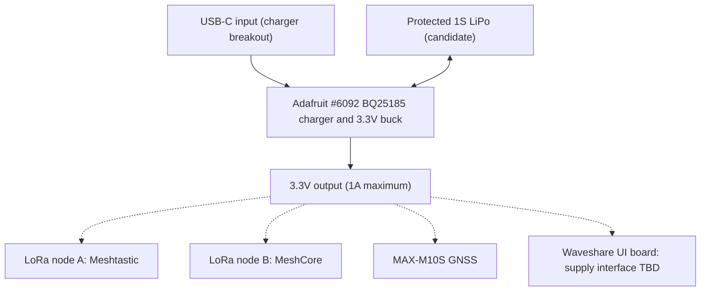

# MeshCrossway V1 battery and power architecture

**Selected prototype module:** [Adafruit BQ25185 USB/DC/Solar Charger with 3.3 V Buck Board, product #6092](https://www.adafruit.com/product/6092). [Amazon search](https://www.amazon.com/s?k=Adafruit+BQ25185+6092).

**Decision status:** selected for prototype evaluation, **not yet electrically approved** for a complete three-board handheld device.

## Proposed concept

- One protected 1S LiPo battery (3.7 V nominal, 4.2 V full); the previously discussed ETWOWUP 10,000 mAh pack is a candidate, not validated.
- One main USB-C charging input at the BQ25185 breakout.
- The BQ25185 breakout provides battery charging and a nominal 3.3 V regulated output rated **up to 1 A**.
- Planned loads: two LoRa V3 ESP32-S3 / SX1262 boards, a u-blox MAX-M10S GNSS breakout, and potentially the Waveshare UI controller, **subject to electrical verification**.

**Dashed connections represent proposed, unapproved wiring, not an assembly-ready schematic.**

## Critical caveats

1. **1 A is a hard design constraint, not a guarantee of sufficient headroom.** Measure the Waveshare/display, both radios during transmit, and GNSS peaks. Confirm simultaneous operation including startup transients before connecting all loads to the board.
2. **The 3.3 V output uses a buck converter, not a buck-boost converter.** When the battery falls below the input headroom required for regulation, the output may droop; characterize the usable discharge range and radio brownout behavior.
3. **The Waveshare already has an AXP2101 battery charger/PMIC.** Do not tie two charger BAT outputs to one cell. Never assume applying an external 3.3 V to its header is a valid replacement for its normal battery or USB supply. Review the exact Waveshare revision schematic and manufacturer power notes to design safe separation of charge and load paths.
4. **USB-C power on the Waveshare and the charger board must not back-feed one another.** Protect debug/programming paths and assess power sequencing, grounds, and connector handling.
5. The charger module's stated charge-current options and thermal performance must be checked against the actual battery datasheet, protection circuit, temperature requirements and expected charge time. A large 10,000 mAh pack may take a long time to recharge.
6. Verify the BQ25185 module's behavior when a load operates during charging and its limits for USB input, battery voltage, system current, and heat dissipation using the official Adafruit guide and Texas Instruments datasheet.
7. Check the battery connector polarity, protected-pack maximum discharge current, cell temperature sensing requirements, mounting safety and actual physical dimensions before PCB mechanical freeze.

## Validation checklist

- [ ] Confirm exact Adafruit #6092 board revision, pinout and datasheet.
- [ ] Read Waveshare ESP32-S3-Touch-LCD-3.5 board schematic, PMIC power-path operation and allowed external supply.
- [ ] Measure total steady-state and worst-case instantaneous current for both radios, GNSS and display.
- [ ] Verify regulated 3.3 V level over battery voltage, temperature and radio-transmission duty cycles.
- [ ] Characterize simultaneous charge/load behavior and power-on/off transitions.
- [ ] Test low-battery cutoff, USB disconnect/reconnect, brownout and safe firmware shutdown.
- [ ] Determine whether #6092 alone is sufficient or whether a higher-current 3.3 V rail and/or different power-path IC is needed.
- [ ] Confirm battery safety, discharge ratings and charge-rate configuration.

## References

- [Adafruit #6092 product](https://www.adafruit.com/product/6092)
- [Adafruit BQ25185 product guide](https://learn.adafruit.com/adafruit-bq25185-usb-dc-solar-charger-with-3-3v-buck-board)
- [Texas Instruments BQ25185](https://www.ti.com/product/BQ25185)
- [Waveshare ESP32-S3-Touch-LCD-3.5](https://www.waveshare.com/esp32-s3-touch-lcd-3.5.htm)
