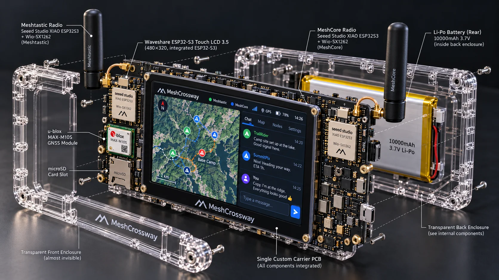

# MeshCrossway — V1 project reference

> **Current baseline: October 26, 2026.** Replaces the older Heltec/Aideepen LoRa V3 two-pack selection and associated GPIO4/5 external UART wiring. These older designs are not valid build instructions. Project is in design and bench-prototype planning; UI simulator does not indicate a working hardware device.

[README](../README.md)

**Mechanical design intent:** one custom carrier PCB, Waveshare display, two independent Seeed XIAO/Wio modules, MAX-M10S GNSS, and protected 1S LiPo **behind** the electronics in the transparent rear shell. The images are conceptual; exact component shapes, mechanical clearance, battery thickness, RF separation, dimensions and power safety remain unverified. [Image inventory and limitations](images/README.md).

## Goal and audience

MeshCrossway is an open-source offline-capable portable touchscreen communicator integrating **independent Meshtastic and MeshCore networks** in one interface. It targets hiking, travel, emergency preparedness and possible future field/rescue coordination, without claiming safety certification or guaranteed delivery. Native identities, encryption and routing remain separate. There is no default cross-protocol bridge.

## V1 selected hardware (authoritative)

| Item | Baseline hardware | Responsibilities |
|---|---|---|
| Central UI | [Waveshare ESP32-S3-Touch-LCD-3.5](https://www.amazon.com/dp/B0F3WS2W5R) | LVGL touch UI, GNSS, storage, APIs, system scheduling |
| Radio A | [Seeed XIAO ESP32-S3 & Wio-SX1262 kit](https://www.seeedstudio.com/Wio-SX1262-with-XIAO-ESP32S3-p-5982.html) | Meshtastic upstream radio and SX1262 |
| Radio B | Second identical **XIAO ESP32-S3 + Wio-SX1262** kit | MeshCore Companion upstream radio and SX1262 |
| Position | Uputronics **u-blox MAX-M10S**, 3 V breakout | GPS/GNSS and local tracking |
| Position antenna | Bingfu active GNSS antenna candidate | Under SMA/bias/current verification |
| Local memory | Waveshare onboard microSD | Logs, messages, GPX, offline data |
| Power | Waveshare AXP2101 + 1S LiPo candidate | Distribution to the two XIAO kits **not yet electrically verified** |

The Seeed radio kit combines XIAO ESP32-S3 and Wio-SX1262 via an **internal B2B connector**; do not run external wires from Waveshare to SX1262 SPI. Avoid purchasing the header-based Wio expansion made for a different XIAO target. Verify LoRa antenna suitability for the deployment region.

## Proposed communication pins

| Link | Waveshare host | External XIAO signals | Status |
|---|---|---|---|
| Meshtastic | TX GPIO39 / RX GPIO40 | RX D7/GPIO44 / TX D6/GPIO43 | candidate, must be verified in firmware |
| MeshCore Companion | TX GPIO17 / RX GPIO18 | RX D7/GPIO44 / TX D6/GPIO43 | candidate; build/serial transport not yet proven |
| GNSS I²C | SDA GPIO21 / SCL GPIO38 | Uputronics MAX-M10S SDA / SCL | verify revision and 3V breakout |
| Logic reference | host GND | both XIAO GND and GNSS GND | required |

**No old LoRa V3 external UART GPIO4/GPIO5 wiring should be used on XIAO.** Serial baseline is 115200 8N1 if enabled on both endpoints; Meshtastic PROTO and MeshCore Companion are *different* binary APIs. The two radios can be developed initially on separate USB power supplies with shared logic GND. Shared external XIAO power from the host J8 rail is a design proposal only.

## Firmware and design principles

1. **Host firmware (own code):** LVGL UI, ESP-IDF/FreeRTOS, independent UART adapters, contact/message store, GNSS parser, local tracks, location scheduler, microSD and diagnostics.
2. **Meshtastic radio A:** upstream XIAO ESP32-S3 Wio-SX1262 build using Serial `PROTO` with verified UART RX=44 / TX=43. Capture binary Protobuf frames, verify queue/ACK distinction and packet-specific hop behavior.
3. **MeshCore radio B:** upstream **Xiao_S3_WIO Companion** build, with custom compilation flags if needed to expose Companion over GPIO44/43 external UART. Stock BLE/USB Companion is not proof of UART. On fresh installs, use the correct **merged firmware image** when release instructions require a partition layout for persistent settings.
4. **Custom source patches only after proven blocker:** zero-hop route control, serial transport or critical missing host API; favor upstream changes rather than local long-term forks.
5. **Radio RF coexistence:** both 900 MHz-class SX1262 modules may operate near one another; antenna separation, blocking, collisions and autonomous TX must be measured.
6. **Power hold:** Waveshare J8 current budget and XIAO external 3V3 feed topology are not yet validated. Do not tie together chargers, 1S battery pads, USB and 3V3 rails without schematic review.

## Feature scope

- Unified local inbox with network-specific identity, channels/groups, private messaging and radio health.
- GPS location, POIs, local track recording, GPX export and map presentation.
- Location sharing by user consent with timed expiry, movement trigger and strict traffic budget.
- Direct Only tracking is **unverified** on real Meshtastic and MeshCore firmware; no silent repeat/flood fallback. Group Direct Only may not be natively possible.
- Large files and offline map data use local SD and future authenticated BLE/Wi-Fi transfer rather than LoRa.
- Reticulum is a **future study**, not part of the initial hardware selection.

## Validation gates before PCB freeze

- Identify shipped Waveshare and Seeed PCB revisions, test GPIO continuity and B2B stack footprint.
- Compile/flash both radios with correct XIAO targets; prove serial RX44/TX43 and UART framing separately.
- Measure J8 headroom, XIAO transmit peaks and powered-off backfeed; evaluate per-radio reset/power isolation.
- Demonstrate independent send/receive and power-cycle recovery of two serial links, messages and configs.
- Confirm GNSS antenna bias/power and microSD access under display load.
- Demonstrate per-packet zero-hop and RF coexistence with at least one test peer/repeater.
- Validate consent, privacy, stale position suppression and regional radio compliance.

## Definitive V1 documents

| Area | Current document |
|---|---|
| Buying, hardware and GPIO wiring | [Hardware wiring/BOM](hardware-wiring.md) |
| Power design and test requirements | [Power architecture](power-architecture.md) |
| Firmware division and patch policy | [Radio firmware strategy](radio-firmware-strategy.md) |
| UART wire protocols and API limitations | [Radio communication architecture](radio-communication-architecture.md) |
| Navigation and sharing | [Navigation and sharing](navigation-and-sharing.md) |
| Meshtastic vs MeshCore comparison | [Protocol comparison](meshtastic-vs-meshcore.md) |
| Reticulum future option | [Future Reticulum](reticulum-future-integration.md) |
| Visual UI prototype | [Simulator documentation](ui-prototype/README.md) |

## Historical note

The October 24, 2026 Aideepen/Heltec-style LoRa V3 hardware selection, Amazon radio pack, **GPIO4/GPIO5 external UART assignments**, associated package-price totals and photos were part of an earlier, superseded prototype proposal. They may still exist in older git commits and image-asset archives, but **are not accepted for current purchasing, assembly or PCB design**. The present baseline is exactly **two Seeed XIAO ESP32-S3 + Wio-SX1262 B2B kits**.
