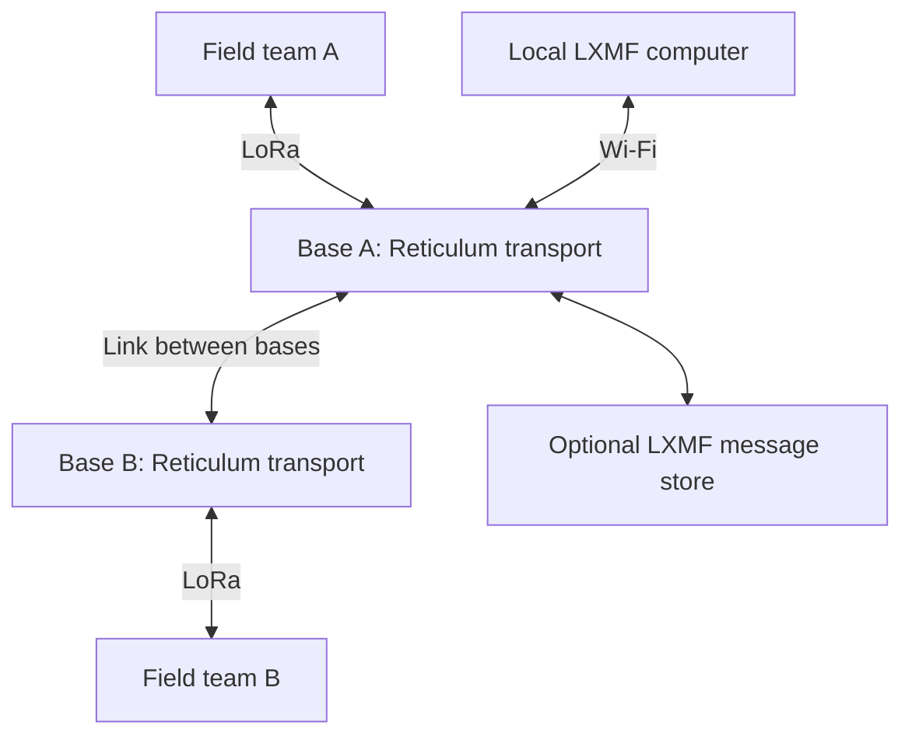

# Reticulum: concepts and a possible future MeshCrossway integration

[Back to MeshCrossway](../README.md) · [Meshtastic vs MeshCore](meshtastic-vs-meshcore.md) · [Current radio strategy](radio-firmware-strategy.md)

> **Status: future implementation candidate.** Reticulum is a subject for evaluation, not an implemented MeshCrossway feature or a committed release milestone. The initial terminal remains based on separate Meshtastic and MeshCore radios. This page records the opportunity, architectural options and evidence needed to decide whether a later version should support Reticulum.

**Technical review: October 26, 2026.** The official Reticulum documentation reviewed identifies itself as version **1.5.5**. Community implementations and applications have separate release cycles. Proposed examples below are engineering scenarios, not MeshCrossway field-test results.

## Contents

1. [What Reticulum is](#what-reticulum-is)
2. [The names and their different jobs](#the-names-and-their-different-jobs)
3. [A possible field-and-base network](#a-possible-field-and-base-network)
4. [What would make it useful](#what-would-make-it-useful)
5. [Comparison with the current MT and MC design](#comparison-with-the-current-mt-and-mc-design)
6. [How routing and security work](#how-routing-and-security-work)
7. [Radio limits still apply](#radio-limits-still-apply)
8. [Where the software would run](#where-the-software-would-run)
9. [Native interoperability and bridging](#native-interoperability-and-bridging)
10. [Licensing and software choices](#licensing-and-software-choices)
11. [Evaluation stages and decision gates](#evaluation-stages-and-decision-gates)
12. [Project decision and next step](#project-decision-and-next-step)
13. [Sources and maintenance](#sources-and-maintenance)

## What Reticulum is

**Reticulum is a networking stack:** software that gives applications identities, destinations, paths and mechanisms for exchanging data. A network can combine LoRa, local Wi-Fi, Ethernet, serial links and connections carried over existing IP networks. Internet access is optional when another usable path connects the participants. [Project overview][RNS-project], [supported connectivity][RNS-connectivity]

For a newcomer, the key idea is that the application can keep using Reticulum while different parts of the journey use different communications equipment. A person in the field might use LoRa to reach a base, while someone at that base uses a computer on local Wi-Fi.

Reticulum is a toolkit for building networks. Installing it does not automatically provide nearby contacts, a maintained radio backbone or coverage of a particular location. The operator still chooses the interfaces, connects the physical links and provides the infrastructure needed for the intended use. [Network design][RNS-networks]

For MeshCrossway, the attraction is **communication across several kinds of links, together with application services such as delayed message delivery**. Whether that benefit justifies additional processing, power and maintenance is an engineering decision to test.

## The names and their different jobs

| Component | Job | Practical meaning |
|---|---|---|
| **Reticulum / RNS** | Networking stack | Handles network identities, reachability and communication between applications. |
| **RNode** | Radio interface/transceiver | A supported radio board with suitable firmware supplies a LoRa connection to a Reticulum implementation. |
| **LXMF** | Messaging format and delivery protocol | Provides a common way for applications to exchange messages over Reticulum. |
| **Sideband, Nomad Network, MeshChatX** | User applications | Present conversations and other services to the user; features differ between clients. |
| **Transport Node** | Forwarding role in a running Reticulum instance | Helps traffic reach other participants and can connect different interfaces. |
| **LXMF Propagation Node** | Optional message-storage service | Retains encrypted messages so recipients can retrieve them later. |

Sources: [RNode][RNS-hardware], [Reticulum instances and transport][RNS-using], [LXMF][LXMF-project], [application directory][RNS-software].

**An ordinary RNode alone is not a complete Reticulum/LXMF messenger.** The network stack and application must also execute somewhere. Similarly, a transport node that forwards packets does not automatically provide a persistent message store. These roles may share a physical device, but they remain separate responsibilities.

## A possible field-and-base network

The diagram shows one potential deployment. Every endpoint uses a suitable Reticulum implementation and application; each LoRa endpoint/base also has the required radio interface.

The link between bases might use a suitable wired or wireless connection, or an IP path. Reticulum's hardware documentation explicitly discusses combining a higher-capacity backbone with LoRa access for field devices. [Combining hardware types][RNS-hardware]

**Project implication:** this could eventually let a MeshCrossway user participate in a wider operation that includes portable radios, local computers and services at a base. The illustrated deployment has not been built or validated by this project, and it does not imply MT/MC message translation.

## What would make it useful

### Several communication media in one network

A future terminal could use a radio link in the field and access services through a local network at a base. Nodes with appropriate interfaces could connect those segments. The interfaces and available paths still need to be configured; moving between links is not a promise of uninterrupted service under every failure or topology change. [Connectivity options][RNS-connectivity]

This is most interesting when the intended operation includes several locations or types of equipment. For a few people who only need short text and positions on an already useful MT or MC network, it may offer less immediate benefit.

### Messages when a recipient is temporarily unavailable

An LXMF propagation service can retain encrypted messages for a recipient who is currently unreachable. Participating services can synchronize retained messages, and the recipient can retrieve them when a usable route becomes available. LXMF also provides queues, delivery receipts, retries and failure handling for client applications. [LXMF propagation and message routing][LXMF-project]

For example, a field user could submit a message to an available service while a teammate is out of range. The teammate could retrieve it later. This requires the service to have received and retained the message; storage limits, expiry and later connectivity still matter.

The UI must distinguish acceptance by a storage service from delivery to the recipient. Neither event establishes that a person read the message.

### Applications, information and location

Different applications expose different parts of the ecosystem:

| Application | Documented examples of functionality | Relevance to a future evaluation |
|---|---|---|
| **Sideband** | LXMF messaging, location/telemetry, maps, attachments, audio messages and LXST voice calls | Useful for an Android/computer pilot and for understanding a field user's workflow. |
| **Nomad Network** | Messaging, delayed delivery, files, a text browser and page server | A possible base-station tool for lightweight instructions or locally published information. |
| **MeshChatX** | Conversations, calls, NomadNet browsing and other tools | Another client to evaluate where a computer-based interface is appropriate. |

Sources: [Sideband author's page][SIDEBAND], [official application directory][RNS-software]. These are upstream capabilities, not features already implemented in MeshCrossway.

Location sharing still needs an appropriate client/API, a valid position source, a chosen audience and an explicit sending policy. Reticulum does not automatically import MT or MC contacts, identities or coordinates. The existing [location-sharing requirements](navigation-and-sharing.md) remain the starting point for any future adapter.

## Comparison with the current MT and MC design

This table compares the **planned MeshCrossway integration**, rather than attempting to rank every upstream feature. The full MT/MC comparison remains in its [separate guide](meshtastic-vs-meshcore.md).

| Question | Current MT + MC terminal plan | Possible Reticulum extension |
|---|---|---|
| Main goal | Access two established radio ecosystems through one screen. | Add a network/application ecosystem that can span different communications media. |
| Where protocol processing lives | Each dedicated radio runs its own MT or MC firmware. | Reticulum and LXMF need a selected host or embedded implementation, in addition to any radio interface. |
| Initial hardware role | Two separate LoRa radio boards and the touchscreen controller. | Start with existing hosts over Wi-Fi; later select any required radio or processing module. |
| User interface | MeshCrossway's planned native interface and protocol adapters. | Another adapter and message model, plus the chosen network/application runtime. |
| Offline message services | Upstream MT Store & Forward and MC Room Server have their own behavior and limits. | Evaluate LXMF propagation services and their different delivery semantics. |
| Nearby contacts | Depend on reachable MT and MC participants and settings. | Depend on reachable Reticulum/LXMF participants or a deliberately built private network. |
| Cross-network message forwarding | No automatic MT-to-MC bridge. | No automatic translation between MT, MC and LXMF. |
| Implementation status | Initial design and validation work. | Future candidate; no MeshCrossway integration or release date committed. |

Current project responsibilities are defined in the [radio firmware strategy](radio-firmware-strategy.md). Reticulum's processing and delivery models are described in [system usage][RNS-using] and [LXMF][LXMF-project]. The project-fit judgments above are proposals.

## How routing and security work

Reticulum uses signed announcements to advertise destinations and establish reachability. Transport nodes learn next-hop information toward those destinations; they do not need a complete global route map. Addressed traffic can follow learned paths. Ordinary instances default to endpoint behavior; forwarding is an explicit transport configuration. [Routing concepts][RNS-understanding], [transport configuration][RNS-using]

This makes infrastructure roles worth planning. Forwarding traffic and announcements from a fast connection onto a slow radio link can consume scarce airtime. The network design needs suitable interface policies and traffic budgets. [Heterogeneous network design][RNS-networks]

Reticulum Links provide forward secrecy by default. Linkless individual packets require destination ratcheting for that property; other destination types do not all share the same protections. The selected implementation, communication mode and identity handling therefore matter. [Security behavior][RNS-understanding]

The official cryptography page says the reference software has not undergone an external security audit. Cryptographic design properties are useful evaluation criteria, but do not establish a universal security ranking over MT or MC. [Cryptographic implementation and audit status][RNS-crypto]

For MeshCrossway, future work would need to define identity persistence, key backup, contact verification, local storage protection and diagnostic exports. A network protocol cannot by itself prevent an unlocked terminal from exposing its stored conversations.

## Radio limits still apply

Using Reticulum over LoRa does not create additional radio bandwidth. The path's slowest link, available airtime, retries and traffic load still constrain the application.

Sideband documents images, files and recorded audio over radio links, as well as live calling through LXST. **Recorded audio and a real-time conversation are different workloads.** App support does not guarantee an acceptable call or transfer over every LoRa configuration. [Sideband features][SIDEBAND]

**Illustrative calculation, not a benchmark:** at 1 kbit/s, 10 kB of data needs about 80 seconds for the data alone, using decimal units. Framing, encryption overhead, acknowledgments, contention and retransmissions would add time.

| Data type | Proposed MeshCrossway policy |
|---|---|
| Short text, coordinates and small status updates | Suitable starting workloads for a radio trial. |
| Repeated position updates | Apply intervals, movement thresholds, audience controls and expiry. |
| Images and recorded audio | Evaluate size and priority against the cost to ordinary messages. |
| Maps, large files and bulk history | Prefer local storage or a higher-capacity path where available. |

These are engineering recommendations. Reticulum does not establish a guaranteed range, runtime or delivery rate for the selected hardware. Network maps and online entrypoints also do not establish usable local LoRa coverage. Test the contacts, routes, antennas and settings that the deployment will actually use.

## Where the software would run

### Reference implementation and embedded alternatives

The reference Reticulum implementation runs as Python software on a suitable host. It is not a firmware image that can simply replace the touchscreen application on the Waveshare board. [Reference runtime][RNS-using]

**microReticulum** is a C++ implementation targeting microcontrollers, including ESP32-class devices, and is listed among the community implementations recognized by the main project. It is a network library that needs an application and integration around it. Its memory configuration includes heap and PSRAM choices. [microReticulum][MICRO-RNS], [recognized implementations][RNS-project]

Standalone applications demonstrate that a phone is not always necessary. **Ratspeak Handheld**, for example, supports on-device LXMF messaging on specified hardware and labels its current firmware beta. That demonstrates feasibility on those targets; it does not validate the selected Waveshare board, its display or the complete MeshCrossway workload. [Handheld implementation][RATSPEAK]

### Four implementation options

| Option | What would run where | Decision to resolve |
|---|---|---|
| **External Android/computer pilot** | An existing host runs a client and Reticulum. Start over local Wi-Fi; attach compatible RNodes later. | Does the actual workflow justify integration? This is the initial evaluation path. |
| **Fixed Linux base/gateway** | A powered base runs Reticulum and any selected LXMF services, with LoRa and local-network interfaces. | Does the main benefit come from infrastructure connectivity? A base does not itself add a messenger to the handheld. |
| **Dedicated embedded network module** | A separate processor runs the selected stack and messaging layer, exposing a defined API to the touchscreen. | Can it provide the commands, events, storage and recovery behavior needed while isolating its workload? |
| **Shared Waveshare controller** | An embedded stack and LXMF/application layer share the ESP32-S3 with LVGL, maps, GNSS, storage and the existing adapters. | Can measured resource margins and scheduling support the complete workload? PSRAM capacity alone is insufficient evidence. |

These are options for evaluation, not selected components. An external pilot is useful for learning; an integrated handheld implementation would still need to meet the project's goal of operating independently of a phone.

### Radio and interface choices

**A third LoRa radio is unnecessary for the initial Wi-Fi trial.** Independent LoRa access can be evaluated later. Stock MT, MC and ordinary RNode firmware should not be assumed to run concurrently on one transceiver. Reflashing a test board replaces its previous role while that firmware is running.

The V1 includes **two Seeed XIAO ESP32-S3 + Wio-SX1262 kits** running the two native mesh protocols. **Reticulum/RNode compatibility with this exact hardware is not confirmed**; any future addition requires an independent firmware and host-interface evaluation. [Supported hardware][RNS-hardware]

USB, BLE or TCP connectivity on a supported build does not establish that the intended external UART pins expose the required interface. Similarly, an embedded transport build is not automatically a ready-made UART messaging coprocessor. Validate the chosen firmware's serial framing, logging, commands and recovery behavior before designing the adapter. [RNode interfaces][RNS-interfaces], [microReticulum transport firmware][MICRO-FIRMWARE]

## Native interoperability and bridging

**Combining communication media is different from translating application protocols.** Reticulum traffic can traverse configured LoRa and network interfaces; that does not make a native Meshtastic or MeshCore conversation become an LXMF conversation. [Interfaces][RNS-interfaces]

Custom gateways or tunnels are separate engineering work. A familiar interface name, or use of the same SX1262 radio, is not evidence of compatible on-air packets, message fields, identities or acknowledgments.

Any future cross-network forwarding feature would need explicit decisions about:

- Which user authorizes forwarding and which audience receives the message.
- How identities, contacts and groups are mapped.
- How encryption boundaries and trusted gateway access are represented.
- How duplicates, loops, retries and message expiry are controlled.
- What delivery status means across each network and storage service.
- Whether location sharing is permitted for that destination and time window.

The recommended first integration would preserve separate network identities and expose them clearly in the UI. Reusing a display name would not prove that two contacts are the same person. No bridge is implemented or selected by this proposal.

## Licensing and software choices

**Licensing is component-specific.** Free application use, available source code and permission to incorporate code into a distributed product are separate questions.

| Component reviewed | Documented terms and qualification |
|---|---|
| **Reference Reticulum implementation** | Uses the custom **Reticulum License**, rather than standard MIT. It grants use, modification and distribution subject to its stated conditions. |
| **LXMF reference implementation** | Its current license file carries the same Reticulum License. |
| **Sideband** | The source/work uses **CC BY-NC-SA 4.0**. The author additionally permits binary use for any purpose and free binary redistribution when no payment or compensation is charged or received for distribution or use. |
| **Alternative embedded implementations** | Each repository, version and bundled dependency has its own terms. For example, microReticulum identifies Apache-2.0; this does not relicense other components. |

Sources: [Reticulum License][RNS-license], [LXMF license][LXMF-license], [Sideband source license][SIDEBAND-license], [Sideband additional permission][SIDEBAND], [microReticulum repository][MICRO-RNS].

The current Reticulum License includes conditions concerning intentional harm to people, use in AI/ML training datasets and model development, and preservation of notices. Those clauses should not be paraphrased as a blanket prohibition on all AI-assisted application development. Check the actual text attached to the selected version before incorporating its code. This page does not resolve legal compatibility between different components.

MeshCrossway's own MIT license does not change third-party licenses. A future implementation decision needs a concrete list of software components and versions, including any map data or services, alongside its technical assessment.

## Evaluation stages and decision gates

The first experiment should use existing hosts. The official manual describes running applications on devices connected to the same local Wi-Fi network, then adding physical radio interfaces later. [Starting with applications][RNS-software], [setup guide][RNS-quickstart]

Record the hardware, firmware, clients, configuration and acceptance thresholds before each relevant test. Advance when the result is reproducible:

| Stage | Experiment | Evidence needed to continue |
|---|---|---|
| **1. Local Wi-Fi** | Exchange LXMF messages between two existing hosts without an Internet dependency. | Discovery, addressed delivery and identity persistence survive restarts. |
| **2. Offline radio** | Connect two verified RNodes, disable alternative data paths and exchange numbered messages and replies. | The intended radio settings support the agreed use case in both directions; record actual receipt, acknowledgments, latency and airtime. |
| **3. Mixed media** | Connect a LoRa endpoint to a Wi-Fi/Ethernet endpoint through a transport node. | Routing and interruption/recovery are observable; queued or failed messages are not reported as delivered. |
| **4. Delayed delivery** | Configure an LXMF propagation service, disconnect the recipient, submit messages and reconnect it. | The recipient retrieves, decrypts and verifies the messages within documented storage/expiry limits; service acceptance is distinct from recipient delivery. |
| **5. Embedded implementation** | Profile the selected option with the UI, maps, GNSS, storage and existing radio adapters active. | Internal heap/PSRAM, queue sizes, UI latency and energy remain within agreed limits; restarts, failed links and unavailable storage have bounded recovery and preserve identities. |

These are proposed decision gates, not tests that have already passed. If an embedded option cannot meet the requirements, retain the external experiment or evaluate a different allocation of processing responsibilities.

## Project decision and next step

**Reticulum is recorded as a possible future MeshCrossway implementation.** Its strongest prospective benefits are mixed-media networking, application services and delayed delivery. The next useful step is an independent Reticulum/LXMF trial that demonstrates those benefits with actual users and paths.

The initial design continues to prioritize the existing MT and MC adapters, hardware verification and interface behavior. This document does not add a third radio, select another processor, revise the PCB or claim a working standalone Reticulum terminal.

A future implementation proposal should identify:

1. The concrete use case that the extension solves.
2. The chosen stack, application API, versions and licenses.
3. Where the network/application runtime and persistent data live.
4. Measured resource, delivery, recovery and power results.
5. The changes needed to hardware, UI and maintenance responsibilities.

Only a validated proposal should be promoted into a planned product capability. Until then, documentation and UI descriptions should keep the **future candidate** status visible.

## Sources and maintenance

Sources below are upstream documentation, original repositories and author-maintained application pages. Links to rolling documentation and repository branches can change after this review.

| Topic | Primary references |
|---|---|
| Architecture and routing | [Project][RNS-project], [understanding Reticulum][RNS-understanding], [building networks][RNS-networks] |
| Hosts and radio interfaces | [System usage][RNS-using], [hardware][RNS-hardware], [interfaces][RNS-interfaces] |
| Applications and delayed delivery | [LXMF][LXMF-project], [application directory][RNS-software], [Sideband][SIDEBAND] |
| Embedded implementations | [microReticulum][MICRO-RNS], [transport firmware][MICRO-FIRMWARE], [Ratspeak Handheld][RATSPEAK] |
| Security and licensing | [Cryptography][RNS-crypto], [Reticulum License][RNS-license], [LXMF license][LXMF-license], [Sideband license][SIDEBAND-license] |
| MeshCrossway baseline | [Firmware strategy](radio-firmware-strategy.md), [MT/MC comparison](meshtastic-vs-meshcore.md), [navigation and sharing](navigation-and-sharing.md) |

For a later revision, record the exact chosen release/commit rather than assuming that this review describes every future build. Recheck board targets, host/API behavior, client features, licensing and standalone firmware status. Preserve the distinction between upstream capability, an engineering proposal and a result measured on MeshCrossway hardware.

[RNS-project]: https://github.com/markqvist/Reticulum
[RNS-connectivity]: https://reticulum.network/hardware.html
[RNS-understanding]: https://reticulum.network/manual/understanding.html
[RNS-networks]: https://reticulum.network/manual/networks.html
[RNS-hardware]: https://reticulum.network/manual/hardware.html
[RNS-using]: https://reticulum.network/manual/using.html
[RNS-interfaces]: https://reticulum.network/manual/interfaces.html
[RNS-software]: https://reticulum.network/manual/software.html
[RNS-quickstart]: https://reticulum.network/manual/gettingstartedfast.html
[RNS-crypto]: https://reticulum.network/crypto.html
[RNS-license]: https://reticulum.network/manual/license.html
[LXMF-project]: https://github.com/markqvist/LXMF
[LXMF-license]: https://github.com/markqvist/LXMF/blob/master/LICENSE
[SIDEBAND]: https://unsigned.io/sideband/
[SIDEBAND-license]: https://github.com/markqvist/Sideband/blob/main/LICENSE
[MICRO-RNS]: https://github.com/attermann/microReticulum
[MICRO-FIRMWARE]: https://github.com/attermann/microReticulum_Firmware
[RATSPEAK]: https://github.com/ratspeak/ratspeak-handheld
