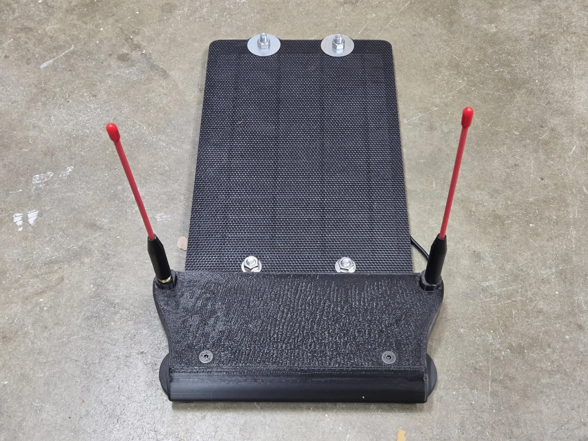
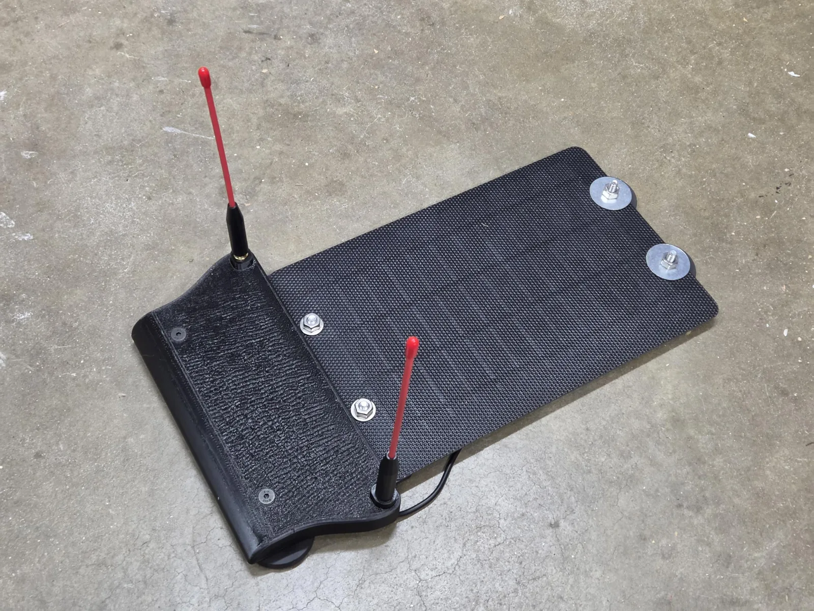
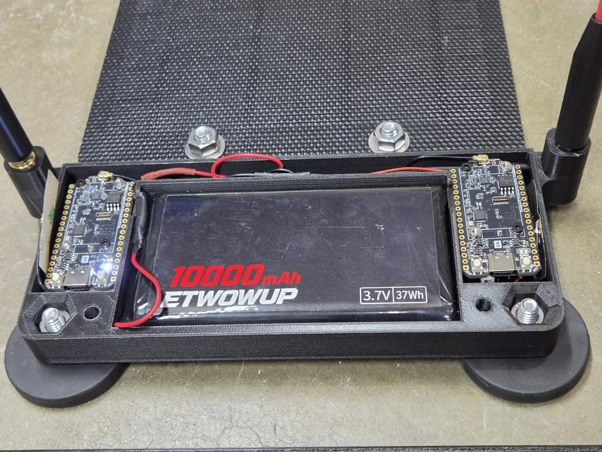

# Dual Heltec V4 solar car-roof mount

A 3D-printable, magnetic car-roof mount for **two Heltec V4 radios** (one Meshtastic,
one MeshCore), a shared **3.7 V 10,000 mAh LiPo battery** and a small **solar panel**.
The phone runs MeshCrossway inside the car and connects to both radios over Bluetooth.

Web page: <https://meshcrossway.renbrant.com/hardware/car-solar-mount/>

## Files

| Part | File | Approx. size |
| --- | --- | --- |
| Base (radios, battery, panel attachment) | [`MeshCrossway-car-dual-solar-base.stl`](MeshCrossway-car-dual-solar-base.stl) | 209 × 100 × 26 mm |
| Cover (textured top, antenna openings) | [`MeshCrossway-car-dual-solar-cover.stl`](MeshCrossway-car-dual-solar-cover.stl) | 215 × 95 × 19 mm |

## Parts used in the reference build

These are the exact parts used in the photos. Buying the same ones avoids surprises with fit and connectors.

| Qty | Part | Option to choose | Link |
| --- | --- | --- | --- |
| 2 | Heltec V4 ESP32-S3 LoRa board (SX1262, no OLED): one for Meshtastic, one for MeshCore | Standard without GPS | [Amazon](https://link.amazon/B03tfSWa8) |
| 1 pack (2 sets) | Slinkdsco 915 MHz LoRa whip antenna with u.FL-to-SMA pigtail (choose the band for your region) | Red | [Amazon](https://link.amazon/B00lC4s3M) |
| 1 | ETWOWUP 3.7 V 10,000 mAh LiPo battery, 1S, PH 2.0 plug, protection circuit (≈37 Wh) | 1PC | [Amazon](https://link.amazon/B0h4jtn9k) |
| 1 pack | Soshine 5 V 6 W USB solar panel with DC cable, keeps the battery charged | 6W x2 | [Amazon](https://link.amazon/B081g0vdr) |
| 1 pack (uses 4) | DIYMAG rubber-coated mounting magnets, 1/4 in stud: two under the base, two under the panel | 1/4in-30LB-1.69in, 6 pcs | [Amazon](https://link.amazon/B00f6AqAr) |

You will also need screws, nuts and washers for the cover, the boards, the panel and the magnets.

> **Support the project.** These are affiliate links. If you buy through them, you pay the same
> price and a small commission helps MeshCrossway's creator keep building and sharing projects
> like this one. Thank you!
>
> *As an Amazon Associate I earn from qualifying purchases.*

## Photos

| | |
| --- | --- |
|  |  |
|  |  |

## RF coexistence notice

The two antennas are only about 20 cm apart (≈ 0.6 wavelength), which gives roughly 13–15 dB
of isolation between the radios. The channels do not overlap (906.875 MHz vs 910.525 MHz), but
while one radio transmits, the other one is overloaded and cannot receive, and at high transmit
power the receiving radio's front end sees more power than conservative design margins allow.
The reference build is in daily use and works, with a small packet loss that depends on how much
each radio transmits. The reference build keeps that loss low by turning off relaying
(Meshtastic Rebroadcast Mode set to None; the MeshCore Companion firmware does not relay).

Read the full technical analysis, mitigation options and test procedure in
[**RF-COEXISTENCE.md**](RF-COEXISTENCE.md) before changing transmit power, boards or antenna spacing.

## Notes

- This is a personal build shared as a suggestion, not a certified product.
- Print in a heat- and UV-resistant material (PETG or ASA) for use on a car roof.
- Check antenna band, magnet hold at speed, and battery and solar charging safety in heat and sun.
  Remove the mount before car washes.

## License

Covered by the repository [LICENSE](../../../LICENSE) (PolyForm Strict 1.0.0): you may print
these parts for personal, noncommercial use. Do not redistribute or resell the files or
printed parts.
