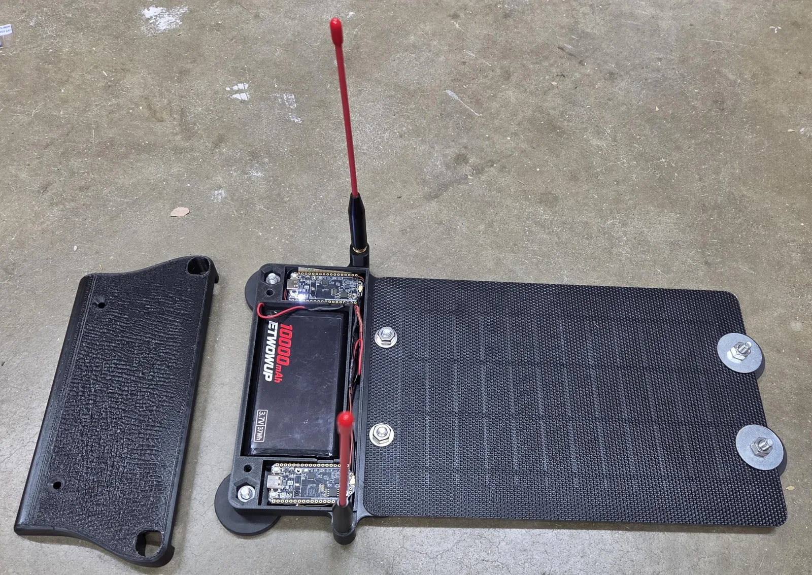
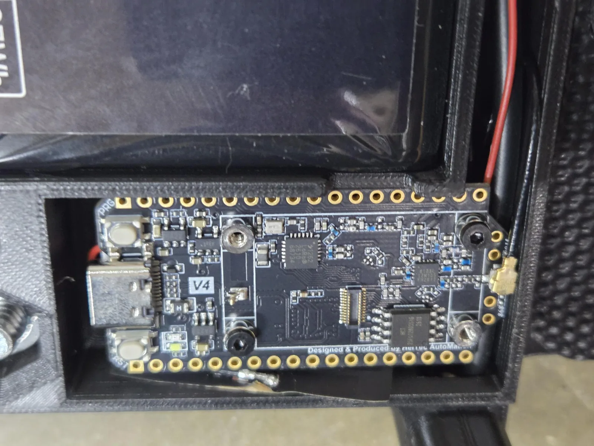

# Dual Heltec V4 solar car-roof mount

A 3D-printable, magnetic car-roof mount for **two Heltec V4 radios** (one Meshtastic,
one MeshCore), a shared **3.7 V 10,000 mAh LiPo battery** and a small **solar panel**.
The phone runs MeshCrossway inside the car and connects to both radios over Bluetooth.

Web page: <https://meshcrossway.renbrant.com/hardware/car-solar-mount/>

## Files

| Part | File | Approx. size |
| --- | --- | --- |
| Base (radios, battery, panel attachment) | [`MeshCrossway-car-dual-solar-base.stl`](MeshCrossway-car-dual-solar-base.stl) | 209 × 100 × 26 mm |
| Cover (textured top, antenna openings) | [`MeshCrossway-car-dual-solar-cover.stl`](MeshCrossway-car-dual-solar-cover.stl) | 215 × 95 × 19 mm |

## Parts used in the reference build

- 2 × Heltec V4 (WiFi LoRa 32 V4): one with Meshtastic, one with MeshCore companion firmware
- 1 × 3.7 V LiPo battery, 10,000 mAh (≈37 Wh), shared by both radios
- 1 × small solar panel bolted to the base, wired to keep the battery charged
- 2 × LoRa antennas (SMA) with u.FL-to-SMA pigtails, one per radio
- 4 × rubber-coated mounting magnets (two under the base, two under the far end of the panel)
- Screws, nuts and washers for the cover, the boards, the panel and the magnets

## Photos

| | |
| --- | --- |
|  |  |
|  |  |

## Notes

- This is a personal build shared as a suggestion, not a certified product.
- Print in a heat- and UV-resistant material (PETG or ASA) for use on a car roof.
- Check antenna band, magnet hold at speed, and battery and solar charging safety in heat and sun.
  Remove the mount before car washes.

## License

Covered by the repository [LICENSE](../../../LICENSE) (PolyForm Strict 1.0.0): you may print
these parts for personal, noncommercial use. Do not redistribute or resell the files or
printed parts.
